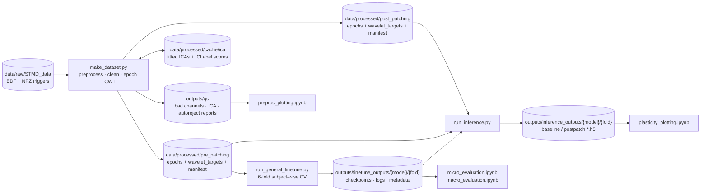

# EEG Foundation Model Fine-Tuning & Plasticity Analysis Pipeline

> **Project status: active development.**
> The pipeline works end to end, but the architecture and code are still being cleaned up. See [Known issues & caveats](#known-issues--caveats) before running anything.

---

## Overview

This repository adapts the pretrained EEG foundation model **LaBraM** (LaBraM-Base, vendored in `libs/labram`) to the STMD EEG dataset. It uses the model's ability to **reconstruct** EEG to measure how neural activity changes after patching.

The idea:

1. **Fine-tune on baseline only.** LaBraM gets a new regression head. It is trained to map a 1 s EEG epoch to that epoch's **time–frequency representation** (a complex Morlet wavelet magnitude in dB, z-scored). Training uses only **baseline (pre-patching)** recordings.
2. **Reconstruct held-out data.** Each cross-validation fold's model then reconstructs epochs from its **held-out test subjects**, both baseline and **post-patching**.
3. **Compare the errors.** The model has only seen baseline activity, so a change in reconstruction error from baseline to post-patching (normalised MAE, per band and per channel) is used as a quantitative marker of changed activity. The analysis notebook shows it as bar charts, distributions, correlations and Glass's Δ topomaps.

The pipeline covers preprocessing, subject-wise k-fold fine-tuning, inference with per-trial metrics, and interactive analysis in Jupyter.



---

## Quick start

```bash
# 1. environment (Python >= 3.10, PyTorch 2.0.1 + CUDA 11.8 wheels, resolved by uv)
uv sync

# 2. preprocess raw EEG -> cleaned epoch tensors + wavelet targets + QC reports
uv run python make_dataset.py

# 3. fine-tune one model per fold (6 folds by default)
uv run python run_general_finetune.py --model_name my_model --target_mode wavelet

# 4. reconstruct held-out baseline + post-patching trials, compute metrics
uv run python run_inference.py --model_name my_model --target_mode wavelet --postpatch
```

Then open the notebooks in `notebooks/` (see [Analysis notebooks](#4-analysis-notebooks)).

**Before re-running `make_dataset.py`:**
- **Delete `data/processed/pre_patching` and `data/processed/post_patching`.** Autoreject drops epochs and the file numbering restarts at 1, so old files with higher numbers would otherwise survive and mix into the new dataset.
- **Keep `data/processed/cache`.** It holds the fitted ICAs, and without it every recording is refitted.

The first run fits one ICA per recording (about 15 s each, roughly 40 min in total). Later runs load them from the cache. Build the final dataset from a run that loads the cached ICAs; see [Reproducibility](#reproducibility).

**Run everything from the repository root.** All paths in `core/settings.py` are relative to `BASE_DIR = Path(".")`, and the scripts import `core` / `libs` as top-level packages. The notebooks `chdir` to the root on their own, but they import `core` in their first cell. The project root therefore has to be on `PYTHONPATH` when the kernel starts. PyCharm does this automatically. Otherwise start Jupyter with `PYTHONPATH=<repo root>`.

### Dependencies

Declared in `pyproject.toml` and locked in `uv.lock`. The important pins:

- `torch==2.0.1`, `torchvision==0.15.2` and `torchaudio==2.0.2`, pulled from the CUDA 11.8 index.
- `timm==0.4.12`, which LaBraM requires.
- `numpy<2`.

Other key libraries: `mne`, `pywavelets`, `h5py`, `einops`, `ipywidgets`, `tensorboardX`, `pyhealth==1.1.4`. `scikit-learn` comes in transitively. Training assumes a CUDA GPU.

For preprocessing:
- `autoreject` (0.4.3) handles local epoch cleaning.
- `mne-icalabel` (≥ 0.9) classifies ICA components automatically. It runs on the installed torch.

---

## Repository structure

```text
├── make_dataset.py              # Step 1: preprocessing, epoching, wavelet targets -> .pt files
├── run_general_finetune.py      # Step 2: subject-wise k-fold fine-tuning of LaBraM + regression head
├── run_inference.py             # Step 3: reconstruction of held-out trials, per-trial metrics -> HDF5
├── make_h5dataset_for_pretrain.py  # Auxiliary/experimental: HDF5 export for LaBraM pretraining (not part of the main pipeline)
├── qc_bad_channels.py           # QC: runs the automatic bad channel detector on all recordings -> outputs/qc/
├── reaction_times.py            # Analysis: button-press reaction times, baseline vs post-patching -> outputs/reaction_times/
├── pyproject.toml / uv.lock     # Environment definition
│
├── core/                        # Project package
│   ├── settings.py              # ALL global configuration (paths, preprocessing, model and wavelet params, bands)
│   ├── architectures.py         # EEGAutoencoder / EEGSpectralDecoder (LaBraM backbone + MLP head)
│   ├── datasets.py              # FinetuneDataset, FinetuneSplits, KFoldSplitter
│   ├── utils.py                 # Wavelet transform, cropping, metric calculation
│   ├── io.py                    # EpochIO (.pt I/O), training-log loading, inference HDF5 read/write
│   ├── io_models.py             # Trial / Metrics dataclasses (lazy views on inference HDF5)
│   ├── io_utils.py              # Filename conventions, figure saving
│   ├── plot_data_processing.py  # Aggregation of inference metrics (means, SEM, Glass's Δ, ...)
│   └── plotting.py              # Matplotlib/ipywidgets plotting helpers used by the notebooks
│
├── notebooks/
│   ├── micro_evaluation.ipynb   # Per-sample reconstruction viewer straight from checkpoints
│   ├── macro_evaluation.ipynb   # Fold-averaged learning curves, model comparison
│   ├── plasticity_plotting.ipynb   # Baseline vs post-patching analysis on inference outputs
│   ├── plasticity_tensor_analysis.ipynb   # Time series of errors/signals from the full tensors (cached per fold)
│   └── preproc_plotting.ipynb   # Plots of the preprocessing QC reports (e.g. ICA removals per session)
│
├── libs/
│   ├── labram/                  # Vendored LaBraM (modified for regression), incl. checkpoints/labram-base.pth
│   └── unscrambly/              # Vendored in-house EEG preprocessing library (DataPreprocessor), extended for this project
│       └── preprocessing/auto_bad_channels.py   # Automatic bad channel detection (added)
│
├── data/                        # (not tracked)
│   ├── raw/STMD_data/           # EDF recordings, NPZ triggers, manual bad channel selections
│   └── processed/               # pre_patching/, post_patching/ (dataset) and cache/ica/ (fitted ICAs)
└── outputs/                     # (not tracked) finetune_outputs/, inference_outputs/, plots/, qc/, reaction_times/
```

---

## Configuration: `core/settings.py`

Every script and notebook reads its configuration from this module at import time. Settings are imported by these runnable entry points, which pass the values to `core` functions as arguments (e.g. `band_indices=settings.FREQ_BAND_INDICES`). New `core` code should not import `settings` itself (`io_models.py`, `plotting.py` and `plot_data_processing.py` still do for a few values). **Settings are not stored with a trained model.** Inference and the notebooks rebuild the model and targets from the *current* settings. These must therefore match the settings used when the targets were generated and the model was trained (check `metadata.json → model_params`).

### Preprocessing / epoching

| Setting | Value | Meaning |
|---|---|---|
| `L_FREQ`, `H_FREQ` | 0.1 Hz, 75 Hz | Band-pass (FIR, firwin) |
| notch | 50 Hz | Set in `make_dataset.py` |
| `NOTCH_WIDTH` | 3 Hz | Stop-band width of the notch. MNE's default of 0.25 Hz removes only the 50.00 Hz peak and leaves the sidebands of line noise whose amplitude varies over time |
| `RSFREQ` | 200 Hz | Resampling rate. One LaBraM patch = 200 samples = 1 s |
| `INCLUDED_CONDITIONS` | `['baseline', 'post-patching']` | Session folders to process (case-insensitive) |
| `EXCLUDED_SUBJECTS` | `STMD67`, `STMD71` | Skipped entirely |
| `RECORDINGS_PER_CONDITION` | `None` | Use all recording folders per session (otherwise last *n* baseline / first *n* post-patching) |
| `TIME_WINDOW` | (−0.2, 0.8) s | Window seen by the model (200 samples) |
| `EXTENDED_OFFSET` | 1.5 s | Extra context on both sides → `EXTENDED_TIME_WINDOW` = (−1.7, 2.3) s |
| `PAD_TIME` → `PADDING` | 1.5 s → 300 samples | Reflect padding added before the CWT |
| `WINDOW_SIZE` | 200 | Samples per model input |
| `CHORDER_STANDARD`, `N_CHANNELS` | 23 channels | Channel order used everywhere (see table below) |
| `SEED` | 42 | `torch.manual_seed`, fold shuffling, ICA and autoreject |
| `EPS` | 1e-8 | Numerical guard in metrics |

### Artifact handling

| Setting | Value | Meaning |
|---|---|---|
| `AUTO_BAD_CHANNEL_PARAMS` | see [automatic bad channel detection](#automatic-bad-channel-detection) | Clipping > 0.5 % of samples, flat < 1 µV, noisy > 10× median. Line-noise criterion off |
| `ICA_PARAMS` | 15 components, extended infomax, `random_state=SEED` | ICA fitted per recording for ICLabel |
| `ICLABEL_THRESHOLDS` | eye ≥ 0.7 · heart, line noise, channel noise ≥ 0.8 · muscle ≥ 0.9 | A component is removed if ICLabel's probability for any of these classes reaches its threshold. Brain and "other" are never removed |
| `AUTOREJECT_WINDOW` | `TIME_WINDOW` ± `AUTOREJECT_MARGIN` (0.4 s) = (−0.6, 1.2) s | Part of each epoch on which autoreject judges artifacts |
| `AUTOREJECT_PARAMS` | `random_state=SEED`, `n_jobs=4`, `n_interpolate=[1, 2, 4, 8]` | Local autoreject. At most 8 channels are interpolated per epoch. `n_jobs` changes the result, so keep it fixed |

### Model / targets

| Setting | Value | Meaning |
|---|---|---|
| `LABRAM_VERSION` | `labram_base_patch200_200` | 12 blocks, embed dim 200, 10 heads, patch size 200 |
| `SPECTRAL_DECODER_PARAMS['freq_window']` | (2, 60) Hz | Wavelet frequency range |
| `N_FREQS` | 50 | Number of wavelet frequencies |
| `FREQS` | `np.geomspace(2, 60, 50)` | Log-spaced frequency axis |
| `SPECTRAL_DECODER_PARAMS['wavelet']` | `cmor1.5-1.0` | Complex Morlet, bandwidth 1.5, centre frequency 1.0 |
| `SPECTRAL_DECODER_PARAMS['target_dim']` | 50 × 200 = 10 000 | Head output size per channel token |
| `AUTOENCODER_PARAMS['target_dim']` | 200 | Head output size per channel token (raw-signal mode) |
| `FREQ_BANDS` | δ 2–4, θ 4–8, α 8–12, β 12–30, γ 30–60 Hz | Bands used for band-wise metrics (edges inclusive). The 3 Hz notch lowers power at about 48.5–51.5 Hz inside the γ band, identically in both sessions |
| `FREQ_BAND_INDICES` | δ 0–9, θ 10–19, α 20–25, β 26–39, γ 40–49 | Indices of the `FREQS` bins in each `FREQ_BANDS` band, computed once from the two. Passed to the metric and time series functions to index the frequency axis of the (23, 50, 200) tensors |

### Paths

| Setting | Path |
|---|---|
| `DATA_ROOT` | `data/raw/STMD_data` |
| `FINETUNE_DIR` (baseline) | `data/processed/pre_patching/{epochs, wavelet_targets, superlet_targets}` |
| `PATCH_DIR` (post-patching) | `data/processed/post_patching/{epochs, wavelet_targets, superlet_targets}` |
| `CACHE_DIR` | `data/processed/cache` (fitted ICAs in `ica/`) |
| `QC_DIR` | `outputs/qc` (preprocessing reports) |
| `FINETUNE_OUTPUT_DIR` | `outputs/finetune_outputs` |
| `INFERENCE_DIR` | `outputs/inference_outputs` |
| `PLOT_DIR`, `PLOT_MACRO`, `PLOT_INFERENCE` | `outputs/plots`, `…/macro_plots`, `…/inference_plots` |
| `CHECKPOINT_DIR` | `libs/labram/checkpoints` (pretrained `labram-base.pth`) |

<details>
<summary><b>Channel mapping (EGI HydroCel 65 → 10-20) and channel indices</b></summary>

The index is the position in `CHORDER_STANDARD`. It equals the `ch_{i}` key in the inference metrics and the row index of every `(23, …)` tensor.

| idx | 10-20 | EGI | | idx | 10-20 | EGI |
|---|---|---|---|---|---|---|
| 0 | FP1 | E10 | | 12 | T3 | E24 |
| 1 | FP2 | E5 | | 13 | T4 | E52 |
| 2 | F3 | E12 | | 14 | T5 | E30 |
| 3 | F4 | E60 | | 15 | T6 | E44 |
| 4 | C3 | E20 | | 16 | A1 | E29 |
| 5 | C4 | E50 | | 17 | A2 | E47 |
| 6 | P3 | E28 | | 18 | FZ | E6 |
| 7 | P4 | E42 | | 19 | CZ | VREF |
| 8 | O1 | E35 | | 20 | PZ | E34 |
| 9 | O2 | E39 | | 21 | T1 | E17 |
| 10 | F7 | E18 | | 22 | T2 | E1 |
| 11 | F8 | E58 | | | | |

In the code, channel names look like `EEG FP1-REF`. The scripts strip them to `FP1` and map them to LaBraM's positional embeddings with `libs.labram.utils.get_input_chans`. For topomaps, `rename_chans_to_mne` converts them to MNE names (`Fp1`, `Fz`, …, `T1→FT9`, `T2→FT10`).
</details>

---

## Pipeline in detail

### Terminology

- **Session**: `baseline` (pre-patching) or `post-patching`. The session is encoded by the **directory** a file lives in (`pre_patching/` vs `post_patching/`), not by the filename.
- **Condition / stimulus type**: the epoch category *within* a session, named `{side}_{eccentricity}` for local mismatch stimuli plus `global`. The current data contains `left_1–3`, `center_2–3`, `right_1–3` and `global`. In `FinetuneDataset` metadata, in the inference HDF5 paths and in the notebooks' `conditions` filter, "condition" means this stimulus type.
- **Trial / epoch id**: 1-based running index of the epoch within a subject × stimulus type, counted **after** autoreject. Ids follow time order: recordings in chronological order, onsets within a recording. Global stimuli have about 5 trials per recording (1–5 after autoreject), so ids 1–5 are roughly the first recording, but rejected epochs shift the boundaries. The `epochs_manifest.csv` links each id to its recording, onset and interpolated channels; use its `recording` column, not id ranges, to select runs. Ids are only stable for one `make_dataset.py` run: re-running it can renumber the epochs, so inference outputs and manifest must come from the same dataset version.
- **Recording**: one EDF file (one recording folder). A session consists of several recordings, usually 4.

---

### 1. Dataset creation: `make_dataset.py`

Converts raw EDF recordings into cleaned, per-epoch PyTorch tensors: one file for the EEG epoch and one for its wavelet target. It also writes QC reports and a manifest that records the origin and interpolated channels of every saved epoch.

**Expected input layout**

```text
data/raw/STMD_data/
└── STMD1/                              # subject
    ├── Baseline/                       # session (matched case-insensitively against INCLUDED_CONDITIONS)
    │   ├── 08_56/                      # recording folder (sorted by name = chronological)
    │   │   ├── *.edf                   # raw EEG
    │   │   ├── *-timestamps.npz        # trigger codes/times + eccentricity (ChkEEG format)
    │   │   ├── bad_ch_selection.pkl    # cached manual bad-channel selection
    │   │   └── ica_selection.pkl       # legacy manual ICA selection (only used with ica_method='manual')
    │   └── 09_09/ …
    └── Post-patching/ …
```

If a selected recording has no `bad_ch_selection.pkl`, `unscrambly` opens its **interactive** bad-channel selection for that session. ICA components are chosen automatically by ICLabel (`ica_method='iclabel'`). The stored manual ICA selections are no longer used, because the pipeline refitted ICA differently from the selection tool, so the stored component indices didn't refer to the same components.

**Processing steps, in execution order**

Per EDF recording (`unscrambly` `preprocess_dir`):

| # | Step | Details |
|---|---|---|
| 1 | Load + montage | `mne.io.read_raw_edf`, montage `GSN-HydroCel-65_1.0` |
| 2 | Automatic bad channel detection | `auto_bad_channels.detect_bad_channels` on the untouched raw recording (see below) |
| 3 | Bad channel interpolation | Manual selection + automatic flags are **interpolated** (`interpolate_bads`) for the whole recording. The list is kept in `interpolation_log[edf stem]` |
| 4 | Re-reference | **Average reference** over all 65 channels, after interpolation so a bad channel can't leak into the average |
| 5 | ICA fit + ICLabel | Fitted on a **copy** band-passed to 1–100 Hz and notched at 50/100 Hz (3 Hz wide): extended infomax, 15 components, seed 42. ICLabel labels every component, and components above `ICLABEL_THRESHOLDS` are excluded. The fitted ICA and its probabilities are cached (see below) |
| 6 | Filtering | Band-pass 0.1–75 Hz (FIR, firwin), then 50 Hz notch with a **3 Hz** stop band (`NOTCH_WIDTH`) |
| 7 | Apply ICA | The excluded components are removed from the real 0.1–75 Hz data. ICA is a spatial projection, so fitting on the 1–100 Hz copy and applying to the real data is equivalent, and it keeps the 0.1–1 Hz content |
| 8 | Triggers | EDF annotations are replaced with NPZ triggers named `DIN21/rec_<edf stem>/ecc_3`, which carry the stimulus code, the source recording and the eccentricity |

Per subject × session:

| # | Step | Where | Details |
|---|---|---|---|
| 9 | Concatenate | `process_subjects` | All recording folders of the session |
| 10 | Resample | `make_dataset.main` | 200 Hz on the continuous data |
| 11 | Epoching | `_epoch_by_side` | **All onset triggers together** (DIN21 left, DIN31 center, DIN41 right, DIN51 global) in one `mne.Epochs`. Window `EXTENDED_TIME_WINDOW` (−1.7, 2.3) s, MNE baseline (−0.2, 0) s |
| 12 | Local autoreject | `_epoch_by_side` | Once per session on the pooled epochs (see below). Bad channels are interpolated per epoch, and epochs that can't be repaired are dropped |
| 13 | Metadata + split | `_attach_trial_metadata`, `_split_by_both` | Per epoch: `eccentricity`, `recording`, `onset_s`, `rec_interpolated`, `ar_interpolated`. Then split into `{side}_{ecc}` (eccentricity 0 excluded) and `global` |
| 14 | Channel match & order | `match_and_order` | On the epochs, **after** autoreject, so autoreject interpolates from all 65 channels. Keeps the 23 mapped channels, renamed to 10-20 names and ordered as `CHORDER_STANDARD`. If a mapped channel is missing, it raises an error and the dataset build stops, instead of saving epochs with a wrong channel order |
| 15 | Unit conversion | `rescale_to_uv` | V → **µV** (×1e6), as LaBraM expects |
| 16 | Wavelet target | `save_dataset` → `utils.calc_wavelet` | CWT of the **full extended epoch** (801 samples), reflect-padded by 300 samples per side, magnitude, padding removed, cropped to `TIME_WINDOW` → **(23, 50, 200)** |
| 17 | EEG epoch | `save_dataset` | Cropped to `TIME_WINDOW` (samples 300:500 of the extended epoch) → **(23, 200)** µV |

The extended window and the extra padding give the low-frequency wavelets enough context. At 2 Hz, the `cmor1.5-1.0` wavelet reaches about ±0.87 s. Without them, edge effects would contaminate the 1 s analysis window.

#### Automatic bad channel detection

`libs/unscrambly/preprocessing/auto_bad_channels.py`, with parameters in `settings.AUTO_BAD_CHANNEL_PARAMS`. It checks all 64 channels except the reference `EEG VREF` (Cz), which is flat in the raw file:

| Criterion | Computed on | Flags if |
|---|---|---|
| Clipping | Raw data. The share of samples where the channel sits at its own maximum \|x\| (the ±5000 µV amplifier rail). Samples where ≥ 25 % of channels saturate together (whole-cap events at recording start/end) are ignored | > 0.5 % |
| Flat | Raw data, 1–40 Hz std | < 1 µV |
| Noisy | 1–40 Hz std after average-referencing to the still-good channels, relative to the channel median. Iterated up to 3 times | > 10× |
| Line noise | 49–51 Hz vs 44–47 / 53–56 Hz power after average referencing | **off** |

- **Calibration.** The defaults were calibrated with `qc_bad_channels.py` against the manual selections.
- **Noisy threshold.** It's high on purpose: the check runs before ICA, so periocular and facial channels carry blinks and muscle activity.
- **Line noise is not a channel criterion.** It's systematic on some electrodes (E34 = Pz in about 80 % of recordings) and is handled by the wider notch instead.
- **Results.** 234 of 9 728 channel checks were flagged (2.4 %; 226 clipping, 8 noisy). 152 of those weren't in the manual selection (1.56 %). Only **35 new flags fall on the 23 model channels** (1.05 %), 28 of them on **T4 (E52)**.

#### ICA with ICLabel and its cache

- **ICLabel** ([Pion-Tonachini et al., 2019](https://doi.org/10.1016/j.neuroimage.2019.05.026)) estimates for each component the probability of *brain, muscle artifact, eye blink, heart beat, line noise, channel noise, other*. It expects extended infomax on average-referenced 1–100 Hz data, which is why ICA is fitted on that copy. The 50/100 Hz notch on the copy keeps line noise from taking over components.
- **Cache.** Each fitted ICA is saved as `data/processed/cache/ica/{edf stem}_{key}-ica.fif` plus `…-iclabel.npy` (the 7-class probabilities). The key is a hash of the ICA's inputs: EDF path, size and modification time, interpolated channels, reference, notch width, fitting band, `ICA_PARAMS`, and the `mne` / `mne-icalabel` versions.
  - A change to any of these changes the filename, so a new ICA is fitted and the old file is simply no longer used. Nothing is deleted automatically.
  - The thresholds are applied when the ICA is loaded, so changing `ICLABEL_THRESHOLDS` needs no refit.
- **Inspecting a recording.** `mne.preprocessing.read_ica(path)` and `plot_components()` / `plot_sources()` / `plot_overlay()` show what was removed.
- **Results.** Every recording had 1–6 components removed (mean 2.4): 321 eye, 33 muscle, 6 channel noise and 1 heart.

#### Local autoreject

[Autoreject](https://autoreject.github.io/) learns a peak-to-peak threshold per channel by cross-validation. Its decisions work like this:
- In each epoch, channels above their threshold count as bad.
- If an epoch has at most ρ (`n_interpolate`) bad channels, they're all interpolated. If it has more, only the ρ worst are.
- If at least κ (`consensus`) × the number of channels are bad, the whole epoch is dropped.
- ρ is chosen from `AUTOREJECT_PARAMS['n_interpolate']` = `[1, 2, 4, 8]`, and κ from 0, 0.1, …, 1, by cross-validation **per session**.

Implementation details:
- **Fitted on a 1 Hz high-passed copy.** The copy is epoched identically, then cropped to `AUTOREJECT_WINDOW` (−0.6, 1.2) s. Slow drifts below 1 Hz would otherwise inflate peak-to-peak amplitude on many channels at once and cause drops that aren't artifacts. The decisions (`reject_log`) are then applied to the real full-length epochs with `ar.transform(epochs, reject_log=...)`.
- **Pooled per session.** All stimulus types are cleaned together, because 20 global epochs per session would be too few for cross-validation.
- **At most 8 of 65 channels are interpolated per epoch.** The default search range would allow up to 32.

Results:
- **Drops.** 490 of 6 840 epochs were dropped (7.2 %). Per session the median is 5.6 %, and 28 of 38 sessions drop ≤ 10 %.
- **Dropped epochs are whole-cap artifacts.** A dropped epoch has a median of 24–56 of 65 channels over threshold, and it's large before the stimulus too.
- **Responses aren't being removed.** Dropped global epochs don't have a larger post- than pre-stimulus amplitude than kept ones (posterior ratio 1.00 vs 1.01).
- **One outlier.** STMD34 post-patching drops 53 of 180, and 32 of those come from its first recording (tunnel1), which is about 20–25 % noisier than the other three across the whole cap.

**Output** (baseline → `FINETUNE_DIR`, post-patching → `PATCH_DIR`), written through `EpochIO.save`:

```text
data/processed/{pre_patching|post_patching}/
├── epochs/              {subject}_{stimulus}_epoch{id}.pt     e.g. STMD11_center_2_epoch1.pt    (23, 200) float32, µV
├── wavelet_targets/     {subject}_{stimulus}_wavelet{id}.pt   e.g. STMD11_center_2_wavelet1.pt  (23, 50, 200) float32, linear magnitude
├── superlet_targets/    (created, but superlets are not implemented)
└── epochs_manifest.csv  one row per saved epoch (see below)
```

Filenames are parsed back by splitting at the *first* underscore (subject) and the *last* marker (`_epoch`). Subject names must therefore not contain underscores. The `id` is a running number per subject × stimulus **after** autoreject, so it doesn't identify the original trial. The manifest does.

**`epochs_manifest.csv`**: one row per saved file.

| Column | Content |
|---|---|
| `subject`, `stimulus`, `id` | Identify the files `{subject}_{stimulus}_epoch{id}.pt` / `…_wavelet{id}.pt`, and the inference HDF5 path `{subject}/{stimulus}/{id}` |
| `recording` | EDF stem the epoch came from |
| `onset_s` | Onset within the concatenated session (s) |
| `rec_interpolated` | Model channel indices (`ch_i`) interpolated for the **whole recording** (manual + automatic), `;`-separated |
| `ar_interpolated` | Model channel indices interpolated **in this epoch** by autoreject, `;`-separated |

Use the two interpolation columns to mask interpolated channels in channel-level analyses (topomaps, channel-wise statistics), and `recording` to leave out single recordings in sensitivity analyses.

**QC reports** (`outputs/qc/`, written by `make_dataset.py` with `core.io.save_report`):

| File | One row per | Content |
|---|---|---|
| `auto_bad_chans.csv` | channel × recording | Detector metrics (`clip_fraction`, `raw_std_uv`, `noise_ratio`, `line_db`, …) and `reasons` (empty = good) |
| `ica_report.csv` | ICA component × recording | ICLabel probabilities for the 7 classes and `excluded` |
| `autoreject_report.csv` | session | `n_epochs`, `n_dropped`, `mean_interp_per_kept_epoch`, `max_interp_per_kept_epoch`, the chosen `n_interpolate` / `consensus`, subject and session |

**CLI**

| Flag | Default | Effect |
|---|---|---|
| `--save_wavelet` | `True` | Compute and save wavelet targets (currently cannot be switched off from the CLI) |
| `--save_superlet` | `False` | Placeholder, does nothing |

#### Reproducibility

- **Seeds.** ICA and autoreject use `SEED`, and autoreject uses a fixed `n_jobs=4`. With the same inputs and settings, separate runs give identical results. With a different `n_jobs` they don't (e.g. 78 vs 79 dropped epochs).
- **Fresh vs cached ICA.** A freshly fitted ICA and the same ICA loaded from the cache differ by floating-point rounding (≈ 1e-17 V). That can flip an epoch that sits exactly on an autoreject threshold. **Build the final dataset from a run that loads the cached ICAs**, i.e. run once to fill the cache, then again. Every later run is then reproducible bit for bit.
- **Machines.** Bit-identical results across machines (other BLAS/CPU) aren't guaranteed.

#### Preprocessing QC summary

Baseline vs post-patching, per subject (19 subjects, paired Wilcoxon):

| Step | Baseline | Post-patching | p |
|---|---|---|---|
| ICA components removed per recording | 2.16 | 2.59 | 0.066 |
| New automatic interpolations on model channels per recording | 0.14 | 0.32 | 0.041 (sign test 0.125; 7 subjects affected, mostly T4) |
| Epochs dropped by autoreject | 6.3 % | 7.9 % | 0.22 |

Post-patching data receives slightly more cleaning throughout, though no step shows a robust difference. Report this and check that the main results hold:
- with interpolated channels masked (via the manifest);
- without STMD34 tunnel1;
- without STMD12/STMD13, which drive the ICA difference.

---

### 2. Fine-tuning: `run_general_finetune.py`

Trains one model per cross-validation fold on **baseline** epochs only.

**CLI**

| Argument | Default | Meaning |
|---|---|---|
| `--model_name` | *required* | Output folder name under `outputs/finetune_outputs/` |
| `--target_mode` | `wavelet` | `wavelet` → `EEGSpectralDecoder`, `autoencoder` → `EEGAutoencoder` (`superlet` is accepted but has no targets) |
| `--k_folds` | 6 | Number of CV folds |
| `--lr` | 5e-4 | Peak learning rate |
| `--weight_decay` | 5e-3 | Initial weight decay |
| `--epochs` | 120 | Training epochs per fold |
| `--huber_beta` | 0.1 | β of the Smooth-L1 (Huber) loss |
| `--no_pretrained` | off | Train from random initialisation instead of LaBraM-Base weights |
| `--mse` | off | Only changes the loss label written to `metadata.json` (see Known issues) |

#### 2.1 Data split: `core.datasets.KFoldSplitter.split_by_subject`

- Loads all baseline epochs from `FINETUNE_EPOCHS_DIR` into `{subject: {stimulus: [(id, tensor), …]}}`.
- Shuffles the subject list with `random.Random(SEED)` and deals subjects into *k* folds (`subjects[i::k]`).
- For fold *i*, the **test** set is fold *i*'s subjects. The remaining subjects keep their shuffled order: the first `len // 5` (≈20 %) form the **validation** set and the rest the **training** set.
- The split is **subject-disjoint**: no subject appears in more than one of train/val/test in a fold. Each subject is a test subject in exactly one fold. With k = 6 this gives roughly 67 / 17 / 17 % of subjects. With the current 19 subjects: 12–13 train, 3 val, 3–4 test.

#### 2.2 Dataset and target transforms: `core.datasets.FinetuneDataset`

Each sample is `(eeg, target, metadata)`, with `metadata = {"subject", "condition", "id"}`. All samples are loaded into memory at construction.

- **EEG input**: the (23, 200) µV epoch, trimmed to a multiple of `WINDOW_SIZE` (`cut_to_size`). In `train_one_epoch`, `evaluate` and inference it is **divided by 100** (LaBraM's 0.1 mV input convention) and rearranged to `(B, 23, 1, 200)`, i.e. 23 channels × 1 patch × 200 samples.
- **Wavelet target** (`target_mode='wavelet'`): the matching `…_wavelet{id}.pt` is loaded from `wavelet_dir`, and then:
  1. `log=True`: converted to dB, `20·log10(mag + 1e-7)`
  2. `normalize=True`: **per-trial z-score** over the whole (23, 50, 200) tensor, `(x − mean) / std`

  Train, validation and test datasets all use `log=True, normalize=True`. Samples without a wavelet file are skipped with a warning.
- **Autoencoder target** (`target_mode='autoencoder'`): the EEG epoch itself (in µV, not divided by 100).

#### 2.3 Model: `core.architectures`

Both models extend `BaseMLPWrapper`. It builds LaBraM with `timm.create_model(LABRAM_VERSION)` and **replaces `model.head`** with a 2-layer MLP that is applied **to every patch token**:

```
Linear(200 → hidden) → LayerNorm(hidden) → GELU → Linear(hidden → target_dim)
```

| Model | hidden | target_dim | Output per trial |
|---|---|---|---|
| `EEGSpectralDecoder` (`wavelet`) | 1024 | 10 000 (= 50 × 200) | `(23, 50, 200)` |
| `EEGAutoencoder` (`autoencoder`) | 512 | 200 | `(23, 200)` |

Forward pass (wavelet mode):

```text
(B, 23, 1, 200) EEG/100
 → TemporalConv patch embedding            → 23 tokens × 200-d  (+ [CLS])
 → + channel position embedding (selected via input_chans) + temporal embedding
 → 12 transformer blocks (10 heads, MLP ratio 4, QK-norm)
 → patch tokens ([CLS] dropped) → fc_norm LayerNorm      (return_patch_tokens=True)
 → MLP head per token                      → (B, 23, 10 000)
 → forward():                 flatten → (B, 230 000)      (used for the loss)
 → get_unflattened_output():  reshape → (B, 23, 50, 200)  (used for inference/plots)
```

There is exactly one 1 s patch per channel, so **each channel's token predicts that channel's own full spectrogram**.

**Pretrained initialisation** (unless `--no_pretrained`):

- Loads `libs/labram/checkpoints/labram-base.pth` and keeps only the `student.*` weights (prefix stripped).
- Prefixes the keys with `model.` to match the wrapper and drops `relative_position_index` keys.
- Loads them non-strictly (`libs.labram.utils.load_state_dict`). The new head (and anything else missing) keeps its random initialisation.

The whole network is fine-tuned; nothing is frozen.

#### 2.4 Optimisation

| Item | Setting |
|---|---|
| Optimiser | AdamW (`libs.labram.optim_factory.create_optimizer`), eps 1e-8, default betas (0.9, 0.999) |
| Batch size | 64 (`BATCH_SIZE`), no gradient accumulation (`UPDATE_FREQ = 1`). Steps/epoch = `len(train) // 64` (the last partial batch is skipped) |
| Learning rate | Linear warm-up from 0 over **8 epochs** (`WARMUP_EPOCHS`), then per-iteration **cosine decay** from `--lr` to `MIN_LR = 1e-6` |
| Layer-wise LR decay | `LAYER_DECAY = 0.9`: LR scale = 0.9^(13 − layer_id). Head + `fc_norm` → 1.0, block 12 → 0.9, …, block 1 → 0.9¹², patch/pos/time embeddings + `cls_token` → 0.9¹³ ≈ 0.25 |
| Weight decay | Cosine schedule **increasing** from `--weight_decay` to 2 × `--weight_decay` (the larger final value is meant to lock in learnt features). 0 for biases and 1-D parameters (LayerNorm) |
| Loss | `nn.SmoothL1Loss(beta=--huber_beta)` (Huber, β = 0.1) on the flattened output |
| Precision | `torch.cuda.amp.autocast` + `NativeScalerWithGradNormCount` loss scaling |
| Gradient clipping | None (`CLIP_GRAD = None`) |
| EMA | Disabled (`USE_EMA = False`) |
| Seed | `torch.manual_seed(42)`. The data split uses seed 42 too |

The training/eval loops are the vendored `libs/labram/engine_for_finetuning.train_one_epoch` / `evaluate`, modified for regression. They log loss, MSE and R² per step. `libs.labram.utils.get_metrics` routes `mse / mae / r2` to `autoencoder_metrics_fn`.

#### 2.5 Training loop, model selection, outputs

For each fold and epoch:

1. `train_one_epoch`. Stats are printed and logged to TensorBoard.
2. If `epoch % 10 == 0`, save `checkpoint-{epoch}.pth` and overwrite `checkpoint.pth`.
3. `evaluate` on the validation set. The metrics are MSE, MAE and **R²**, where R² = `r2_score` over *all* flattened validation predictions (z-scored dB space).
4. Append one JSON line to `log.txt`, containing `train_*` and `val_*` metrics, `epoch` and `n_parameters`.
5. If validation R² beats the best so far (starting at 0.0), save `checkpoint-best_val.pth`. **This is the checkpoint used by inference and by the notebooks.**

```text
outputs/finetune_outputs/{model_name}/
├── metadata.json          # hyperparameters, results, model_params (see below)
└── {1..k}/                # one folder per fold (1-based)
    ├── checkpoint-best_val.pth
    ├── checkpoint-0.pth, checkpoint-10.pth, …, checkpoint-110.pth
    ├── checkpoint.pth     # latest multiple-of-10 epoch
    ├── log.txt            # JSON lines, one per epoch
    └── logs/              # TensorBoard event files
```

Checkpoints contain `model`, `optimizer`, `epoch`, `args` and `scaler`.

`metadata.json` contains:

- `hyperparameters`: batch_size, epochs, warm-up, weight_decay, lr, pretrained.
- `results`: `r2_per_fold` (best validation R² per fold), `mean_val_r2`, and `max_r2_val_epochs`, the epoch at which each fold's best checkpoint was taken.
- `model_params`: the `SPECTRAL_DECODER_PARAMS` / `AUTOENCODER_PARAMS` used, plus `loss_type`.

---

### 3. Inference: `run_inference.py`

Reconstructs every fold's **held-out test subjects** with that fold's best checkpoint, for baseline and (optionally) post-patching data. It stores targets, reconstructions and per-trial metrics.

**CLI**

| Argument | Default | Meaning |
|---|---|---|
| `--model_name` | *required* | Folder under `outputs/finetune_outputs/` |
| `--target_mode` | `wavelet` | Must match the training mode |
| `--postpatch` | off | Also reconstruct the post-patching epochs of each fold's test subjects |

**Steps per fold** (k = 6 is hard-coded here):

1. Rebuild the folds with `KFoldSplitter(FINETUNE_EPOCHS_DIR, seed=SEED)`. These are the same splits as in training, as long as the data directory is unchanged.
2. Build the test `FinetuneDataset` from baseline epochs (`log=True, normalize=True`).
3. Instantiate the model from the current settings and load `{fold}/checkpoint-best_val.pth`. A fold without this file is skipped. The model runs in `eval()` on GPU when available.
4. Delete the fold's output folder `{model_name}/{fold}/` if it exists, so no file of a previous run (e.g. an old `postpatch_reconstruction.h5` or time series file) is left next to the new outputs. Anything stored there by hand is deleted too.
5. `run_reconstruction`: batches of 256 go through `model.get_unflattened_output` under autocast. For every trial it computes metrics (`core.utils.get_inference_metrics`, band-wise with `settings.FREQ_BAND_INDICES`) and writes them (`core.io.save_inference_trial_hdf`).
6. With `--postpatch`: load the **same test subjects'** epochs from `PATCH_EPOCHS_DIR` and wavelet targets from `PATCH_WAVELET_DIR`, then repeat step 5.

Every subject is a test subject in exactly one fold. Merging the six folds therefore gives out-of-sample reconstructions for **every subject, exactly once**.

**Output layout** (`outputs/inference_outputs/{model_name}/{fold}/`):

```text
baseline_reconstruction.h5   /   postpatch_reconstruction.h5
└── {subject}/                         e.g. STMD11
    └── {stimulus}/                    e.g. left_2, global
        └── {id}/                      e.g. 17  (HDF5 key, i.e. a string)
            ├── target   (23, 50, 200) float32, gzip   z-scored dB wavelet target
            ├── output   (23, 50, 200) float32, gzip   reconstruction
            └── attrs (one pair per time window):
                ├── {window}_metrics_json           trial-level Metrics as JSON
                └── {window}_channel_metrics_json   {"ch_0": Metrics, …, "ch_22": Metrics} as JSON
```

`{window}` is every key of `METRIC_WINDOWS` in `core/settings.py`: `full` (`TIME_WINDOW`, −0.2–0.8 s), `analysis` (`ANALYSIS_WINDOW`, 0–0.4 s), `button` (0.4–0.8 s) and `reference` (−0.2–0 s). For each window, `run_reconstruction` crops target and output with `cut_to_timewindow` and computes the metrics on the crop. The crops are *not* re-normalised: only the full window is z-scored. Files written before the window metrics were added only contain `metrics_json` / `channel_metrics_json`, and the current `Trial` class can't read them, so re-run inference for such models.

(In `autoencoder` mode, `target`/`output` are (23, 200) µV and there are no band-wise metrics.)

#### Metric definitions: `core.utils.get_inference_metrics` / `calculate_bandwise_metrics`

Metrics are computed per trial, **in the target space**, i.e. the per-trial z-scored dB wavelet magnitude. Notation: `σ_sig(c, f)` = standard deviation **over time** of the target for channel *c* and frequency *f*, and `σ_rec(c, f)` is the same for the reconstruction.

| Field (`Metrics`) | Trial level | Channel level (`ch_i`) |
|---|---|---|
| `r2` | `r2_score` over the flattened (23·50·200) tensor | `r2_score` over the channel's (50·200) values |
| `mae` | mean \|target − output\| | same, within the channel |
| `signal_volatility` | mean over (c, f) of `σ_sig` | mean over f of `σ_sig(c, ·)` |
| `recon_volatility` | same for `σ_rec` | same for `σ_rec` |
| `nmae` | `mae / signal_volatility` (+ EPS) | `mae / (signal_volatility + EPS)` of the channel |
| `signal_mean`, `recon_mean` | mean of target / output | mean of the channel's target / output |
| `corrected_mae` | volatility-corrected MAE, **not stored**: filled in at analysis time by `plot_data_processing.fill_corrected_maes` (see below) | same, corrected per channel |
| `*_bandwise` | a dict `{band: value}` of the metrics above, restricted to the frequencies in each `FREQ_BANDS` band. Band volatility = mean of the (channel-averaged) `σ` over the band's frequencies | same, within the channel |

**NMAE** (normalised MAE) expresses the reconstruction error relative to the temporal variability of the signal, so trials, channels and bands with different dynamics become comparable.

**Volatility-corrected MAE.** MAE grows with volatility: a trial whose signal fluctuates more has a larger error, with a within-subject correlation of r ≈ .5–.9 depending on the band. A pre/post change in volatility therefore shows up as a change in MAE, even if reconstruction quality is unchanged. NMAE assumes MAE is *proportional* to volatility, which slightly over-corrects within bands (log–log slopes ≈ 0.8). The corrected MAE estimates the dependence from the data instead, like an ANCOVA:

1. For every band (and all bands), centre volatility and MAE within each subject and session. Neither between-subject differences nor the pre/post shift then enter the fit.
2. Fit one line through the centred trials of all subjects (baseline + post-patching): slope β.
3. `corrected_mae = mae − β · (signal_volatility − mean baseline volatility)`: the MAE the trial would have at the average baseline volatility, in MAE units. The baseline mean of `corrected_mae` equals the baseline mean of `mae`.

The whole tensor and every channel are corrected separately, each with its own slopes and reference volatility. `fill_corrected_maes(baseline_trials, postpatch_trials, bands)` writes the values into `trial.metrics` and `trial.channel_metrics[ch]` and returns the slopes (`{band: β}`, `{channel: {band: β}}`). Baseline and post-patching slopes are practically identical (per-subject slope differences: all p > .05), which justifies one shared slope per band. Only subjects with both sessions are used for fitting, but every trial is corrected. Run it once after loading the trials. Re-running it overwrites the values.

#### Reading inference results: `core.io` / `core.io_models`

```python
from core import io, settings
trials = io.load_inference_trials(settings.INFERENCE_DIR / "my_model" / "1" / "baseline_reconstruction.h5",
                                  subjects=None, conditions=["global"], idxs=None,
                                  exclude_subjects=None, window="analysis")   # List[Trial]
t = trials[0]
t.subject, t.condition, t.idx, t.window  # metadata
t.target_data, t.recon_data            # np.ndarray, read lazily from HDF5 on every access
t.metrics.nmae_bandwise["gamma (30-60Hz)"]   # selected window (here: analysis)
t.channel_metrics["ch_8"].nmae         # O1, selected window
t.full_metrics.mae                     # a specific window, independent of t.window
t.reference_channel_metrics["ch_8"].mae  # {full,analysis,button,reference}_metrics / _channel_metrics
```

`Trial` is a lazy view on an open HDF5 group. Every window's metrics are available as `{window}_metrics` / `{window}_channel_metrics`, parsed from the JSON attributes into `Metrics` dataclasses on first access and cached. `metrics` / `channel_metrics` return the metrics of the trial's `window` (default `"full"`), i.e. the same cached objects as `{window}_metrics` / `{window}_channel_metrics`. All analysis helpers read `metrics` / `channel_metrics`, so the window passed to `load_inference_trials` selects the window of the whole analysis, including the volatility corrections. An unknown window raises a `ValueError` when the trial is created.

#### Time series metrics

The stored metrics average over time. For errors and signals **over time**, `plot_data_processing.calc_metric_time_series(trial, metric, band_indices)` computes one of `TIME_SERIES_METRICS` on the full (23, 50, 200) tensors and averages it over each band's frequency bins:

| Metric | Value per (channel, frequency, time) |
|---|---|
| `mae` | \|target − output\| |
| `error` | target − output |
| `target`, `recon` | target / output |

It returns `{band: (23, 200) array}` for every band and `"all bands"`. Time is kept, so `[:, t]` is every channel at sample *t* (sample = (seconds + 0.2) · 200), and `.mean(axis=0)` gives the whole-head series. The time means equal the stored `mae` / `mae_bandwise` metrics.

Reading the full tensors takes about 10 ms per trial (gzip), about 85 s for all folds and both sessions. The band time series can therefore be saved once to a separate HDF5 file with `io.save_time_series_metrics_hdf` and read back much faster:

```text
time series file
└── {subject}/{stimulus}/{id}/
    └── {metric}/                     e.g. mae, target
        └── {band}   (23, 200) float32   e.g. "alpha (8-12Hz)", "all bands"
```

```python
trials = io.load_inference_trials(reconstruction_path, ..., time_series_path=time_series_path)
t.time_series("mae")["alpha (8-12Hz)"]   # (23, 200), read from the file on every call, not cached
t.time_series("mae", bands=["alpha (8-12Hz)"])   # read only these bands
```

`calc_time_series_metrics(trial, metric_names, band_indices)` computes several metrics from one read of the tensors and returns `{metric: {band: (23, 200)}}`, the input of `save_time_series_metrics_hdf`. For plots, `get_subjectwise_time_series_mean(trials, metric, band, channels)` averages each subject's trials (and the given channel indices, all if `None`) and returns the mean and SEM over subjects, both `(200,)`, plus the number of subjects. `plotting.plot_time_series` draws one line per session with a ±SEM band, and `plotting.plot_time_series_grid` one such panel per band. The notebook shows the error metric, the `target` signal and its reconstruction (`recon`) for all bands this way, and the paired session differences (post − baseline) of target and reconstruction in the same panels. If the model reproduces the change in the signal, the Δ target and Δ reconstruction lines overlap.

`plasticity_tensor_analysis.ipynb` builds the caches as `{baseline,postpatch}_ts_metrics.h5` in each fold folder on first run, with all four metrics for **all** trials of a file, regardless of the notebook's filters, so one cache serves every subject / condition / id selection. For `huber_1001_all_data` that is about 1,600 trials, 23 s and 750 MB per file, i.e. about 4.5 min and 9 GB for the 12 files. Each file is written under a temporary name and renamed when complete, so an interrupted run leaves no partial cache.

`load_inference_trials` attaches each trial's group of the time series file as `trial.time_series_data`. Trials missing from the file get a warning and keep `time_series_data = None`, and `time_series()` raises a `ValueError` for them or for a metric that was not saved. Keep the time series file in the fold folder: inference deletes the folder, so a re-run cannot leave a time series file of the previous model behind.

---

### 4. Analysis notebooks

All notebooks read their configuration from `core.settings`. Each figure has a **filename box + "Save Figure" button** (`plotting.save_button`) that writes a 300 dpi PNG to the listed directory. In all time–frequency plots, the time axis is **epoch-relative**: 0 ms is −200 ms pre-stimulus, so stimulus onset falls at 200 ms. The frequency axis is logarithmic.

#### `micro_evaluation.ipynb`: per-sample reconstruction viewer

Inspects the reconstructions of single test samples, running the model directly from training checkpoints (no inference outputs needed).

| Parameter | Meaning |
|---|---|
| `fold_to_load` | **0-based** fold index (checkpoint folder = `fold_to_load + 1`) |
| `model_name`, `target_mode` | Model to load |
| `epochs_to_load`, `load_best` | Which checkpoints to show (`checkpoint-{epoch}.pth`, `checkpoint-best_val.pth`) |
| `apply_log` | Applies `20·log10` to the output. Keep `False` for models trained on the current (already log-scaled, z-scored) targets |

It rebuilds the fold's test set and shows sample/channel sliders. For each checkpoint it plots true / reconstructed / absolute-error heatmaps (wavelet mode) or overlaid waveforms (autoencoder mode) with R². Figures go to `outputs/plots/{model_name}/reconstructions/`.

#### `macro_evaluation.ipynb`: fold-averaged training curves and model comparison

Reads `log.txt` from every fold (`io.load_model_log_data`) and averages the metrics per epoch over folds (`utils.avg_metrics_over_folds`).

| Section | Output |
|---|---|
| Train vs. validation R² for one model | Curve, with the train–val gap Δ annotated at the best-validation epoch → `macro_plots/train_val/` |
| Validation R² of several models | One curve per model (dashed if the name contains `pre`). `to` limits the epochs, and `compare_diff` annotates Δ between model pairs → `macro_plots/val_multiple/` |
| Test-set comparison | *(disabled with `%%script false`)* Evaluates every fold's best checkpoint on its test set and plots a bar chart of the mean test R² → `macro_plots/test_comparison/` |

#### `plasticity_plotting.ipynb`: baseline vs. post-patching analysis

Requires `run_inference.py --postpatch` outputs. The configuration cell sets:

- `model_name`
- `subjects`, e.g. `None` for all
- `conditions`: stimulus types, e.g. `["global"]`
- `id_low`, `id_high` → `trial_ids`: trial id range `range(id_low, id_high)`, i.e. **excluding** `id_high` (e.g. `1, 12` selects ids 1–11). Set both to `None` for all trials. Ids may be ints or strings. Ids are numbered per subject and stimulus type in time order (see [Terminology](#terminology)), so a range selects an approximate early or late part of each session
- `bands`: `None` for all bands in `FREQ_BANDS`
- `exclude_left_patched`: excludes the left-eye-dominant subjects of `eye_dominance.csv` (patched on the left eye)
- `exclude_right_patched_lefties`: excludes the left-eye-dominant subjects of `rightpatch_eye_dominance.csv` (from STMD35 on, every subject was patched on the right eye)
- `exclude_button_press`: excludes subjects of the button-press paradigm (before `NO_PRESS_FROM_SUBJECT`)
- `time_window`: `full`, `analysis`, `button` or `reference`. Passed to `load_inference_trials`, so every plot, statistic and volatility correction of the notebook uses that window's metrics. It also sets the `window_*` file name suffix
- `topomap_vlim`: colour scale of the effect-size topomaps. `None` uses one symmetric scale per figure from its largest absolute value, a number (e.g. `0.5`) the same fixed scale in all topomap figures

The subjects in `settings.EXCLUDED_SUBJECTS` are always excluded. Folds 1–6 are loaded and merged into `baseline_merged` / `postpatch_merged` lists of `Trial`s, and `fill_corrected_maes` adds the volatility-corrected MAE right after loading (it prints the global slopes and the range of the channel slopes per band).

**Statistics.** Bar charts use **subject means**: every subject's trials are averaged per session first, then the mean and SEM (`ddof=1`) over subjects are shown. Comparisons of the two sessions use the paired subject differences (post − baseline). The topomaps, distributions and correlation plots work on pooled trials.

**Saving.** Every figure is saved under `outputs/plots/inference_plots/{model_name}/{conditions}/{plot type}/`, so file names only carry the window and exclusion suffixes (e.g. `error_window_full_excl_left.png`). Only the full window is z-scored: the sub-windows are slices of it, so their means and volatilities are not normalised, and the 40-sample reference window gives noisier volatility, NMAE and corrections than the 80-sample analysis and button windows. With `conditions = None`, the folder is called `all_conditions`.

| Section | What it shows | Plot type folder |
|---|---|---|
| Band-wise error comparison | Grouped bars of band-wise + global NMAE, baseline vs post, subject means ± SEM | `bandwise_e_comparison/` |
| Band-wise R² comparison | Same for R² | `bandwise_e_comparison/` |
| Band-wise MAE comparison | Same for MAE | `bandwise_e_mae_comparison/` |
| Band-wise volatility-adjusted MAE comparison | Same for the subject-level adjusted MAE (`calc_subject_adjusted_metric`): baseline subject means unchanged, post-patching subject means adjusted to the subject's baseline volatility | `bandwise_e_mae_comparison/` (`adjusted_error_*`) |
| Single channel comparison viewer | Sliders for sample and channel. True / reconstructed / error heatmaps for baseline and post rows, plus a band-wise NMAE bar chart | `single_channel_comparison/` |
| Topomaps of Glass's Δ (adjusted MAE, MAE) | Per channel and band + all bands, from **subject means**: `Δ = mean(post − baseline) / SD(baseline subject means)` (`calc_subjectwise_channel_d(..., effect_size="glass")`). One figure for the subject-level volatility-adjusted MAE (`calc_subject_adjusted_channel_metric`), one for the raw MAE. channels placed at their recording HydroCel electrode positions (`create_topomap_info`), one symmetric `RdBu_r` scale shared by all bands of a figure (`topomap_vlim` in the configuration cell fixes it across figures). **Positive = worse reconstruction after patching**. The MAE version mostly reflects the volatility change | `bandwise_topomaps/` (`adj_mae_glass_topomaps_*`, `mae_glass_topomaps_*`) |
| Topomaps of Cohen's d_z (adjusted MAE, NMAE) | Per channel and band + all bands: `d_z = mean(d) / SD(d)` of the subject differences (`calc_subjectwise_channel_d`, `ddof` selectable). One figure for the volatility-adjusted MAE (`calc_subject_adjusted_channel_metric`, per-channel fits) and one for NMAE | `bandwise_topomaps/` (`subjectwise_adj_mae_dz_topomaps_*`, `subjectwise_nmae_dz_topomaps_*`) |
| *(placeholder)* | Trials where post-patching NMAE < baseline (commented out) | — |
| Band-wise volatility | `signal_volatility` (temporal SD of the z-scored band power) per band + global, subject means ± SEM | `bandwise_volatility/` |
| Paired tests of the volatility change | Printed table per band + all bands: change of the subject-mean volatility in % of baseline, d_z, paired t-test, Wilcoxon signed-rank test, number of subjects with an increase | — |
| Subject-wise gamma NMAE | Per-subject γ-band NMAE, baseline vs post, ± SEM over that subject's trials | `subjectwise_e_comparison/` |
| NMAE distribution | Overlaid histograms (40 bins) of trial NMAE with means | `nmae_dist_comparison/` |
| Band-wise NMAE distributions | Same, one panel per band | `nmae_dist_comparison/` |
| Volatility ↔ error correlation | Scatter of trial volatility vs NMAE and vs MAE (two figures, `correlation_plot`), baseline and post-patching trials pooled, one panel per band + global with a linear fit, slope *m* and Pearson *r* (no p-value: pooled trials are not independent) | `correlation_plots/` (`nmae_correlation_*`, `mae_correlation_*`) |
| Volatility vs MAE, NMAE and corrected MAE | Rows: bands + global. Columns: MAE, NMAE, corrected MAE against volatility (own y scale each). Pooled trials, baseline and post-patching in separate colours with their own fitted line, slope and *r* | `correlation_plots/` (`mae_correction_correlation_*`) |
| Change of MAE, NMAE and corrected MAE | Bars of the mean subject difference (post − baseline) ± SEM per band + global, in % of each metric's mean baseline value so the metrics are comparable, with N. The cell also prints the paired t-test p-values | `bandwise_e_mae_comparison/` (`mae_correction_difference_*`) |
| Subject changes vs volatility change (subject-level adjustment) | One figure per metric (MAE, NMAE, corrected MAE). One point per subject: left the raw change (post − baseline) against the volatility change with the fitted line, right the adjusted change. The right panel is flat by construction | `subject_adjustment/` (`{metric}_subject_adjustment_*`) |
| Change before and after the subject-level adjustment | Two panels, three bars per band (MAE, NMAE, corrected MAE), in % of baseline, mean ± SEM of the subject differences with a paired t-test. Left: raw subject means (reuses `raw_changes` from the previous bar cell). Right: adjusted subject means from `calc_subject_adjusted_metric`; this test treats the fitted slope as known, so its p-values are marginally optimistic. The cell prints both tables | `subject_adjustment/` (`subject_adjustment_difference_*`) |

**Subject-level volatility adjustment (recommended).** The pre/post comparison runs on subject means, so the volatility dependence is removed at that level: per band, the subjects' metric changes (post − baseline) are regressed on their volatility changes. The intercept is the change at zero volatility change, i.e. the volatility-adjusted effect. Adjusted subject values (`adjusted post = post − slope · Δvolatility`, baseline unchanged) come from `calc_subject_adjusted_metric` / `calc_subject_adjusted_channel_metric`, and their mean difference equals the intercept. After the adjustment, MAE and NMAE agree in every band (on `huber_1001_all_data`, global condition: delta ≈ +2.85 %, theta ≈ +1.7 %, other bands n.s.). Adjusted corrected MAE is identical to adjusted MAE by construction (the trial-level correction is linear in volatility, so the subject-level slope absorbs it); the agreement with NMAE is the independent check.

In the before/after plot, the corrected MAE is flat in delta, beta, gamma and all bands. Theta and alpha keep a small slope (m ≈ 0.1–0.16). Two reasons: the pooled scatter also contains differences between subjects, and the within-subject slope is attenuated, because a single trial's volatility is a noisy estimate. At the subject level (each subject's change of a metric vs. their change of volatility), corrected MAE still follows volatility in theta–gamma (r ≈ .35–.55) and NMAE in all bands (r ≈ .44). Neither metric is fully volatility-free at the level of the paired comparison. Regressing the subject changes on the volatility change and reading off the intercept (the change at zero volatility change) gives the same result for all three metrics (delta ≈ +3.2 %, theta ≈ +1.8 %, other bands n.s.), which is the subject-level adjustment described above.

#### `preproc_plotting.ipynb`: preprocessing QC plots

Reads the QC reports in `outputs/qc/`. It currently plots the distribution of ICLabel removals per recording, baseline vs post-patching, with session means. Extract subject, session and recording from the `recording` path (`…/<subject>/<session>/<recording folder>/<file>.edf`), and **always group by all three**. Recording folders are named by clock time (e.g. `08_56`), and several subjects share the same folder names.

---

## `core` package reference

| Module | Contents |
|---|---|
| `settings.py` | All configuration (see [Configuration](#configuration-coresettingspy)) |
| `architectures.py` | `BaseMLPWrapper` (LaBraM + MLP head, exposes `get_num_layers` / `no_weight_decay` for the optimiser). `EEGSpectralDecoder` and `EEGAutoencoder` with `forward` (flattened output) and `get_unflattened_output` (per-channel shaped output) |
| `datasets.py` | `FinetuneDataset` (loads samples, applies log/z-score to wavelet targets, returns `(eeg, target, metadata)`). `FinetuneSplits` (holds one fold's train/val/test dicts; `initialize_datasets()`). `KFoldSplitter` (subject-wise k-fold split) |
| `utils.py` | `calc_wavelet` (padded CWT magnitude), `cut_to_timewindow` (crop by seconds), `cut_to_size` (trim to a multiple of the window), `add_prefix_dict_keys`, `format_model_input` (single trial → `(1, N, A, 200)/100`), `reconstruct_model_output` (load checkpoint + predict), `calculate_r2`, `calculate_bandwise_metrics`, `get_inference_metrics`, `avg_metrics_over_folds` |
| `io.py` | `EpochIO` (`save`, `load_specific`, `load_all_epochs`, `load_subject` for `.pt` files). `load_model_log_data` (per-fold `log.txt`). `save_inference_trial_hdf`, `save_time_series_metrics_hdf` (per-band time series, see [Time series metrics](#time-series-metrics)), `load_inference_trials` (filters for subjects, conditions and trial ids as ints or strings, `exclude_subjects`, the time `window` of the returned trials, and an optional `time_series_path`). `NumpyEncoder` for JSON. `save_report` (list of dicts → CSV, used for all QC reports and the manifest). Legacy `save_dict_to_hdf` |
| `io_models.py` | `Metrics` dataclass (all metric fields incl. `corrected_mae(_bandwise)`, `from_dict` / `to_dict`). `Trial` dataclass (lazy `target_data`, `recon_data`; cached `{full,analysis,button,reference}_metrics` / `_channel_metrics`; `window` field, and `metrics` / `channel_metrics` returning the metrics of that window; optional `time_series_data` group and `time_series(metric, bands=None)` returning `{band: (23, 200)}`, read uncached) |
| `io_utils.py` | `vars_to_filename` / `vars_from_filename` (filename convention), `nested_group_to_dict`, `save_figure`, `generate_hash` (short SHA-256 of a dict, used for the ICA cache key) |
| `plot_data_processing.py` | Time series: `calc_metric_time_series` / `calc_time_series_metrics` (`{band: (23, 200)}` of `TIME_SERIES_METRICS` metrics, see [Time series metrics](#time-series-metrics)), `calc_subjectwise_time_series`, `get_subjectwise_time_series_mean` (mean ± SEM over subjects), `get_subjectwise_time_series_difference` (paired post − baseline difference per subject, mean ± SEM). Volatility correction: `fill_corrected_maes` (see [Metric definitions](#metric-definitions-coreutilsget_inference_metrics--calculate_bandwise_metrics)). Trial aggregation: `extract_metric`, `get_metric_stats`, `get_bandwise_metric_stats`, `get_channel_metric_stats`, `get_channel_bandwise_metric_stats` (mean, SEM with `ddof=1`, SD with `ddof=0`). Subject level: `calc_subjectwise_metric_stats`, `calc_subjectwise_channel_metric_stats` (`group_by='channel'` returns `{channel: {subject: {band}}}`), `get_subjectwise_metric_mean` (mean ± SEM of subject means). Subject-level volatility adjustment: `calc_subject_adjusted_metric` / `calc_subject_adjusted_channel_metric` (baseline and adjusted post-patching subject means, slopes). `calc_subjectwise_channel_d` (subject-level Cohen's d_z or Glass's Δ per channel and band, selectable `ddof`). `calc_channel_glass_delta` and `calc_channel_bandwise_glass_delta` (pooled-trial Glass's Δ, no longer used in the notebook). `rename_chans_to_mne`, `create_topomap_info` (mne.Info in model channel order with 10-20 labels at the positions of the recording EGI HydroCel-65 electrodes, `VREF` = Cz). Viewer helpers `get_channel_viewer_metrics`, `order_to_channel_viewer_format` |
| `plotting.py` | `single_channel_viewer`, `show_reconstructions`, `set_heatmap_formatting`, `plot_grouped_bar`, `distribution_viewer`, `correlation_plot`, `session_correlation_plot` (bands × metrics grid, one colour and fitted line per session, adjustable point size), `save_button`, `save_heatmap`, `save_line_plot`, `plot_time_series` (lines with ±SEM bands, optional vertical and horizontal markers), `plot_time_series_grid` (one `plot_time_series` panel per band, separate y-axes). `plot_grouped_bar` places the bars of a group side by side for any number of series |

---

## Vendored libraries

### `libs/labram`: LaBraM

Code from the original LaBraM repository (Jiang et al., *Large Brain Model for Learning Generic Representations with Tremendous EEG Data in BCI*). It includes the pretrained `checkpoints/labram-base.pth`. `vqnsp.pth`, the neural tokenizer, is not used by this pipeline. Project-specific modifications:

- `engine_for_finetuning.py`: `train_one_epoch` / `evaluate` were rewritten for regression. Targets are flattened, samples are 3-tuples with metadata, and MSE/R² are logged. A TODO in the file plans to move this logic into `core/`.
- `utils.py`: `get_metrics` routes `mse/mae/r2` to a new `autoencoder_metrics_fn`.
- `optim_factory.py`: `get_num_layer_for_vit` strips the `model.` prefix of the wrapper, so layer-wise LR decay works on `BaseMLPWrapper`.
- `modeling_finetune.py`: `Block` defaults `init_values` to 1e-4 when it is `None`. This means the LayerScale parameters (`gamma_1`/`gamma_2`) are always created, matching the pretrained checkpoint. The `return_patch_tokens` option used by the wrappers is original LaBraM code.

### `libs/unscrambly`: in-house EEG preprocessing

`preprocessing.DataPreprocessor` handles the following:

- EDF loading and montage.
- Manual ICA and bad-channel selection, cached as `.pkl` files.
- Re-referencing and filtering.
- NPZ trigger import with eccentricity.
- Multi-subject processing (`process_subjects`).
- Epoching split by side and/or eccentricity (`create_subject_epochs`).

Trigger codes are defined in `preprocessing/trigger_mapping.yaml`. See `libs/unscrambly/preprocessing/README.md` for the full API.

Project-specific extensions of the vendored copy:

- **`auto_bad_channels.py`** (new): automatic bad channel detection. `DataPreprocessor` takes `auto_bad_channel_params`, and the report is in `auto_bad_channel_report`.
- **Reordered `preprocess_dir`**: detection → interpolation → average reference → ICA fit → filtering → ICA apply → triggers. The interpolated channels per EDF are stored in `interpolation_log`.
- **ICLabel ICA** (`ica_method='iclabel'`, `ica_params`, `iclabel_thresholds`, `cache_dir`), including the ICA cache and `ica_report`. `ica_method='manual'` keeps the old behaviour with `ica_selection.pkl`; `None` disables ICA.
- **Notch width** via `filter_params['notch_width']`.
- **Trigger names** carry the source recording: `DIN21/rec_<edf stem>/ecc_3`.
- **`_epoch_by_side`** epochs all triggers together and supports `autoreject_mode='local'` (with `autoreject_params`, `autoreject_window`, the 1 Hz fitting copy and `autoreject_report`) or `'global'`.
- **`_attach_trial_metadata`** (replaces `_attach_eccentricity_metadata`) attaches `eccentricity`, `recording`, `onset_s`, `rec_interpolated` and `ar_interpolated` per epoch.
- **`create_subject_epochs`** passes subject and session as `context` to the reports.

A newer upstream version of unscrambly exists. It restructures the code into `TaskPreprocessor` / `RestingPreprocessor`, adds a PREP pipeline, an epoch cache and autoreject. It hasn't been adopted, for three reasons:
- On STMD recordings, PREP's multitaper line-noise removal left far more 50 Hz residual than the 3 Hz notch, and PREP disables the notch.
- ICA selection has the same fit mismatch there.
- Its `channel_groups.yaml` lists E52 (T4) as left and E24 (T3) as right.

Only local autoreject was ported.

---

## Auxiliary scripts

**`reaction_times.py`**: button-press reaction times, baseline vs post-patching.
- **Method.** For every stimulus onset in the NPZ triggers, it takes the first button press (DIN14) before the next onset. It uses the same subjects, sessions and recordings as `make_dataset.py`.
- **Outputs.** `outputs/reaction_times/reaction_times.csv` (one row per onset), summaries per session, stimulus type and subject, and plots in `outputs/plots/reaction_times/`.
- **Current results:**
  - The median press is at about 710 ms in both sessions. Only 0.1–0.2 % of presses fall before 400 ms, and about 68 % before 800 ms.
  - There's no session difference (Wilcoxon over subject medians, p = 0.84).
  - Global stimuli get no button presses.
- **Options.** `--include_all` also analyses eccentricity-0 onsets. `--max_rt_ms` treats later presses as no response.

**`qc_bad_channels.py`**: runs the automatic bad channel detector on every recording without the full preprocessing, and compares it with the manual selections. Outputs are `outputs/qc/auto_bad_channels_metrics.csv` (every channel) and `auto_bad_channels.csv` (flagged channels, with a `manually_flagged` column). Use it to review or retune `AUTO_BAD_CHANNEL_PARAMS`.

**`make_h5dataset_for_pretrain.py`** builds an HDF5 file in LaBraM's pretraining format. The processing is 0.1–75 Hz, 200 Hz resampling, with 21 channels mapped and ordered to 10-20. It is experimental and not part of the main pipeline:

- Its input path is hard-coded to `STMD1/Baseline`.
- It imports `shock.utils`, so it needs `libs/labram/dataset_maker` on `sys.path`.

---

## Known issues & caveats

**Data preparation**
- **Delete `data/processed/pre_patching` and `post_patching` (not `cache/`) before re-running.** Otherwise old epoch files with higher ids survive and mix into the new dataset.
- **The ICA cache key has no `cache_version` entry.** Changes to the *code* before the ICA fit (e.g. a different fitting filter or step order) don't change the key, so outdated ICAs would still be loaded. Add a version number to the key, or clear `data/processed/cache/ica/`, after such changes.
- **Loading `bad_ch_selection.pkl` yourself doesn't apply it.** The pkl is keyed by EDF **file name**, but `preprocess_dir` looks it up by **path**. If you pass it directly to `preprocess_dir` (e.g. in test scripts), the manual bad channels are silently not applied, and new ICA cache files are created. `process_subjects` handles this correctly.
- **Autoreject thresholds are learned per session**, from all of its recordings pooled. A recording that's uniformly noisier than the others loses many epochs (STMD34 post-patching tunnel1: 32 of 45).
- **Recordings without an NPZ file** fall back to EDF annotations. Those have no eccentricity or recording tag, so their local stimuli are dropped and `recording` is empty in the manifest.
- Changing `N_FREQS`, `freq_window`, `EXTENDED_OFFSET`, `PAD_TIME`, the wavelet or `TIME_WINDOW` requires regenerating all targets and retraining. Models trained with a different `N_FREQS` cannot be loaded (head shape mismatch).
- `--save_wavelet` uses `store_true` with `default=True`, so it cannot be disabled from the CLI. Superlet targets (`--save_superlet`, `--target_mode superlet`) are not implemented: a superlet dataset is empty.

**Training**
- `--mse` does **not** switch the loss. The criterion is always `SmoothL1Loss(beta=--huber_beta)`, and the flag only changes `loss_type` in `metadata.json`. `AUTOENCODER_PARAMS['loss_type']` is unused.
- The script calls `torch.cuda.get_device_name(0)`, so it fails on machines without CUDA.
- `checkpoint-best_val.pth` is only written once validation R² exceeds 0. A fold that never gets there has no best checkpoint, and inference silently skips it.
- The no-weight-decay list (`pos_embed`, `cls_token`, `time_embed`) is matched against unprefixed names, but the wrapper's parameters are named `model.pos_embed` etc. These embeddings therefore do receive weight decay.

**Fold reproducibility**
- Inference and the notebooks rebuild the folds from the *current* contents of `FINETUNE_EPOCHS_DIR`. The subject order comes from filesystem glob order and is not sorted before seeded shuffling. Adding or removing subjects, or moving the data to another filesystem, can change the splits. Test sets would then no longer match training.

**Inference / metrics**
- In the trial-level and band-wise NMAE, `EPS` is added to the ratio (`mae / std + eps`), not to the denominator. The channel-level NMAE adds it to the denominator.
- `load_inference_trials` keeps the HDF5 file open while the returned `Trial` objects are in use.

**Notebooks**
- `micro_evaluation.ipynb` calls `calculate_bandwise_metrics` with an outdated signature, so the band-wise MAE table fails in wavelet mode (the error is printed). Its `apply_log = True` default is wrong for current models, and its channel slider allows index 23, which is out of range.
- `single_channel_viewer` pairs the *i*-th baseline trial with the *i*-th post-patching trial of the loaded lists. These are not matched trials.
- The scratch cells at the end of `plasticity_plotting.ipynb` call `calc_wavelet` without the new `pad` argument.
