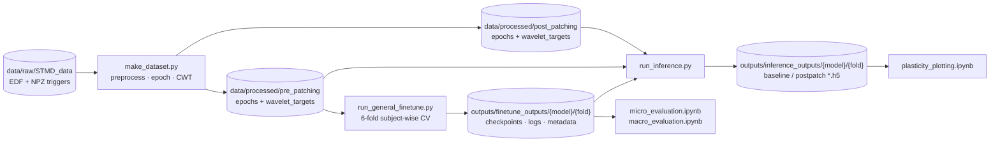

# EEG Foundation Model Fine-Tuning & Plasticity Analysis Pipeline

> **Project status: active development.**
> The pipeline works end to end, but the architecture and code are still being cleaned up. See [Known issues & caveats](#known-issues--caveats) before running anything.

---

## Overview

This repository adapts the pretrained EEG foundation model **LaBraM** (LaBraM-Base, vendored in `libs/labram`) to the STMD EEG dataset. It uses the model's ability to **reconstruct** EEG to measure how neural activity changes after patching.

The idea:

1. **Fine-tune on baseline only.** LaBraM gets a new regression head. It is trained to map a 1 s EEG epoch to that epoch's **time–frequency representation** (a complex Morlet wavelet magnitude in dB, z-scored). Training uses only **baseline (pre-patching)** recordings.
2. **Reconstruct held-out data.** Each cross-validation fold's model then reconstructs epochs from its **held-out test subjects**, both baseline and **post-patching**.
3. **Compare the errors.** The model has only seen baseline activity, so a change in reconstruction error from baseline to post-patching (normalised MAE, per band and per channel) is used as a quantitative marker of changed activity. The analysis notebook shows it as bar charts, distributions, correlations and Glass's Δ topomaps.

The pipeline covers preprocessing, subject-wise k-fold fine-tuning, inference with per-trial metrics, and interactive analysis in Jupyter.



---

## Quick start

```bash
# 1. environment (Python >= 3.10, PyTorch 2.0.1 + CUDA 11.8 wheels, resolved by uv)
uv sync

# 2. preprocess raw EEG -> epoch tensors + wavelet targets
uv run python make_dataset.py

# 3. fine-tune one model per fold (6 folds by default)
uv run python run_general_finetune.py --model_name my_model --target_mode wavelet

# 4. reconstruct held-out baseline + post-patching trials, compute metrics
uv run python run_inference.py --model_name my_model --target_mode wavelet --postpatch
```

Then open the notebooks in `notebooks/` (see [Analysis notebooks](#4-analysis-notebooks)).

**Run everything from the repository root.** All paths in `core/settings.py` are relative to `BASE_DIR = Path(".")`, and the scripts import `core` / `libs` as top-level packages. The notebooks `chdir` to the root on their own, but they import `core` in their first cell. The project root therefore has to be on `PYTHONPATH` when the kernel starts. PyCharm does this automatically. Otherwise start Jupyter with `PYTHONPATH=<repo root>`.

### Dependencies

Declared in `pyproject.toml` and locked in `uv.lock`. The important pins:

- `torch==2.0.1`, `torchvision==0.15.2` and `torchaudio==2.0.2`, pulled from the CUDA 11.8 index.
- `timm==0.4.12`, which LaBraM requires.
- `numpy<2`.

Other key libraries: `mne`, `pywavelets`, `h5py`, `einops`, `ipywidgets`, `tensorboardX`, `autoreject`, `pyhealth==1.1.4`. `scikit-learn` comes in transitively. Training assumes a CUDA GPU.

---

## Repository structure

```text
├── make_dataset.py              # Step 1: preprocessing, epoching, wavelet targets -> .pt files
├── run_general_finetune.py      # Step 2: subject-wise k-fold fine-tuning of LaBraM + regression head
├── run_inference.py             # Step 3: reconstruction of held-out trials, per-trial metrics -> HDF5
├── make_h5dataset_for_pretrain.py  # Auxiliary/experimental: HDF5 export for LaBraM pretraining (not part of the main pipeline)
├── qc_bad_channels.py           # QC: runs the automatic bad channel detector on all recordings -> outputs/qc/
├── reaction_times.py            # Analysis: button-press reaction times, baseline vs post-patching -> outputs/reaction_times/
├── pyproject.toml / uv.lock     # Environment definition
│
├── core/                        # Project package
│   ├── settings.py              # ALL global configuration (paths, preprocessing, model and wavelet params, bands)
│   ├── architectures.py         # EEGAutoencoder / EEGSpectralDecoder (LaBraM backbone + MLP head)
│   ├── datasets.py              # FinetuneDataset, FinetuneSplits, KFoldSplitter
│   ├── utils.py                 # Wavelet transform, cropping, metric calculation
│   ├── io.py                    # EpochIO (.pt I/O), training-log loading, inference HDF5 read/write
│   ├── io_models.py             # Trial / Metrics dataclasses (lazy views on inference HDF5)
│   ├── io_utils.py              # Filename conventions, figure saving
│   ├── plot_data_processing.py  # Aggregation of inference metrics (means, SEM, Glass's Δ, ...)
│   └── plotting.py              # Matplotlib/ipywidgets plotting helpers used by the notebooks
│
├── notebooks/
│   ├── micro_evaluation.ipynb   # Per-sample reconstruction viewer straight from checkpoints
│   ├── macro_evaluation.ipynb   # Fold-averaged learning curves, model comparison
│   └── plasticity_plotting.ipynb   # Baseline vs post-patching analysis on inference outputs
│
├── libs/
│   ├── labram/                  # Vendored LaBraM (modified for regression), incl. checkpoints/labram-base.pth
│   └── unscrambly/              # Vendored in-house EEG preprocessing library (DataPreprocessor)
│
├── data/                        # (not tracked) raw/ and processed/ data
└── outputs/                     # (not tracked) finetune_outputs/, inference_outputs/, plots/
```

---

## Configuration: `core/settings.py`

Every script and notebook reads its configuration from this module at import time. **Settings are not stored with a trained model.** Inference and the notebooks rebuild the model and targets from the *current* settings. These must therefore match the settings used when the targets were generated and the model was trained (check `metadata.json → model_params`).

### Preprocessing / epoching

| Setting | Value | Meaning |
|---|---|---|
| `L_FREQ`, `H_FREQ` | 0.1 Hz, 75 Hz | Band-pass (FIR, firwin) |
| notch | 50 Hz | Set in `make_dataset.py` |
| `RSFREQ` | 200 Hz | Resampling rate. One LaBraM patch = 200 samples = 1 s |
| `INCLUDED_CONDITIONS` | `['baseline', 'post-patching']` | Session folders to process (case-insensitive) |
| `EXCLUDED_SUBJECTS` | `STMD35`, `STMD37`–`STMD45` | Skipped entirely |
| `RECORDINGS_PER_CONDITION` | `None` | Use all recording folders per session (otherwise last *n* baseline / first *n* post-patching) |
| `TIME_WINDOW` | (−0.2, 0.8) s | Window seen by the model (200 samples) |
| `EXTENDED_OFFSET` | 1.5 s | Extra context on both sides → `EXTENDED_TIME_WINDOW` = (−1.7, 2.3) s |
| `PAD_TIME` → `PADDING` | 1.5 s → 300 samples | Reflect padding added before the CWT |
| `WINDOW_SIZE` | 200 | Samples per model input |
| `CHORDER_STANDARD`, `N_CHANNELS` | 23 channels | Channel order used everywhere (see table below) |
| `SEED` | 42 | `torch.manual_seed` and fold shuffling |
| `EPS` | 1e-8 | Numerical guard in metrics |

### Model / targets

| Setting | Value | Meaning |
|---|---|---|
| `LABRAM_VERSION` | `labram_base_patch200_200` | 12 blocks, embed dim 200, 10 heads, patch size 200 |
| `SPECTRAL_DECODER_PARAMS['freq_window']` | (1, 60) Hz | Wavelet frequency range |
| `N_FREQS` | 50 | Number of wavelet frequencies |
| `FREQS` | `np.geomspace(1, 60, 50)` | Log-spaced frequency axis |
| `SPECTRAL_DECODER_PARAMS['wavelet']` | `cmor1.5-1.0` | Complex Morlet, bandwidth 1.5, centre frequency 1.0 |
| `SPECTRAL_DECODER_PARAMS['target_dim']` | 50 × 200 = 10 000 | Head output size per channel token |
| `AUTOENCODER_PARAMS['target_dim']` | 200 | Head output size per channel token (raw-signal mode) |
| `FREQ_BANDS` | δ 1–4, θ 4–8, α 8–12, β 12–30, γ 30–60 Hz | Bands used for band-wise metrics (edges inclusive) |

### Paths

| Setting | Path |
|---|---|
| `DATA_ROOT` | `data/raw/STMD_data` |
| `FINETUNE_DIR` (baseline) | `data/processed/pre_patching/{epochs, wavelet_targets, superlet_targets}` |
| `PATCH_DIR` (post-patching) | `data/processed/post_patching/{epochs, wavelet_targets, superlet_targets}` |
| `FINETUNE_OUTPUT_DIR` | `outputs/finetune_outputs` |
| `INFERENCE_DIR` | `outputs/inference_outputs` |
| `PLOT_DIR`, `PLOT_MACRO`, `PLOT_INFERENCE` | `outputs/plots`, `…/macro_plots`, `…/inference_plots` |
| `CHECKPOINT_DIR` | `libs/labram/checkpoints` (pretrained `labram-base.pth`) |

<details>
<summary><b>Channel mapping (EGI HydroCel 65 → 10-20) and channel indices</b></summary>

The index is the position in `CHORDER_STANDARD`. It equals the `ch_{i}` key in the inference metrics and the row index of every `(23, …)` tensor.

| idx | 10-20 | EGI | | idx | 10-20 | EGI |
|---|---|---|---|---|---|---|
| 0 | FP1 | E10 | | 12 | T3 | E24 |
| 1 | FP2 | E5 | | 13 | T4 | E52 |
| 2 | F3 | E12 | | 14 | T5 | E30 |
| 3 | F4 | E60 | | 15 | T6 | E44 |
| 4 | C3 | E20 | | 16 | A1 | E29 |
| 5 | C4 | E50 | | 17 | A2 | E47 |
| 6 | P3 | E28 | | 18 | FZ | E6 |
| 7 | P4 | E42 | | 19 | CZ | VREF |
| 8 | O1 | E35 | | 20 | PZ | E34 |
| 9 | O2 | E39 | | 21 | T1 | E17 |
| 10 | F7 | E18 | | 22 | T2 | E1 |
| 11 | F8 | E58 | | | | |

In the code, channel names look like `EEG FP1-REF`. The scripts strip them to `FP1` and map them to LaBraM's positional embeddings with `libs.labram.utils.get_input_chans`. For topomaps, `rename_chans_to_mne` converts them to MNE names (`Fp1`, `Fz`, …, `T1→FT9`, `T2→FT10`).
</details>

---

## Pipeline in detail

### Terminology

- **Session**: `baseline` (pre-patching) or `post-patching`. The session is encoded by the **directory** a file lives in (`pre_patching/` vs `post_patching/`), not by the filename.
- **Condition / stimulus type**: the epoch category *within* a session, named `{side}_{eccentricity}` for local mismatch stimuli plus `global`. The current data contains `left_1–3`, `center_2–3`, `right_1–3` and `global`. In `FinetuneDataset` metadata, in the inference HDF5 paths and in the notebooks' `conditions` filter, "condition" means this stimulus type.
- **Trial / epoch id**: 1-based running index of the epoch within a subject × stimulus type.

---

### 1. Dataset creation: `make_dataset.py`

Converts raw EDF recordings into per-epoch PyTorch tensors, one file for the EEG epoch and one for its wavelet target.

**Expected input layout**

```text
data/raw/STMD_data/
└── STMD1/                              # subject
    ├── Baseline/                       # session (matched case-insensitively against INCLUDED_CONDITIONS)
    │   ├── 08_56/                      # recording folder (sorted by name = chronological)
    │   │   ├── *.edf                   # raw EEG
    │   │   ├── *-timestamps.npz        # trigger codes/times + eccentricity (ChkEEG format)
    │   │   ├── bad_ch_selection.pkl    # cached manual bad-channel selection
    │   │   └── ica_selection.pkl       # cached manual ICA component selection
    │   └── 09_09/ …
    └── Post-patching/ …
```

If any selected recording has no cached `bad_ch_selection.pkl` / `ica_selection.pkl`, `unscrambly` opens its **interactive** bad-channel / ICA selection for that session.

**Processing steps, in execution order**

| # | Step | Where | Details |
|---|---|---|---|
| 1 | Load + montage | `unscrambly` `preprocess_dir` | `mne.io.read_raw_edf`, montage `GSN-HydroCel-65_1.0` |
| 2 | ICA | 〃 | 15 components fitted per recording. Manually selected components are removed |
| 3 | Bad channels | 〃 | Manually selected channels plus **automatically detected** ones (`auto_bad_channels.py`, see below) are **interpolated** (`interpolate_bads`). Detection runs on the raw recording before ICA |
| 4 | Re-reference | 〃 | **Average reference**, computed over all 65 channels, before channel reduction |
| 5 | Filtering | 〃 | Band-pass 0.1–75 Hz (FIR, firwin), then 50 Hz notch |
| 6 | Triggers | 〃 | EDF annotations are replaced with NPZ triggers. Eccentricity is encoded as `DIN21/ecc_3` etc. |
| 7 | Concatenate | `process_subjects` | All recording folders of a subject × session are concatenated |
| 8 | Resample | `make_dataset.main` | 200 Hz on the continuous data |
| 9 | Channel match & order | `match_and_order` | Drops channels not in `EGI_TO_1020_MAP`, renames them to 10-20 names and reorders them to `CHORDER_STANDARD` (23 ch) |
| 10 | Epoching | `create_subject_epochs` | **Onset** triggers: DIN21 left, DIN31 center, DIN41 right, DIN51 global. Window `EXTENDED_TIME_WINDOW` (−1.7, 2.3) s. MNE baseline correction over (−0.2, 0) s. No amplitude rejection, no autoreject. `split_by='both'` gives keys `{side}_{ecc}` (eccentricity 0 excluded) and `global` |
| 11 | Unit conversion | `rescale_to_uv` | V → **µV** (×1e6), as LaBraM expects |
| 12 | Wavelet target | `save_dataset` → `utils.calc_wavelet` | CWT of the **full extended epoch** (801 samples). Reflect-padded by 300 samples per side first, magnitude `abs(coeffs)`, padding removed. Permuted to (channels, freqs, time), then cropped to `TIME_WINDOW` → **(23, 50, 200)** |
| 13 | EEG epoch | `save_dataset` | Cropped to `TIME_WINDOW` (samples 300:500 of the extended epoch) → **(23, 200)** µV |

**Automatic bad channel detection** (`libs/unscrambly/preprocessing/auto_bad_channels.py`, parameters in `settings.AUTO_BAD_CHANNEL_PARAMS`). It runs on each raw recording and adds its flags to the manual selection:

| Criterion | Computed on | Default |
|---|---|---|
| Clipping | Raw data. Fraction of samples at the channel's own max \|x\| (the ±5000 µV rail), ignoring samples where ≥ 25 % of channels saturate together (whole-cap events at recording start/end) | > 0.5 % |
| Flat | Raw data, 1–40 Hz std | < 1 µV |
| Noisy | Average reference to the still-good channels (iterated), 1–40 Hz std relative to the channel median | > 10× |
| Line noise | Average reference, 49–51 Hz vs 44–47/53–56 Hz power | **off** |

- **Calibration.** The defaults were calibrated with `qc_bad_channels.py`. They flag about 2.4 % of channels, close to the 2.6 % selected manually. T4 (E52) is the model channel flagged most often.
- **Noisy threshold.** It is high on purpose: the check runs before ICA, so periocular and facial channels carry blinks and muscle activity.
- **Line noise is not a channel criterion.** Line noise is systematic on some electrodes (E34 = Pz in about 80 % of recordings), so flagging it would interpolate Pz almost everywhere. The notch filter should remove it instead.
- **Report.** `make_dataset.py` writes the per-channel detection report to `outputs/qc/auto_bad_channels_make_dataset.csv`.

The extended window and the extra padding give the low-frequency wavelets (≈1 Hz atoms span several seconds) enough context. Without them, edge effects would contaminate the 1 s analysis window.

**Output** (baseline → `FINETUNE_DIR`, post-patching → `PATCH_DIR`), written through `EpochIO.save`:

```text
data/processed/{pre_patching|post_patching}/
├── epochs/            {subject}_{stimulus}_epoch{id}.pt     e.g. STMD11_center_2_epoch1.pt    (23, 200) float32, µV
├── wavelet_targets/   {subject}_{stimulus}_wavelet{id}.pt   e.g. STMD11_center_2_wavelet1.pt  (23, 50, 200) float32, linear magnitude
└── superlet_targets/  (created, but superlets are not implemented)
```

Filenames are parsed back by splitting at the *first* underscore (subject) and the *last* marker (`_epoch`). Subject names must therefore not contain underscores.

**CLI**

| Flag | Default | Effect |
|---|---|---|
| `--save_wavelet` | `True` | Compute and save wavelet targets (currently cannot be switched off from the CLI) |
| `--save_superlet` | `False` | Placeholder, does nothing |

> ⚠️ The current working copy of `make_dataset.py` is in a **debugging state**. See [Known issues](#known-issues--caveats).

---

### 2. Fine-tuning: `run_general_finetune.py`

Trains one model per cross-validation fold on **baseline** epochs only.

**CLI**

| Argument | Default | Meaning |
|---|---|---|
| `--model_name` | *required* | Output folder name under `outputs/finetune_outputs/` |
| `--target_mode` | `wavelet` | `wavelet` → `EEGSpectralDecoder`, `autoencoder` → `EEGAutoencoder` (`superlet` is accepted but has no targets) |
| `--k_folds` | 6 | Number of CV folds |
| `--lr` | 5e-4 | Peak learning rate |
| `--weight_decay` | 5e-3 | Initial weight decay |
| `--epochs` | 120 | Training epochs per fold |
| `--huber_beta` | 0.1 | β of the Smooth-L1 (Huber) loss |
| `--no_pretrained` | off | Train from random initialisation instead of LaBraM-Base weights |
| `--mse` | off | Only changes the loss label written to `metadata.json` (see Known issues) |

#### 2.1 Data split: `core.datasets.KFoldSplitter.split_by_subject`

- Loads all baseline epochs from `FINETUNE_EPOCHS_DIR` into `{subject: {stimulus: [(id, tensor), …]}}`.
- Shuffles the subject list with `random.Random(SEED)` and deals subjects into *k* folds (`subjects[i::k]`).
- For fold *i*, the **test** set is fold *i*'s subjects. The remaining subjects keep their shuffled order: the first `len // 5` (≈20 %) form the **validation** set and the rest the **training** set.
- The split is **subject-disjoint**: no subject appears in more than one of train/val/test in a fold. Each subject is a test subject in exactly one fold. With k = 6 this gives roughly 67 / 17 / 17 % of subjects. With the current 19 subjects: 12–13 train, 3 val, 3–4 test.

#### 2.2 Dataset and target transforms: `core.datasets.FinetuneDataset`

Each sample is `(eeg, target, metadata)`, with `metadata = {"subject", "condition", "id"}`. All samples are loaded into memory at construction.

- **EEG input**: the (23, 200) µV epoch, trimmed to a multiple of `WINDOW_SIZE` (`cut_to_size`). In `train_one_epoch`, `evaluate` and inference it is **divided by 100** (LaBraM's 0.1 mV input convention) and rearranged to `(B, 23, 1, 200)`, i.e. 23 channels × 1 patch × 200 samples.
- **Wavelet target** (`target_mode='wavelet'`): the matching `…_wavelet{id}.pt` is loaded from `wavelet_dir`, and then:
  1. `log=True`: converted to dB, `20·log10(mag + 1e-7)`
  2. `normalize=True`: **per-trial z-score** over the whole (23, 50, 200) tensor, `(x − mean) / std`

  Train, validation and test datasets all use `log=True, normalize=True`. Samples without a wavelet file are skipped with a warning.
- **Autoencoder target** (`target_mode='autoencoder'`): the EEG epoch itself (in µV, not divided by 100).

#### 2.3 Model: `core.architectures`

Both models extend `BaseMLPWrapper`. It builds LaBraM with `timm.create_model(LABRAM_VERSION)` and **replaces `model.head`** with a 2-layer MLP that is applied **to every patch token**:

```
Linear(200 → hidden) → LayerNorm(hidden) → GELU → Linear(hidden → target_dim)
```

| Model | hidden | target_dim | Output per trial |
|---|---|---|---|
| `EEGSpectralDecoder` (`wavelet`) | 1024 | 10 000 (= 50 × 200) | `(23, 50, 200)` |
| `EEGAutoencoder` (`autoencoder`) | 512 | 200 | `(23, 200)` |

Forward pass (wavelet mode):

```text
(B, 23, 1, 200) EEG/100
 → TemporalConv patch embedding            → 23 tokens × 200-d  (+ [CLS])
 → + channel position embedding (selected via input_chans) + temporal embedding
 → 12 transformer blocks (10 heads, MLP ratio 4, QK-norm)
 → patch tokens ([CLS] dropped) → fc_norm LayerNorm      (return_patch_tokens=True)
 → MLP head per token                      → (B, 23, 10 000)
 → forward():                 flatten → (B, 230 000)      (used for the loss)
 → get_unflattened_output():  reshape → (B, 23, 50, 200)  (used for inference/plots)
```

There is exactly one 1 s patch per channel, so **each channel's token predicts that channel's own full spectrogram**.

**Pretrained initialisation** (unless `--no_pretrained`):

- Loads `libs/labram/checkpoints/labram-base.pth` and keeps only the `student.*` weights (prefix stripped).
- Prefixes the keys with `model.` to match the wrapper and drops `relative_position_index` keys.
- Loads them non-strictly (`libs.labram.utils.load_state_dict`). The new head (and anything else missing) keeps its random initialisation.

The whole network is fine-tuned; nothing is frozen.

#### 2.4 Optimisation

| Item | Setting |
|---|---|
| Optimiser | AdamW (`libs.labram.optim_factory.create_optimizer`), eps 1e-8, default betas (0.9, 0.999) |
| Batch size | 64 (`BATCH_SIZE`), no gradient accumulation (`UPDATE_FREQ = 1`). Steps/epoch = `len(train) // 64` (the last partial batch is skipped) |
| Learning rate | Linear warm-up from 0 over **8 epochs** (`WARMUP_EPOCHS`), then per-iteration **cosine decay** from `--lr` to `MIN_LR = 1e-6` |
| Layer-wise LR decay | `LAYER_DECAY = 0.9`: LR scale = 0.9^(13 − layer_id). Head + `fc_norm` → 1.0, block 12 → 0.9, …, block 1 → 0.9¹², patch/pos/time embeddings + `cls_token` → 0.9¹³ ≈ 0.25 |
| Weight decay | Cosine schedule **increasing** from `--weight_decay` to 2 × `--weight_decay` (the larger final value is meant to lock in learnt features). 0 for biases and 1-D parameters (LayerNorm) |
| Loss | `nn.SmoothL1Loss(beta=--huber_beta)` (Huber, β = 0.1) on the flattened output |
| Precision | `torch.cuda.amp.autocast` + `NativeScalerWithGradNormCount` loss scaling |
| Gradient clipping | None (`CLIP_GRAD = None`) |
| EMA | Disabled (`USE_EMA = False`) |
| Seed | `torch.manual_seed(42)`. The data split uses seed 42 too |

The training/eval loops are the vendored `libs/labram/engine_for_finetuning.train_one_epoch` / `evaluate`, modified for regression. They log loss, MSE and R² per step. `libs.labram.utils.get_metrics` routes `mse / mae / r2` to `autoencoder_metrics_fn`.

#### 2.5 Training loop, model selection, outputs

For each fold and epoch:

1. `train_one_epoch`. Stats are printed and logged to TensorBoard.
2. If `epoch % 10 == 0`, save `checkpoint-{epoch}.pth` and overwrite `checkpoint.pth`.
3. `evaluate` on the validation set. The metrics are MSE, MAE and **R²**, where R² = `r2_score` over *all* flattened validation predictions (z-scored dB space).
4. Append one JSON line to `log.txt`, containing `train_*` and `val_*` metrics, `epoch` and `n_parameters`.
5. If validation R² beats the best so far (starting at 0.0), save `checkpoint-best_val.pth`. **This is the checkpoint used by inference and by the notebooks.**

```text
outputs/finetune_outputs/{model_name}/
├── metadata.json          # hyperparameters, results, model_params (see below)
└── {1..k}/                # one folder per fold (1-based)
    ├── checkpoint-best_val.pth
    ├── checkpoint-0.pth, checkpoint-10.pth, …, checkpoint-110.pth
    ├── checkpoint.pth     # latest multiple-of-10 epoch
    ├── log.txt            # JSON lines, one per epoch
    └── logs/              # TensorBoard event files
```

Checkpoints contain `model`, `optimizer`, `epoch`, `args` and `scaler`.

`metadata.json` contains:

- `hyperparameters`: batch_size, epochs, warm-up, weight_decay, lr, pretrained.
- `results`: `r2_per_fold` (best validation R² per fold), `mean_val_r2`, and `max_r2_val_epochs`, the epoch at which each fold's best checkpoint was taken.
- `model_params`: the `SPECTRAL_DECODER_PARAMS` / `AUTOENCODER_PARAMS` used, plus `loss_type`.

---

### 3. Inference: `run_inference.py`

Reconstructs every fold's **held-out test subjects** with that fold's best checkpoint, for baseline and (optionally) post-patching data. It stores targets, reconstructions and per-trial metrics.

**CLI**

| Argument | Default | Meaning |
|---|---|---|
| `--model_name` | *required* | Folder under `outputs/finetune_outputs/` |
| `--target_mode` | `wavelet` | Must match the training mode |
| `--postpatch` | off | Also reconstruct the post-patching epochs of each fold's test subjects |

**Steps per fold** (k = 6 is hard-coded here):

1. Rebuild the folds with `KFoldSplitter(FINETUNE_EPOCHS_DIR, seed=SEED)`. These are the same splits as in training, as long as the data directory is unchanged.
2. Build the test `FinetuneDataset` from baseline epochs (`log=True, normalize=True`).
3. Instantiate the model from the current settings and load `{fold}/checkpoint-best_val.pth`. A fold without this file is skipped. The model runs in `eval()` on GPU when available.
4. `run_reconstruction`: batches of 256 go through `model.get_unflattened_output` under autocast. For every trial it computes metrics (`core.utils.get_inference_metrics`) and writes them (`core.io.save_inference_trial_hdf`).
5. With `--postpatch`: load the **same test subjects'** epochs from `PATCH_EPOCHS_DIR` and wavelet targets from `PATCH_WAVELET_DIR`, then repeat step 4.

Every subject is a test subject in exactly one fold. Merging the six folds therefore gives out-of-sample reconstructions for **every subject, exactly once**.

**Output layout** (`outputs/inference_outputs/{model_name}/{fold}/`):

```text
baseline_reconstruction.h5   /   postpatch_reconstruction.h5
└── {subject}/                         e.g. STMD11
    └── {stimulus}/                    e.g. left_2, global
        └── {id}/                      e.g. 17  (HDF5 key, i.e. a string)
            ├── target   (23, 50, 200) float32, gzip   z-scored dB wavelet target
            ├── output   (23, 50, 200) float32, gzip   reconstruction
            └── attrs:
                ├── metrics_json           trial-level Metrics as JSON
                └── channel_metrics_json   {"ch_0": Metrics, …, "ch_22": Metrics} as JSON
```

(In `autoencoder` mode, `target`/`output` are (23, 200) µV and there are no band-wise metrics.)

#### Metric definitions: `core.utils.get_inference_metrics` / `calculate_bandwise_metrics`

Metrics are computed per trial, **in the target space**, i.e. the per-trial z-scored dB wavelet magnitude. Notation: `σ_sig(c, f)` = standard deviation **over time** of the target for channel *c* and frequency *f*, and `σ_rec(c, f)` is the same for the reconstruction.

| Field (`Metrics`) | Trial level | Channel level (`ch_i`) |
|---|---|---|
| `r2` | `r2_score` over the flattened (23·50·200) tensor | `r2_score` over the channel's (50·200) values |
| `mae` | mean \|target − output\| | same, within the channel |
| `signal_volatility` | mean over (c, f) of `σ_sig` | mean over f of `σ_sig(c, ·)` |
| `recon_volatility` | same for `σ_rec` | same for `σ_rec` |
| `nmae` | `mae / signal_volatility` (+ EPS) | `mae / signal_volatility` of the channel |
| `signal_mean`, `recon_mean` | mean of target / output | ⚠️ currently also the *whole-trial* mean |
| `*_bandwise` | a dict `{band: value}` of the metrics above, restricted to the frequencies in each `FREQ_BANDS` band. Band volatility = mean of the (channel-averaged) `σ` over the band's frequencies | same, within the channel |

**NMAE** (normalised MAE) is the primary plasticity metric. It expresses the reconstruction error relative to the temporal variability of the signal, so trials, channels and bands with different dynamics become comparable.

#### Reading inference results: `core.io` / `core.io_models`

```python
from core import io, settings
trials = io.load_inference_trials(settings.INFERENCE_DIR / "my_model" / "1" / "baseline_reconstruction.h5",
                                  subjects=None, conditions=["global"], idxs=None)   # List[Trial]
t = trials[0]
t.subject, t.condition, t.idx          # metadata
t.target_data, t.recon_data            # np.ndarray, read lazily from HDF5 on every access
t.metrics.nmae_bandwise["gamma (30-60Hz)"]
t.channel_metrics["ch_8"].nmae         # O1
```

`Trial` is a lazy view on an open HDF5 group. `metrics` / `channel_metrics` are parsed from the JSON attributes into `Metrics` dataclasses and cached. `load_inference_data` / `extract_data` are legacy loaders for an older HDF5 layout, in which metrics were stored as groups.

---

### 4. Analysis notebooks

All notebooks read their configuration from `core.settings`. Each figure has a **filename box + "Save Figure" button** (`plotting.save_button`) that writes a 300 dpi PNG to the listed directory. In all time–frequency plots, the time axis is **epoch-relative**: 0 ms is −200 ms pre-stimulus, so stimulus onset falls at 200 ms. The frequency axis is logarithmic.

#### `micro_evaluation.ipynb`: per-sample reconstruction viewer

Inspects the reconstructions of single test samples, running the model directly from training checkpoints (no inference outputs needed).

| Parameter | Meaning |
|---|---|
| `fold_to_load` | **0-based** fold index (checkpoint folder = `fold_to_load + 1`) |
| `model_name`, `target_mode` | Model to load |
| `epochs_to_load`, `load_best` | Which checkpoints to show (`checkpoint-{epoch}.pth`, `checkpoint-best_val.pth`) |
| `apply_log` | Applies `20·log10` to the output. Keep `False` for models trained on the current (already log-scaled, z-scored) targets |

It rebuilds the fold's test set and shows sample/channel sliders. For each checkpoint it plots true / reconstructed / absolute-error heatmaps (wavelet mode) or overlaid waveforms (autoencoder mode) with R². Figures go to `outputs/plots/{model_name}/reconstructions/`.

#### `macro_evaluation.ipynb`: fold-averaged training curves and model comparison

Reads `log.txt` from every fold (`io.load_model_log_data`) and averages the metrics per epoch over folds (`utils.avg_metrics_over_folds`).

| Section | Output |
|---|---|
| Train vs. validation R² for one model | Curve, with the train–val gap Δ annotated at the best-validation epoch → `macro_plots/train_val/` |
| Validation R² of several models | One curve per model (dashed if the name contains `pre`). `to` limits the epochs, and `compare_diff` annotates Δ between model pairs → `macro_plots/val_multiple/` |
| Test-set comparison | *(disabled with `%%script false`)* Evaluates every fold's best checkpoint on its test set and plots a bar chart of the mean test R² → `macro_plots/test_comparison/` |

#### `plasticity_plotting.ipynb`: baseline vs. post-patching analysis

Requires `run_inference.py --postpatch` outputs. The configuration cell sets:

- `model_name`
- `subjects`, e.g. `None` for all
- `conditions`: stimulus types, e.g. `["global"]`
- `trial_ids`: **strings**, or `None`
- `bands`: `None` for all bands in `FREQ_BANDS`

Folds 1–6 are loaded and merged into `baseline_merged` / `postpatch_merged` lists of `Trial`s. Unless stated otherwise, statistics are **mean ± SEM over trials**.

| Section | What it shows | Save dir (`outputs/plots/inference_plots/…`) |
|---|---|---|
| Band-wise error comparison | Grouped bars of band-wise NMAE, baseline vs post | `bandwise_e_comparison/` |
| Band-wise R² comparison | Same for band-wise R² | `bandwise_e_comparison/` |
| Single channel comparison viewer | Sliders for sample and channel. True / reconstructed / error heatmaps for baseline and post rows, plus a band-wise NMAE bar chart | `single_channel_comparison/{conditions}/` |
| Topomaps of Glass's Δ | Per channel: `Δ = (mean NMAE_post − mean NMAE_base) / SD_base` over trials, for the global NMAE and each band. MNE `standard_1005` montage, symmetric `RdBu_r` scale. **Positive = worse reconstruction after patching** | `bandwise_topomaps/` |
| *(placeholder)* | Trials where post-patching NMAE < baseline (commented out) | — |
| Band-wise volatility | Mean `signal_volatility` (temporal SD of the z-scored band power) per band + global | `bandwise_amplitude/` |
| Subject-wise gamma NMAE | Per-subject γ-band NMAE, baseline vs post | `subjectwise_e_comparison/` |
| Channel-wise NMAE for one subject | Per-channel γ-band NMAE (subject hard-coded to `STMD32`) | `channelwise_e_comparison/` |
| NMAE distribution | Overlaid histograms (40 bins) of trial NMAE with means | `nmae_dist_comparison/` |
| Band-wise NMAE distributions | Same, one panel per band | `nmae_dist_comparison/` |
| Volatility ↔ NMAE correlation | Scatter per band + global, with a linear fit and Pearson *r*, for baseline and post-patching separately | `correlation_plots/` |
| Scratch cells (end) | Load/plot a single wavelet target or epoch file. Wavelet sanity check on a synthetic 2 Hz sine | — |

---

## `core` package reference

| Module | Contents |
|---|---|
| `settings.py` | All configuration (see [Configuration](#configuration-coresettingspy)) |
| `architectures.py` | `BaseMLPWrapper` (LaBraM + MLP head, exposes `get_num_layers` / `no_weight_decay` for the optimiser). `EEGSpectralDecoder` and `EEGAutoencoder` with `forward` (flattened output) and `get_unflattened_output` (per-channel shaped output) |
| `datasets.py` | `FinetuneDataset` (loads samples, applies log/z-score to wavelet targets, returns `(eeg, target, metadata)`). `FinetuneSplits` (holds one fold's train/val/test dicts; `initialize_datasets()`). `KFoldSplitter` (subject-wise k-fold split) |
| `utils.py` | `calc_wavelet` (padded CWT magnitude), `cut_to_timewindow` (crop by seconds), `cut_to_size` (trim to a multiple of the window), `add_prefix_dict_keys`, `format_model_input` (single trial → `(1, N, A, 200)/100`), `reconstruct_model_output` (load checkpoint + predict), `calculate_r2`, `calculate_bandwise_metrics`, `get_inference_metrics`, `avg_metrics_over_folds` |
| `io.py` | `EpochIO` (`save`, `load_specific`, `load_all_epochs`, `load_subject` for `.pt` files). `load_model_log_data` (per-fold `log.txt`). `save_inference_trial_hdf`, `load_inference_trials`. `NumpyEncoder` for JSON. Legacy `save_dict_to_hdf` / `load_inference_data` / `extract_data` |
| `io_models.py` | `Metrics` dataclass (all metric fields, `from_dict` / `to_dict`). `Trial` dataclass (lazy `target_data`, `recon_data`, cached `metrics`, `channel_metrics`) |
| `io_utils.py` | `vars_to_filename` / `vars_from_filename` (filename convention), `nested_group_to_dict`, `save_figure` |
| `plot_data_processing.py` | Trial aggregation: `extract_metric`, `get_metric_stats`, `get_bandwise_metric_stats`, `get_channel_metric_stats`, `get_channel_bandwise_metric_stats` (mean, SEM, SD, all with `ddof=0`). `calc_subjectwise_metric_stats` and `calc_subjectwise_channel_metric_stats`. `calc_channel_glass_delta` and `calc_channel_bandwise_glass_delta`. `rename_chans_to_mne`. Viewer helpers `get_channel_viewer_metrics`, `order_to_channel_viewer_format` |
| `plotting.py` | `single_channel_viewer`, `show_reconstructions`, `set_heatmap_formatting`, `plot_grouped_bar`, `distribution_viewer`, `correlation_plot`, `save_button`, `save_heatmap`, `save_line_plot` |

---

## Vendored libraries

### `libs/labram`: LaBraM

Code from the original LaBraM repository (Jiang et al., *Large Brain Model for Learning Generic Representations with Tremendous EEG Data in BCI*). It includes the pretrained `checkpoints/labram-base.pth`. `vqnsp.pth`, the neural tokenizer, is not used by this pipeline. Project-specific modifications:

- `engine_for_finetuning.py`: `train_one_epoch` / `evaluate` were rewritten for regression. Targets are flattened, samples are 3-tuples with metadata, and MSE/R² are logged. A TODO in the file plans to move this logic into `core/`.
- `utils.py`: `get_metrics` routes `mse/mae/r2` to a new `autoencoder_metrics_fn`.
- `optim_factory.py`: `get_num_layer_for_vit` strips the `model.` prefix of the wrapper, so layer-wise LR decay works on `BaseMLPWrapper`.
- `modeling_finetune.py`: `Block` defaults `init_values` to 1e-4 when it is `None`. This means the LayerScale parameters (`gamma_1`/`gamma_2`) are always created, matching the pretrained checkpoint. The `return_patch_tokens` option used by the wrappers is original LaBraM code.

### `libs/unscrambly`: in-house EEG preprocessing

`preprocessing.DataPreprocessor` handles the following:

- EDF loading and montage.
- Manual ICA and bad-channel selection, cached as `.pkl` files.
- Re-referencing and filtering.
- NPZ trigger import with eccentricity.
- Multi-subject processing (`process_subjects`).
- Epoching split by side and/or eccentricity (`create_subject_epochs`).

Trigger codes are defined in `preprocessing/trigger_mapping.yaml`. See `libs/unscrambly/preprocessing/README.md` for the full API.

---

## Auxiliary script

**`make_h5dataset_for_pretrain.py`** builds an HDF5 file in LaBraM's pretraining format. The processing is 0.1–75 Hz, 200 Hz resampling, with 21 channels mapped and ordered to 10-20. It is experimental and not part of the main pipeline:

- Its input path is hard-coded to `STMD1/Baseline`.
- It imports `shock.utils`, so it needs `libs/labram/dataset_maker` on `sys.path`.

---

## Known issues & caveats

**Data preparation**
- `make_dataset.py` is currently in a **debugging state**:
  - The `io_handler.save(...)` calls for epochs and wavelet targets are commented out. The first five epochs are dumped as PNG/TXT into `outputs/plots/` instead, so **running it does not write a dataset**.
  - When re-enabling saving, move the `cut_to_timewindow` crop of the EEG epoch out of the `if j < 5:` block. Otherwise the full 801-sample extended epochs are saved.
- Changing `N_FREQS`, `freq_window`, `EXTENDED_OFFSET`, `PAD_TIME`, the wavelet or `TIME_WINDOW` requires regenerating all targets and retraining. Models trained with a different `N_FREQS` cannot be loaded (head shape mismatch).
- `--save_wavelet` uses `store_true` with `default=True`, so it cannot be disabled from the CLI. Superlet targets (`--save_superlet`, `--target_mode superlet`) are not implemented: a superlet dataset is empty.

**Training**
- `--mse` does **not** switch the loss. The criterion is always `SmoothL1Loss(beta=--huber_beta)`, and the flag only changes `loss_type` in `metadata.json`. `AUTOENCODER_PARAMS['loss_type']` is unused.
- The script calls `torch.cuda.get_device_name(0)`, so it fails on machines without CUDA.
- `checkpoint-best_val.pth` is only written once validation R² exceeds 0. A fold that never gets there has no best checkpoint, and inference silently skips it.
- The no-weight-decay list (`pos_embed`, `cls_token`, `time_embed`) is matched against unprefixed names, but the wrapper's parameters are named `model.pos_embed` etc. These embeddings therefore do receive weight decay.

**Fold reproducibility**
- Inference and the notebooks rebuild the folds from the *current* contents of `FINETUNE_EPOCHS_DIR`. The subject order comes from filesystem glob order and is not sorted before seeded shuffling. Adding or removing subjects, or moving the data to another filesystem, can change the splits. Test sets would then no longer match training.

**Inference / metrics**
- Channel-level `signal_mean` / `recon_mean` hold the whole-trial mean, not the channel mean.
- In NMAE, `EPS` is added to the ratio (`mae / std + eps`), not to the denominator.
- `load_inference_trials` compares `idxs` with HDF5 keys, which are strings. Pass trial ids as strings. The HDF5 file stays open while the returned `Trial` objects are in use.

**Notebooks**
- `micro_evaluation.ipynb` calls `calculate_bandwise_metrics` with an outdated signature, so the band-wise MAE table fails in wavelet mode (the error is printed). Its `apply_log = True` default is wrong for current models, and its channel slider allows index 23, which is out of range.
- `single_channel_viewer` pairs the *i*-th baseline trial with the *i*-th post-patching trial of the loaded lists. These are not matched trials.
- The scratch cells at the end of `plasticity_plotting.ipynb` call `calc_wavelet` without the new `pad` argument.
