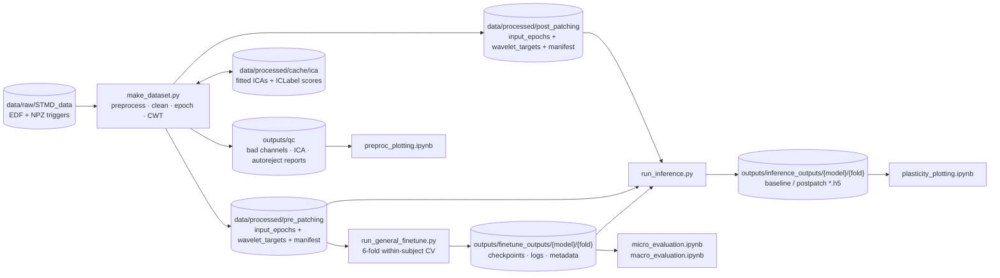

# EEG Foundation Model Fine-Tuning & Plasticity Analysis Pipeline

> **Project status: active development, design change in progress.**
> The dataset step (`make_dataset.py`) builds the data for the new **pre/post patch design** (see [Design change](#design-change-prepost-patches-and-masked-channel-reconstruction)). Training (step 2) splits the trials into patches, trains with masked loss and fold-level target normalization, and does masked-channel reconstruction with `--masked`. Inference (step 3) reconstructs both patches of every trial and writes them to `pre/` / `post/` groups. The functions that read the inference files and the analysis notebooks (step 4) still expect the previous single-window files and are being adapted. See [Known issues & caveats](#known-issues--caveats) before running anything.

---

## Overview

This repository adapts the pretrained EEG foundation model **LaBraM** (LaBraM-Base, vendored in `libs/labram`) to the STMD EEG dataset. It uses the model's ability to **reconstruct** EEG to measure how neural activity changes after patching.

The idea:

1. **Fine-tune on baseline only.** LaBraM gets a new regression head. It is trained to map a 1 s EEG patch to that patch's **time–frequency representation** (a complex Morlet wavelet magnitude in dB, normalized with one mean and SD per fold). Training uses only **baseline (pre-patching)** recordings.
2. **Reconstruct held-out data.** Each cross-validation fold's model then reconstructs epochs from its **held-out test subjects**, both baseline and **post-patching**.
3. **Compare the errors.** The model has only seen baseline activity, so a change in reconstruction error from baseline to post-patching (normalised MAE, per band and per channel) is used as a quantitative marker of changed activity. The analysis notebook shows it as bar charts, distributions, correlations and Glass's Δ topomaps.

The pipeline covers preprocessing, subject-wise k-fold fine-tuning, inference with per-trial metrics, and interactive analysis in Jupyter.

### Design change: pre/post patches and masked-channel reconstruction

The previous model learnt the wavelet transform of its own input, so its error could not depend on brain state, and its window edges were computed from data it never saw. The new design:

- **Masked-channel reconstruction.** The model sees the EEG of all channels except a masked one (or a neighbourhood around it) and predicts the masked channel's wavelet target. Interpolated channels are never targets.
- **Two patches per trial.** Every trial is split into a **pre-stimulus patch** (−1.3 … −0.3 s) and a **post-stimulus patch** (−0.3 … 0.7 s), one LaBraM patch (1 s, 200 samples) each. They go through the model in **separate forward passes** and get **separately computed wavelet targets**, so the two share no data.
- **Scored windows.** Post 0 … 0.4 s (before any button press), pre −1.0 … −0.7 s. With the wavelet cycles used (≤ 0.29 s reach), every scored bin is computed from real data of its own patch only.
- **Pre-stimulus correction.** The pre-patch error serves as a reference for the post-patch error of the same model, which cancels cap-refit and session effects to first order. Within-session contrasts across the four recording blocks of a session give a cap-free check.
- **Within-subject folds** (`KFoldSplitter.split_within_subjects`), so a subject label can be given to the model.

The dataset step implements this. Training (`run_general_finetune.py`) implements the two patches, the validity masks, within-subject folds and, with `--masked`, masked-channel reconstruction (see [2.3 Masked-channel reconstruction](#23-masked-channel-reconstruction---masked)). No subject label is given to the model so far. Inference (`run_inference.py`) follows the new design (see [3. Inference](#3-inference-run_inferencepy)); the loaders of the inference files and the notebooks still follow the previous design.



---

## Quick start

```bash
# 1. environment (Python >= 3.10, PyTorch 2.0.1 + CUDA 11.8 wheels, resolved by uv)
uv sync

# 2. preprocess raw EEG -> cleaned epoch tensors + wavelet targets + QC reports
uv run python make_dataset.py

# 3. fine-tune one model per fold (6 folds by default)
uv run python run_general_finetune.py --model_name my_model --target_mode wavelet

# 4. reconstruct held-out baseline + post-patching trials, compute metrics
uv run python run_inference.py --model_name my_model --postpatch   # target mode, masking and folds from the run's metadata.json
```

Then open the notebooks in `notebooks/` (see [Analysis notebooks](#4-analysis-notebooks)).

**Before re-running `make_dataset.py`:**
- **Empty `input_epochs/` and `wavelet_targets/` in `data/processed/pre_patching` and `post_patching`** (or delete both folders). Inputs and targets are paired by file name only, so files of an earlier run would mix into the new dataset. `make_dataset.py` refuses to start while these folders contain `.pt` files (see [Guard and consistency check](#guard-and-consistency-check)).
- **Keep `data/processed/cache`.** It holds the fitted ICAs, and without it every recording is refitted.

The first run fits one ICA per recording (about 15 s each, roughly 40 min in total). Later runs load them from the cache. Build the final dataset from a run that loads the cached ICAs; see [Reproducibility](#reproducibility).

**Run everything from the repository root.** All paths in `core/settings.py` are relative to `BASE_DIR = Path(".")`, and the scripts import `core` / `libs` as top-level packages. The notebooks `chdir` to the root on their own, but they import `core` in their first cell. The project root therefore has to be on `PYTHONPATH` when the kernel starts. PyCharm does this automatically. Otherwise start Jupyter with `PYTHONPATH=<repo root>`.

### Dependencies

Declared in `pyproject.toml` and locked in `uv.lock`. The important pins:

- `torch==2.0.1`, `torchvision==0.15.2` and `torchaudio==2.0.2`, pulled from the CUDA 11.8 index.
- `timm==0.4.12`, which LaBraM requires.
- `numpy<2`.

Other key libraries: `mne`, `pywavelets`, `h5py`, `einops`, `ipywidgets`, `tensorboardX`, `pyhealth==1.1.4`. `nibabel` lets MNE read the `fsaverage` template (`ridge_leakage.py --head_model fsaverage`). `scikit-learn` comes in transitively. Training assumes a CUDA GPU.

For preprocessing:
- `autoreject` (0.4.3) handles local epoch cleaning.
- `mne-icalabel` (≥ 0.9) classifies ICA components automatically. It runs on the installed torch.

---

## Repository structure

```text
├── make_dataset.py              # Step 1: preprocessing, epoching, fast-press exclusion, pre/post patch wavelet targets -> .pt files
├── run_general_finetune.py      # Step 2: within-subject k-fold fine-tuning of LaBraM + regression head on pre/post patches
├── run_inference.py             # Step 3: reconstruction of held-out trials, per-trial metrics -> HDF5
├── make_h5dataset_for_pretrain.py  # Auxiliary/experimental: HDF5 export for LaBraM pretraining (not part of the main pipeline)
├── qc_bad_channels.py           # QC: runs the automatic bad channel detector on all recordings -> outputs/qc/
├── reaction_times.py            # Analysis: button-press reaction times, baseline vs post-patching -> outputs/reaction_times/ (its trigger-code loader is used by make_dataset.py)
├── stimulus_intervals.py        # Analysis: time between consecutive stimuli -> outputs/stimulus_intervals/
├── labram_inj_test.py           # Check: gain injection test of a trained masked-channel model -> outputs/labram_injection/
├── ridge_leakage.py             # Check: linear masked-channel prediction (leakage), build comparison, gain injection -> outputs/ridge_leakage/
├── pyproject.toml / uv.lock     # Environment definition
│
├── core/                        # Project package
│   ├── settings.py              # ALL global configuration (paths, preprocessing, model and wavelet params, bands)
│   ├── architectures.py         # EEGAutoencoder / EEGSpectralDecoder (LaBraM backbone + MLP head)
│   ├── datasets.py              # FinetuneDataset, FinetuneSplits, KFoldSplitter (subject-wise and within-subject folds)
│   ├── utils.py                 # Wavelet transform and validity masks, cropping, metric calculation
│   ├── io.py                    # EpochIO (.pt I/O), training-log loading, inference HDF5 read/write
│   ├── io_models.py             # Trial / Metrics dataclasses (lazy views on inference HDF5), TargetStats (target normalization)
│   ├── io_utils.py              # Filename conventions, figure saving
│   ├── plot_data_processing.py  # Aggregation of inference metrics (means, SEM, Glass's Δ, ...)
│   └── plotting.py              # Matplotlib/ipywidgets plotting helpers used by the notebooks
│
├── notebooks/
│   ├── micro_evaluation.ipynb   # Per-sample reconstruction viewer straight from checkpoints
│   ├── macro_evaluation.ipynb   # Fold-averaged learning curves, model comparison
│   ├── plasticity_plotting.ipynb   # Baseline vs post-patching analysis on inference outputs
│   ├── plasticity_tensor_analysis.ipynb   # Time series of errors/signals from the full tensors (cached per fold)
│   └── preproc_plotting.ipynb   # Plots of the preprocessing QC reports (e.g. ICA removals per session)
│
├── libs/
│   ├── labram/                  # Vendored LaBraM (modified for regression), incl. checkpoints/labram-base.pth
│   └── unscrambly/              # Vendored in-house EEG preprocessing library (DataPreprocessor), extended for this project
│       └── preprocessing/auto_bad_channels.py   # Automatic bad channel detection (added)
│
├── data/                        # (not tracked)
│   ├── raw/STMD_data/           # EDF recordings, NPZ triggers, manual bad channel selections
│   └── processed/               # pre_patching/, post_patching/ (dataset) and cache/ica/ (fitted ICAs)
└── outputs/                     # (not tracked) finetune_outputs/, inference_outputs/, plots/, qc/, reaction_times/, ridge_leakage/
```

---

## Configuration: `core/settings.py`

Every script and notebook reads its configuration from this module at import time. Settings are imported by these runnable entry points, which pass the values to `core` functions as arguments (e.g. `band_indices=settings.FREQ_BAND_INDICES`). New `core` code should not import `settings` itself (`io_models.py`, `plotting.py` and `plot_data_processing.py` still do for a few values). **Settings are not stored with a trained model.** Inference and the notebooks rebuild the model and targets from the *current* settings. These must therefore match the settings used when the targets were generated and the model was trained (check `metadata.json → model_params`).

### Preprocessing / epoching

| Setting | Value | Meaning |
|---|---|---|
| `L_FREQ`, `H_FREQ` | 0.1 Hz, 75 Hz | Band-pass (FIR, firwin) |
| notch | 50 Hz | Set in `make_dataset.py` |
| `NOTCH_WIDTH` | 3 Hz | Stop-band width of the notch. MNE's default of 0.25 Hz removes only the 50.00 Hz peak and leaves the sidebands of line noise whose amplitude varies over time |
| `RSFREQ` | 200 Hz | Resampling rate. One LaBraM patch = 200 samples = 1 s |
| `INCLUDED_CONDITIONS` | `['baseline', 'post-patching']` | Session folders to process (case-insensitive) |
| `EXCLUDED_SUBJECTS` | `STMD67`, `STMD71` | Skipped entirely |
| `RECORDINGS_PER_CONDITION` | `None` | Use all recording folders per session (otherwise last *n* baseline / first *n* post-patching) |
| `PRE_WINDOW`, `POST_WINDOW` | (−1.3, −0.3) s, (−0.3, 0.7) s | The two patches of a trial, one LaBraM patch (200 samples) each, meeting at −0.3 s. Each goes through the model in its own forward pass |
| `EPOCH_WINDOW` = `WHOLE_EPOCH_WINDOW` | (−1.3, 0.7) s | Epoching window, and the window of the saved input epoch and wavelet target (both patches together, split during training) |
| `PATCH_SIZE` = `TARGET_WINDOW_SIZE` | 200 | Samples per patch, and per predicted wavelet target |
| `PATCH_PARAMS` | `epoch_window` = `EPOCH_WINDOW`, `patch_windows` = `{'pre': PRE_WINDOW, 'post': POST_WINDOW}`, `fs` = `RSFREQ` | Time window arguments of `FinetuneDataset`, which cuts every saved trial into one sample per patch |
| `INJECTION_ONSET_RAMP`, `INJECTION_SOURCE_DEPTH`, `INJECTION_LABELS`, `MIXED_INJECTION_GAINS`, `INJECTION_N_ROI` | 0.02 s, 0.7, `["pericalcarine"]`, V1 +10 % / lateral occipital +25 % / lingual −10 %, 4 | Gain injection of `ridge_leakage.py` and `labram_inj_test.py`: raised-cosine ramp of the gain after onset, depth of the sphere-model dipole, aparc labels of the fsaverage source, sources and gains of a mixed injection, and the number of channels (where the injected pattern is strongest) the results are averaged over |
| `N_NEIGHBOURS` | 4 | Nearest electrodes (HydroCel-65 positions) hidden together with a target channel in masked-channel reconstruction. Default of `--n_neighbors` in training and inference, and of the "cluster" scheme of `ridge_leakage.py` |
| `LOSS_WINDOWS` | `{'pre': PRE_WINDOW, 'post': POST_WINDOW}` | Target bins of every patch used by the training loss, the validation metrics and the target normalization, masked with `valid_wavelet_bins`. The whole patch keeps every bin computed from the patch's own data (6 668 of 10 000 per patch). Set to `PRE_TARGET_WINDOW` / `POST_TARGET_WINDOW` to train on the scored bins only |
| `PRE_TARGET_WINDOW` | (−1.0, −0.7) s | Scored part of the pre patch. Wavelet support −1.29 … −0.41 s |
| `POST_TARGET_WINDOW` | (0.0, 0.4) s | Scored part of the post patch, before any button press. Wavelet support −0.29 … 0.69 s |
| `PAD_TIME` → `PADDING` | 0.3 s → 60 samples | Reflect padding of each patch for its CWT. It only reaches bins outside the scored windows |
| `BASELINE_WINDOW` | `None` | No baseline correction: a baseline window would shift each patch by data of the other one. The 0.1 Hz high-pass removes drift |
| `MIN_REACTION_TIME` | 0.5 s | Trials with a button press earlier than this after onset are dropped (about 1.4 % of trials) |
| `METRIC_WINDOWS` | `full` = `PATCH_WINDOWS`, `analysis` = `{'pre': PRE_TARGET_WINDOW, 'post': POST_TARGET_WINDOW}` | Time windows the inference metrics are computed on, per patch. Bins reaching into a patch's reflect padding are left out, so `full` is every valid bin of the patch. The pre-stimulus reference is `analysis` of the pre patch (`reference` and `button` were removed) |
| `CHORDER_STANDARD`, `N_CHANNELS` | 23 channels | Channel order used everywhere (see table below) |
| `SEED` | 42 | `torch.manual_seed`, fold shuffling, ICA and autoreject |
| `EPS` | 1e-8 | Numerical guard in metrics |

### Artifact handling

| Setting | Value | Meaning |
|---|---|---|
| `AUTO_BAD_CHANNEL_PARAMS` | see [automatic bad channel detection](#automatic-bad-channel-detection) | Clipping > 0.5 % of samples, flat < 1 µV, noisy > 10× median. Line-noise criterion off |
| `ICA_PARAMS` | 15 components, extended infomax, `random_state=SEED` | ICA fitted per recording for ICLabel |
| `ICLABEL_THRESHOLDS` | eye ≥ 0.7 · heart, line noise, channel noise ≥ 0.8 · muscle ≥ 0.9 | A component is removed if ICLabel's probability for any of these classes reaches its threshold. Brain and "other" are never removed |
| `AUTOREJECT_WINDOW` | `WHOLE_EPOCH_WINDOW` = (−1.3, 0.7) s | Part of each epoch on which autoreject judges artifacts: every sample the inputs and wavelet targets are made of |
| `AUTOREJECT_PARAMS` | `random_state=SEED`, `n_jobs=4`, `n_interpolate=[1, 2, 4, 8]` | Local autoreject. At most 8 channels are interpolated per epoch. `n_jobs` changes the result, so keep it fixed |

### Model / targets

| Setting | Value | Meaning |
|---|---|---|
| `LABRAM_VERSION` | `labram_base_patch200_200` | 12 blocks, embed dim 200, 10 heads, patch size 200 |
| `SPECTRAL_DECODER_PARAMS['freq_window']` | (5, 60) Hz | Wavelet frequency range. Below 5 Hz the wavelets reach further than a patch allows |
| `N_FREQS` | 50 | Number of wavelet frequencies |
| `FREQS` | `np.geomspace(5, 60, 50)` | Log-spaced frequency axis |
| `WAVELET_PARAMS` | `max_cycles` = `MORLET_CYCLES` ≈ 5.44, `max_reach` ≈ 0.286 s | Complex Morlet (`cmorB-1.0`). Cycles per frequency `n(f) = min(5.44, 2π·f·max_reach/3)`: 3 cycles at 5 Hz (`MIN_CYCLES`), rising to 5.44 (the previous `cmor1.5-1.0`) from about 9.1 Hz. Every wavelet reaches at most 0.286 s (3 SD) |
| `SPECTRAL_DECODER_PARAMS['target_dim']` | 50 × 200 = 10 000 | Head output size per channel token: one patch's wavelet target |
| `AUTOENCODER_PARAMS['target_dim']` | 200 | Head output size per channel token (raw-signal mode) |
| `FREQ_BANDS` | θ 5–8, α 8–12, β 12–30, γ 30–60 Hz | Bands used for band-wise metrics (edges inclusive). The 3 Hz notch lowers power at about 48.5–51.5 Hz inside the γ band, identically in both sessions |
| `FREQ_BAND_INDICES` | θ 0–9, α 10–17, β 18–35, γ 36–49 | Indices of the `FREQS` bins in each `FREQ_BANDS` band, computed once from the two. Passed to the metric and time series functions to index the frequency axis of the (23, 50, …) tensors |

### Paths

| Setting | Path |
|---|---|
| `DATA_ROOT` | `data/raw/STMD_data` |
| `FINETUNE_DIR` (baseline) | `data/processed/pre_patching/{input_epochs, wavelet_targets}` (`FINETUNE_INPUT_EPOCHS_DIR`, `FINETUNE_WAVELET_DIR`) |
| `PATCH_DIR` (post-patching) | `data/processed/post_patching/{input_epochs, wavelet_targets}` (`PATCH_INPUT_EPOCHS_DIR`, `PATCH_WAVELET_DIR`) |
| `CACHE_DIR` | `data/processed/cache` (fitted ICAs in `ica/`) |
| `QC_DIR` | `outputs/qc` (preprocessing reports) |
| `FINETUNE_OUTPUT_DIR` | `outputs/finetune_outputs` |
| `INFERENCE_DIR` | `outputs/inference_outputs` |
| `PLOT_DIR`, `PLOT_MACRO`, `PLOT_INFERENCE` | `outputs/plots`, `…/macro_plots`, `…/inference_plots` |
| `CHECKPOINT_DIR` | `libs/labram/checkpoints` (pretrained `labram-base.pth`) |

<details>
<summary><b>Channel mapping (EGI HydroCel 65 → 10-20) and channel indices</b></summary>

The index is the position in `CHORDER_STANDARD`. It equals the `ch_{i}` key in the inference metrics and the row index of every `(23, …)` tensor.

| idx | 10-20 | EGI | | idx | 10-20 | EGI |
|---|---|---|---|---|---|---|
| 0 | FP1 | E10 | | 12 | T3 | E24 |
| 1 | FP2 | E5 | | 13 | T4 | E52 |
| 2 | F3 | E12 | | 14 | T5 | E30 |
| 3 | F4 | E60 | | 15 | T6 | E44 |
| 4 | C3 | E20 | | 16 | A1 | E29 |
| 5 | C4 | E50 | | 17 | A2 | E47 |
| 6 | P3 | E28 | | 18 | FZ | E6 |
| 7 | P4 | E42 | | 19 | CZ | VREF |
| 8 | O1 | E35 | | 20 | PZ | E34 |
| 9 | O2 | E39 | | 21 | T1 | E17 |
| 10 | F7 | E18 | | 22 | T2 | E1 |
| 11 | F8 | E58 | | | | |

In the code, channel names look like `EEG FP1-REF`. The scripts strip them to `FP1` and map them to LaBraM's positional embeddings with `libs.labram.utils.get_input_chans`. For topomaps, `rename_chans_to_mne` converts them to MNE names (`Fp1`, `Fz`, …, `T1→FT9`, `T2→FT10`).
</details>

---

## Pipeline in detail

### Terminology

- **Session**: `baseline` (pre-patching) or `post-patching`. The session is encoded by the **directory** a file lives in (`pre_patching/` vs `post_patching/`), not by the filename.
- **Condition / stimulus type**: the epoch category *within* a session, named `{side}_{eccentricity}` for local mismatch stimuli plus `global`. The current data contains `left_1–3`, `center_2–3`, `right_1–3` and `global`. In `FinetuneDataset` metadata, in the inference HDF5 paths and in the notebooks' `conditions` filter, "condition" means this stimulus type.
- **Trial / epoch id**: 1-based running index of the epoch within a subject × stimulus type, counted **after** autoreject and the fast-press exclusion. Ids follow time order: recordings in chronological order, onsets within a recording. Global stimuli have about 5 trials per recording (1–5 after autoreject), so ids 1–5 are roughly the first recording, but rejected epochs shift the boundaries. The `epochs_manifest.csv` links each id to its recording, onset and interpolated channels; use its `recording` column, not id ranges, to select runs. Ids are only stable for one `make_dataset.py` run: re-running it can renumber the epochs, so inference outputs and manifest must come from the same dataset version.
- **Recording**: one EDF file (one recording folder). A session consists of several recordings, usually 4.

---

### 1. Dataset creation: `make_dataset.py`

Converts raw EDF recordings into cleaned, per-trial PyTorch tensors: one file for the EEG input epoch (pre and post patch together) and one for its wavelet target (both patches' targets together). It also writes QC reports and a manifest that records the origin and interpolated channels of every saved epoch.

**Expected input layout**

```text
data/raw/STMD_data/
└── STMD1/                              # subject
    ├── Baseline/                       # session (matched case-insensitively against INCLUDED_CONDITIONS)
    │   ├── 08_56/                      # recording folder (sorted by name = chronological)
    │   │   ├── *.edf                   # raw EEG
    │   │   ├── *-timestamps.npz        # trigger codes/times + eccentricity (ChkEEG format)
    │   │   ├── bad_ch_selection.pkl    # cached manual bad-channel selection
    │   │   └── ica_selection.pkl       # legacy manual ICA selection (only used with ica_method='manual')
    │   └── 09_09/ …
    └── Post-patching/ …
```

If a selected recording has no `bad_ch_selection.pkl`, `unscrambly` opens its **interactive** bad-channel selection for that session. ICA components are chosen automatically by ICLabel (`ica_method='iclabel'`). The stored manual ICA selections are no longer used, because the pipeline refitted ICA differently from the selection tool, so the stored component indices didn't refer to the same components.

**Processing steps, in execution order**

Per EDF recording (`unscrambly` `preprocess_dir`):

| # | Step | Details |
|---|---|---|
| 1 | Load + montage | `mne.io.read_raw_edf`, montage `GSN-HydroCel-65_1.0` |
| 2 | Automatic bad channel detection | `auto_bad_channels.detect_bad_channels` on the untouched raw recording (see below) |
| 3 | Bad channel interpolation | Manual selection + automatic flags are **interpolated** (`interpolate_bads`) for the whole recording. The list is kept in `interpolation_log[edf stem]` |
| 4 | Re-reference | **Average reference** over all 65 channels, after interpolation so a bad channel can't leak into the average |
| 5 | ICA fit + ICLabel | Fitted on a **copy** band-passed to 1–100 Hz and notched at 50/100 Hz (3 Hz wide): extended infomax, 15 components, seed 42. ICLabel labels every component, and components above `ICLABEL_THRESHOLDS` are excluded. The fitted ICA and its probabilities are cached (see below) |
| 6 | Filtering | Band-pass 0.1–75 Hz (FIR, firwin), then 50 Hz notch with a **3 Hz** stop band (`NOTCH_WIDTH`) |
| 7 | Apply ICA | The excluded components are removed from the real 0.1–75 Hz data. ICA is a spatial projection, so fitting on the 1–100 Hz copy and applying to the real data is equivalent, and it keeps the 0.1–1 Hz content |
| 8 | Triggers | EDF annotations are replaced with NPZ triggers named `DIN21/rec_<edf stem>/ecc_3`, which carry the stimulus code, the source recording and the eccentricity |

Per subject × session:

| # | Step | Where | Details |
|---|---|---|---|
| 9 | Concatenate | `process_subjects` | All recording folders of the session |
| 10 | Resample | `make_dataset.main` | 200 Hz on the continuous data |
| 11 | Epoching | `_epoch_by_side` | **All onset triggers together** (DIN21 left, DIN31 center, DIN41 right, DIN51 global) in one `mne.Epochs`. Window `EPOCH_WINDOW` (−1.3, 0.7) s (401 samples), **no baseline correction** |
| 12 | Local autoreject | `_epoch_by_side` | Once per session on the pooled epochs (see below). Bad channels are interpolated per epoch, and epochs that can't be repaired are dropped |
| 13 | Metadata + split | `_attach_trial_metadata`, `_split_by_both` | Per epoch: `eccentricity`, `recording`, `onset_s`, `rec_interpolated`, `ar_interpolated`. Then split into `{side}_{ecc}` (eccentricity 0 excluded) and `global` |
| 14 | Fast-press exclusion | `make_dataset.drop_fast_presses` | Drops epochs whose first button press (DIN14, before the next onset of the same recording) comes earlier than `MIN_REACTION_TIME` (0.5 s) after onset, as such presses fall into the post-stimulus wavelet targets. Reaction times come from the trigger annotations of the same preprocessed session, so they match the epochs exactly (checked against `reaction_times.py`: ≤ 4 ms apart, the 200 Hz resampling). Epochs without a press are kept. Report: `fast_press_report.csv` |
| 15 | Channel match & order | `match_and_order` | On the epochs, **after** autoreject, so autoreject interpolates from all 65 channels. Keeps the 23 mapped channels, renamed to 10-20 names and ordered as `CHORDER_STANDARD`. If a mapped channel is missing, it raises an error and the dataset build stops, instead of saving epochs with a wrong channel order |
| 16 | Unit conversion | `rescale_to_uv` | V → **µV** (×1e6), as LaBraM expects |
| 17 | Input epoch | `save_dataset` | Cropped to `EPOCH_WINDOW` (the last MNE sample dropped) → **(23, 400)** µV: pre patch = samples 0:200, post patch = 200:400 |
| 18 | Wavelet target | `save_dataset` → `patch_wavelet_target` → `utils.calc_wavelet` | **Each patch transformed separately** from its own 200 samples, reflect-padded by 60 samples per side, magnitude, padding removed, and only then joined → **(23, 50, 400)**, stored as float16 |

**Why the patches are transformed separately.** A wavelet bin near the patch boundary would otherwise contain data of the other patch, and the pre and post errors would no longer be independent. With the cycles of `WAVELET_PARAMS`, every wavelet reaches at most 0.286 s (3 SD; 3 cycles at 5 Hz, 0.13 s at 20 Hz, 0.065 s at 40 Hz). The scored windows keep that distance from their patch edges, so every scored bin is computed from real data of its own patch, and the reflect padding only reaches bins that are never scored. `utils.valid_wavelet_bins(freqs, patch_window, target_window, fs, **WAVELET_PARAMS)` returns this as a (freqs, 200) mask per patch: a bin is valid if it lies in the target window and its wavelet stays inside the patch. With the current settings it equals the scored windows at every frequency; it guards against settings changes that would let bins reach the padding.

**float16 targets.** Storing the magnitudes as float16 halves the size (0.92 MB per trial). Converted back to float32 before the log, the dB values differ from float32 storage by at most 0.004 dB (checked on real epochs; magnitudes 2·10⁻⁴ … 47, well inside the float16 range). Always convert to float32 before taking the log.

#### Automatic bad channel detection

`libs/unscrambly/preprocessing/auto_bad_channels.py`, with parameters in `settings.AUTO_BAD_CHANNEL_PARAMS`. It checks all 64 channels except the reference `EEG VREF` (Cz), which is flat in the raw file:

| Criterion | Computed on | Flags if |
|---|---|---|
| Clipping | Raw data. The share of samples where the channel sits at its own maximum \|x\| (the ±5000 µV amplifier rail). Samples where ≥ 25 % of channels saturate together (whole-cap events at recording start/end) are ignored | > 0.5 % |
| Flat | Raw data, 1–40 Hz std | < 1 µV |
| Noisy | 1–40 Hz std after average-referencing to the still-good channels, relative to the channel median. Iterated up to 3 times | > 10× |
| Line noise | 49–51 Hz vs 44–47 / 53–56 Hz power after average referencing | **off** |

- **Calibration.** The defaults were calibrated with `qc_bad_channels.py` against the manual selections.
- **Noisy threshold.** It's high on purpose: the check runs before ICA, so periocular and facial channels carry blinks and muscle activity.
- **Line noise is not a channel criterion.** It's systematic on some electrodes (E34 = Pz in about 80 % of recordings) and is handled by the wider notch instead.
- **Results.** 234 of 9 728 channel checks were flagged (2.4 %; 226 clipping, 8 noisy). 152 of those weren't in the manual selection (1.56 %). Only **35 new flags fall on the 23 model channels** (1.05 %), 28 of them on **T4 (E52)**.

#### ICA with ICLabel and its cache

- **ICLabel** ([Pion-Tonachini et al., 2019](https://doi.org/10.1016/j.neuroimage.2019.05.026)) estimates for each component the probability of *brain, muscle artifact, eye blink, heart beat, line noise, channel noise, other*. It expects extended infomax on average-referenced 1–100 Hz data, which is why ICA is fitted on that copy. The 50/100 Hz notch on the copy keeps line noise from taking over components.
- **Cache.** Each fitted ICA is saved as `data/processed/cache/ica/{edf stem}_{key}-ica.fif` plus `…-iclabel.npy` (the 7-class probabilities). The key is a hash of the ICA's inputs: EDF path, size and modification time, interpolated channels, reference, notch width, fitting band, `ICA_PARAMS`, and the `mne` / `mne-icalabel` versions.
  - A change to any of these changes the filename, so a new ICA is fitted and the old file is simply no longer used. Nothing is deleted automatically.
  - The thresholds are applied when the ICA is loaded, so changing `ICLABEL_THRESHOLDS` needs no refit.
- **Inspecting a recording.** `mne.preprocessing.read_ica(path)` and `plot_components()` / `plot_sources()` / `plot_overlay()` show what was removed.
- **Results.** Every recording had 1–6 components removed (mean 2.4): 321 eye, 33 muscle, 6 channel noise and 1 heart.

#### Local autoreject

[Autoreject](https://autoreject.github.io/) learns a peak-to-peak threshold per channel by cross-validation. Its decisions work like this:
- In each epoch, channels above their threshold count as bad.
- If an epoch has at most ρ (`n_interpolate`) bad channels, they're all interpolated. If it has more, only the ρ worst are.
- If at least κ (`consensus`) × the number of channels are bad, the whole epoch is dropped.
- ρ is chosen from `AUTOREJECT_PARAMS['n_interpolate']` = `[1, 2, 4, 8]`, and κ from 0, 0.1, …, 1, by cross-validation **per session**.

Implementation details:
- **Fitted on a 1 Hz high-passed copy.** The copy is epoched identically, then cropped to `AUTOREJECT_WINDOW` (the whole epoch, −1.3 … 0.7 s). Slow drifts below 1 Hz would otherwise inflate peak-to-peak amplitude on many channels at once and cause drops that aren't artifacts. The decisions (`reject_log`) are then applied to the real full-length epochs with `ar.transform(epochs, reject_log=...)`.
- **Pooled per session.** All stimulus types are cleaned together, because 20 global epochs per session would be too few for cross-validation.
- **At most 8 of 65 channels are interpolated per epoch.** The default search range would allow up to 32.

Results (from the previous build with the (−0.6, 1.2) s autoreject window; re-check them after rebuilding with the new window):
- **Drops.** 490 of 6 840 epochs were dropped (7.2 %). Per session the median is 5.6 %, and 28 of 38 sessions drop ≤ 10 %.
- **Dropped epochs are whole-cap artifacts.** A dropped epoch has a median of 24–56 of 65 channels over threshold, and it's large before the stimulus too.
- **Responses aren't being removed.** Dropped global epochs don't have a larger post- than pre-stimulus amplitude than kept ones (posterior ratio 1.00 vs 1.01).
- **One outlier.** STMD34 post-patching drops 53 of 180, and 32 of those come from its first recording (tunnel1), which is about 20–25 % noisier than the other three across the whole cap.

**Output** (baseline → `FINETUNE_DIR`, post-patching → `PATCH_DIR`), written through `EpochIO.save`:

```text
data/processed/{pre_patching|post_patching}/
├── input_epochs/        {subject}_{stimulus}_input{id}.pt     e.g. STMD11_center_2_input1.pt    (23, 400) float32, µV, −1.3 … 0.7 s
├── wavelet_targets/     {subject}_{stimulus}_wavelet{id}.pt   e.g. STMD11_center_2_wavelet1.pt  (23, 50, 400) float16, linear magnitude
└── epochs_manifest.csv  one row per saved epoch (see below)
```

Samples 0:200 of both files are the pre patch (−1.3 … −0.3 s), samples 200:400 the post patch (−0.3 … 0.7 s). Filenames are parsed back by splitting at the *first* underscore (subject) and the *last* marker (`_input`, `_wavelet`). Subject names must therefore not contain underscores. Load the inputs with `EpochIO.load_all_epochs(directory, marker='_input')`. The `id` is a running number per subject × stimulus **after** autoreject and the fast-press exclusion, so it doesn't identify the original trial. The manifest does.

**`epochs_manifest.csv`**: one row per saved file.

| Column | Content |
|---|---|
| `subject`, `stimulus`, `id` | Identify the files `{subject}_{stimulus}_input{id}.pt` / `…_wavelet{id}.pt`, and the inference HDF5 path `{subject}/{stimulus}/{id}` |
| `recording` | EDF stem the epoch came from |
| `onset_s` | Onset within the concatenated session (s) |
| `rec_interpolated` | Model channel indices (`ch_i`) interpolated for the **whole recording** (manual + automatic), `;`-separated |
| `ar_interpolated` | Model channel indices interpolated **in this epoch** by autoreject, `;`-separated |

Use the two interpolation columns to mask interpolated channels in channel-level analyses (topomaps, channel-wise statistics), and `recording` to leave out single recordings in sensitivity analyses.

**QC reports** (`outputs/qc/`, written by `make_dataset.py` with `core.io.save_report`):

| File | One row per | Content |
|---|---|---|
| `auto_bad_chans.csv` | channel × recording | Detector metrics (`clip_fraction`, `raw_std_uv`, `noise_ratio`, `line_db`, …) and `reasons` (empty = good) |
| `ica_report.csv` | ICA component × recording | ICLabel probabilities for the 7 classes and `excluded` |
| `autoreject_report.csv` | session | `n_epochs`, `n_dropped`, `mean_interp_per_kept_epoch`, `max_interp_per_kept_epoch`, the chosen `n_interpolate` / `consensus`, subject and session |
| `fast_press_report.csv` | subject × session × stimulus | `n_epochs` (after autoreject) and `n_dropped` by the fast-press exclusion |

#### Guard and consistency check

Inputs and wavelet targets are paired by file name only, so leftovers of an earlier run could be paired with new epochs. Two checks prevent that:

- **Guard** (`check_output_dirs_empty`): runs at the start of `main`, before any preprocessing. It raises a `RuntimeError` if `input_epochs/` or `wavelet_targets/` of either session already contains `.pt` files. It deletes nothing.
- **Consistency check** (`check_saved_consistency`): runs after saving. It compares the `(subject, stimulus, id)` keys of `input_epochs/`, `wavelet_targets/` and `epochs_manifest.csv` per session, prints missing and extra keys, and ends the run with a `RuntimeError` if they differ. This catches stimulus groups that a failure inside `save_dataset` cut short (each subject × stimulus is saved inside one `try` block).

Together they guarantee that an input and a target with the same key come from the same trial of the same run.

**CLI**

| Flag | Default | Effect |
|---|---|---|
| `--save_wavelet` | `True` | Compute and save wavelet targets (currently cannot be switched off from the CLI) |
| `--save_superlet` | `False` | Placeholder, does nothing |
| `--no_ica` | off | Skip ICA (`ica_method=None`): no components are removed, every other step is unchanged. Used to measure what ICA contributes (see `ridge_leakage.py`) |
| `--no_interpolation` | off | Leave the manual and automatically detected bad channels of a recording in the data (`bad_channels=None`) instead of interpolating them. Autoreject still interpolates per epoch; add `--no_autoreject` for no interpolation at all |
| `--no_auto_bad_chans` | off | Skip the automatic bad channel detection (`auto_bad_channel_params=None`); manual selections are still handled. No `auto_bad_chans.csv` is written |
| `--no_autoreject` | off | Skip autoreject (`autoreject_mode=None`): no epochs are dropped or repaired. No `autoreject_report.csv` is written, and the QC check at the end is skipped when one of its reports is missing |
| `--output_dir` | `data/processed` (`PROCESS_DIR`) | Folder for the `pre_patching/` and `post_patching/` dataset folders. A build outside `PROCESS_DIR` writes its QC reports to `<output_dir>/qc` instead of `outputs/qc`, so it doesn't overwrite the main build's reports. Training and inference only read `PROCESS_DIR` |

`make_dataset.py` imports `load_trigger_codes` from `reaction_times.py`, so run it from the repository root. A second build next to the main one, e.g. a **raw** build without any channel cleaning (no ICA, no automatic detection, no bad channel interpolation, no autoreject; filtering, average reference, epoching, fast-press exclusion and wavelet targets as usual):

```bash
uv run python make_dataset.py --no_ica --no_auto_bad_chans --no_interpolation --no_autoreject --output_dir data/processed_raw
```

Single flags give builds that isolate one step, e.g. `--no_ica --output_dir data/processed_no_ica`. Every build records its steps (ICA, automatic bad channel detection, bad channel interpolation, autoreject: on/off) in `<output_dir>/build_info.json`, which `ridge_leakage.py` states in its report.

The guard and the consistency check apply to every build, each in its own folders.

#### Reproducibility

- **Seeds.** ICA and autoreject use `SEED`, and autoreject uses a fixed `n_jobs=4`. With the same inputs and settings, separate runs give identical results. With a different `n_jobs` they don't (e.g. 78 vs 79 dropped epochs).
- **Fresh vs cached ICA.** A freshly fitted ICA and the same ICA loaded from the cache differ by floating-point rounding (≈ 1e-17 V). That can flip an epoch that sits exactly on an autoreject threshold. **Build the final dataset from a run that loads the cached ICAs**, i.e. run once to fill the cache, then again. Every later run is then reproducible bit for bit.
- **Machines.** Bit-identical results across machines (other BLAS/CPU) aren't guaranteed.

#### Preprocessing QC summary

Baseline vs post-patching, per subject (19 subjects, paired Wilcoxon; from the previous build, re-check after rebuilding):

| Step | Baseline | Post-patching | p |
|---|---|---|---|
| ICA components removed per recording | 2.16 | 2.59 | 0.066 |
| New automatic interpolations on model channels per recording | 0.14 | 0.32 | 0.041 (sign test 0.125; 7 subjects affected, mostly T4) |
| Epochs dropped by autoreject | 6.3 % | 7.9 % | 0.22 |

Post-patching data receives slightly more cleaning throughout, though no step shows a robust difference. Report this and check that the main results hold:
- with interpolated channels masked (via the manifest);
- without STMD34 tunnel1;
- without STMD12/STMD13, which drive the ICA difference.

---

### 2. Fine-tuning: `run_general_finetune.py`

Trains one model per cross-validation fold on **baseline** epochs only.

> **Adapted to the pre/post patch design.** Every trial is split into a pre and a post sample, the loss and validation metrics only use the bins of `utils.valid_wavelet_bins`, and the targets are normalized with fold-level statistics. With `--masked`, the model predicts a hidden channel from the visible ones; without it, each channel's token predicts its own channel's target.

**CLI**

| Argument | Default | Meaning |
|---|---|---|
| `--model_name` | *required* | Output folder name under `outputs/finetune_outputs/` |
| `--target_mode` | `wavelet` | `wavelet` → `EEGSpectralDecoder`, `autoencoder` → `EEGAutoencoder` (`superlet` is accepted but has no targets) |
| `--k_folds` | 6 | Number of CV folds |
| `--lr` | 5e-4 | Peak learning rate |
| `--weight_decay` | 5e-3 | Initial weight decay |
| `--epochs` | 120 | Training epochs per fold |
| `--huber_beta` | 0.1 | β of the Smooth-L1 (Huber) loss |
| `--no_pretrained` | off | Train from random initialisation instead of LaBraM-Base weights |
| `--mse` | off | Use `nn.MSELoss` instead of the Huber loss |
| `--masked` | off | Masked-channel reconstruction: hide a target channel with its nearest electrodes and train on the target channel only (see 2.3) |
| `--n_neighbors` | `N_NEIGHBOURS` = 4 | Nearest electrodes hidden with the target channel with `--masked`, 0 hides the target channel only |

#### 2.1 Data split: `core.datasets.KFoldSplitter`

`KFoldSplitter(input_data_dir, target_data_dir, target_mode, seed, k_folds, no_press_threshold)` loads the data once with `EpochIO.load_all_input_target_data`:
- The input epochs (`*_input{id}.pt` in `FINETUNE_INPUT_EPOCHS_DIR`) are paired by `(subject, stimulus, id)` with their targets (`*_wavelet{id}.pt` in `FINETUNE_WAVELET_DIR`) into `{subject: {stimulus: [(id, (input, target)), …]}}`, sorted by id. Files are read in sorted order, so the folds don't depend on the file system.
- Inputs without a target are skipped with a warning. In `autoencoder` mode every input is its own target and the target folder is not read.
- The splits pass the `(input, target)` pairs through unchanged, so a trial is the unit of splitting and both patches of a trial are always in the same split.

`run_general_finetune.py` uses **`split_within_subjects`**. For every fold it:
- prints `FinetuneSplits.describe()`: trials, subjects, stimulus types and the range of trials per subject of every split, and a warning listing the subject × stimulus groups missing from a split (e.g. a group too small to get validation trials);
- saves the fold's `(subject, stimulus, id)` keys of every split as `keys.json` (`{"train": [[subject, stimulus, id], …], "val": …, "test": …}`). Both splits save keys in this format.

**Subject-wise folds: `KFoldSplitter.split_by_subject`** (not used by the script at the moment):
- Shuffles the subject list with `random.Random(SEED)` and deals subjects into *k* folds (`subjects[i::k]`).
- For fold *i*, the **test** set is fold *i*'s subjects. The remaining subjects keep their shuffled order: the first `len // 5` (≈20 %) form the **validation** set and the rest the **training** set.
- The split is **subject-disjoint**: no subject appears in more than one of train/val/test in a fold. Each subject is a test subject in exactly one fold. With k = 6 this gives roughly 67 / 17 / 17 % of subjects. With the current 19 subjects: 12–13 train, 3 val, 3–4 test.

**Within-subject folds: `KFoldSplitter.split_within_subjects`** (used by the script, and needed for models that get a subject label). Every subject is in the training, validation and test data of every fold:
- Epochs are identified by `(subject, stimulus, id)` keys. The keys of every subject × stimulus group are shuffled with `random.Random(SEED)` and concatenated, and fold *i* is every *k*-th key (`keys[i::k]`), like `split_by_subject`. Each fold therefore holds about 1/k of every subject's every stimulus type, and every epoch is a test epoch in exactly one fold.
- For fold *i*, the test set is fold *i*. From the remaining epochs, 20 % (`len // 5`) of every subject × stimulus group is shuffled into the validation set, the rest is the training set, so training and validation are stratified too.
- `_select(keys)` turns the key lists back into the `{subject: {stimulus: [(id, (input, target)), …]}}` dicts of `FinetuneSplits`.
- On the 3 201 baseline epochs of the previous build (19 subjects, 171 subject × stimulus groups, 9–20 epochs each): about 2 183 train / 484 val / 534 test epochs per fold, every group in all three sets of every fold.

#### 2.2 Dataset and target transforms: `core.datasets.FinetuneDataset`

`FinetuneDataset(epochs_dict, **PATCH_PARAMS, target_mode, log, normalize, masks, target_stats, interpolations, seed, n_eval_channels)` holds all samples in memory.

- **One sample per patch.** Every trial's (23, 400) input and (23, 50, 400) target over `EPOCH_WINDOW` are cut with `cut_to_timewindow` into the `patch_windows` of `PATCH_PARAMS`: a pre sample (−1.3 … −0.3 s) and a post sample (−0.3 … 0.7 s), each with a (23, 200) input and a (23, 50, 200) target. `metadata = {"subject", "condition", "id", "allowed", "patch"}`, with `patch` = `"pre"` or `"post"`. A dataset therefore has twice as many samples as trials.
- **Allowed target channels**: `metadata["allowed"]` is a (23,) bool tensor, False for the trial's interpolated channels. `interpolations` comes from `io.load_interpolated_channels(<dataset dir>/epochs_manifest.csv)`: the union of `rec_interpolated` and `ar_interpolated` per `(subject, stimulus, id)`. Without `interpolations` (training without `--masked`) every channel is allowed.
- **EEG input**: the (23, 200) µV patch. In `train_one_epoch`, `evaluate` and inference it is **divided by 100** (LaBraM's 0.1 mV input convention) and rearranged to `(B, 23, 1, 200)`, i.e. 23 channels × 1 patch × 200 samples.
- **Wavelet target** (`target_mode='wavelet'`): converted from float16 to float32 and, with `log=True`, to dB, `20·log10(mag + 1e-7)`. The samples keep the dB targets.
- **Autoencoder target** (`target_mode='autoencoder'`): the input patch itself (in µV, not divided by 100).
- **Masks**: `masks = {patch: (50, 200) bool}` marks the target bins the loss and metrics use in each patch. The script builds them with `utils.valid_wavelet_bins(FREQS, patch_window, LOSS_WINDOWS[patch], RSFREQ, **WAVELET_PARAMS)` in wavelet mode. Without masks every bin is used.
- **`__getitem__`** returns `(input, target, metadata, mask, target_ch, eval_chs)`:
  - `mask`: the patch's validity mask repeated over channels, a bool tensor of the target's shape.
  - `target_ch`: the training target channel of the current epoch for `--masked` (see 2.3), set with `set_epoch(epoch)`.
  - `eval_chs`: the sample's `n_eval_channels` (3) fixed evaluation target channels for `--masked` (see 2.3).

  The new items come after `metadata`, so code that reads `batch[0..2]` by index is unaffected.

**Target normalization: `core.io_models.TargetStats`.** One mean μ and one SD σ per fold:
- `FinetuneSplits.initialize_datasets(patch_params, target_mode, log, normalize, masks, target_stats, interpolations, seed, n_eval_channels)` builds the three datasets. If `target_stats` is not given, it fits them with `TargetStats.fit(training_dataset.masked_targets())`: all masked-in dB values of the training samples' **allowed** channels, pooled over trials, patches, channels, frequencies and time (float64 sums). Interpolated channels are never targets, so they are left out. Only in wavelet mode with masks.
- The same stats are set on the training, validation and test datasets and kept in `fold.target_stats`. `__getitem__` returns `(target − μ) / σ` when `normalize=True`. `denormalize` converts model outputs back to dB.
- A fixed transform keeps the absolute level and variability of every trial in the target, unlike the previous per-trial z-score, which removed each trial's overall power and scale.
- The script saves the stats as `target_stats.json` in the fold folder. Inference has to denormalize the outputs with them before computing metrics in dB.

#### 2.3 Masked-channel reconstruction (`--masked`)

The model predicts a target channel's wavelet target from the other channels, with the target and its `--n_neighbors` nearest electrodes hidden. The loss only covers the target channel.

**Hiding channels in the model** (`modeling_finetune.NeuralTransformer.forward_features`, `bool_masked_pos` = the wrappers' `channel_mask`, shape (B, 23)):
1. The hidden channels' input is set to 0 **before** the patch embedding. `TemporalConv` applies `GroupNorm` over all 23 channel tokens of a sample, so without this the hidden channel's raw signal would shift the embedding of every visible token. Changing a hidden channel's input changed the output by up to 1.7 without the zeroing and by 0.0 with it.
2. After the patch embedding, the hidden tokens are replaced by the learnt `mask_token`, which is loaded from LaBraM's pretraining checkpoint (`student.mask_token`) and is the same vector for every channel and trial. The channel position and time embeddings are added to every token as usual, so the transformer knows *which* channel is missing but nothing of its signal.

With `channel_mask=None` or all False the output is identical to the model without masking.

**Clusters**: `utils.build_neighbor_mask(n_neighbours, 23)` is a (23, 23) bool table; row *c* is channel *c* and its `n_neighbours` nearest electrodes (`utils.nearest_electrodes`, HydroCel-65 positions), the same clusters as `ridge_leakage.py`. `--n_neighbors 0` hides the target only.

**Training target channel**: every sample has a fixed random permutation of its allowed channels (`utils.channel_permutation`, seeded with `SEED` and the sample's `(subject, stimulus, id, patch)` key via `zlib.crc32`), and epoch *e* uses `perm[e % len(perm)]` (`FinetuneDataset.set_epoch`). Every allowed channel is the target ⌊epochs / L⌋ or ⌈epochs / L⌉ times per sample (L allowed channels), in random order, the same in every run, fold and dataset order. Interpolated channels are never targets, but they stay visible as input.

**Loss**: `engine_for_finetuning.target_channel_masks(masks, target_ch, neighbour_table)` returns the hidden clusters and a loss mask that keeps only the valid bins of each sample's target channel (the hidden neighbours are not scored). `criterion(output[loss_mask], target[loss_mask])`, so only the target channel's bins get a gradient. Training MSE / R² and the validation metrics use the same mask.

**Validation channels**: each validation sample is evaluated on 3 fixed channels (`N_EVAL_CHANNELS` in the script), one forward pass each, every pass scored on its target channel only. `utils.balanced_eval_channels` assigns them greedily in dataset order: every sample takes the allowed channels evaluated least so far, ties rotated by the sample index. Interpolation makes some channels allowed in only 62 % of the trials, so picking evenly within each sample (random or by sample index) evaluates channels between ~120 and ~210 times on the manifest; the greedy assignment gives 161–168. The channels are the same in every epoch, so changes between validations come from the model only.

Without `--masked` nothing is hidden, every channel's token predicts its own channel's target and all channels are scored.

#### 2.4 Model: `core.architectures`

Both models extend `BaseMLPWrapper`. It builds LaBraM with `timm.create_model(LABRAM_VERSION)` and **replaces `model.head`** with a 2-layer MLP that is applied **to every patch token**:

```
Linear(200 → hidden) → LayerNorm(hidden) → GELU → Linear(hidden → target_dim)
```

| Model | hidden | target_dim | Output per sample (patch) |
|---|---|---|---|
| `EEGSpectralDecoder` (`wavelet`) | 1024 | 10 000 (= 50 × 200) | `(23, 50, 200)` |
| `EEGAutoencoder` (`autoencoder`) | 512 | 200 | `(23, 200)` |

Forward pass (wavelet mode):

```text
(B, 23, 1, 200) EEG/100
 → TemporalConv patch embedding            → 23 tokens × 200-d  (+ [CLS])
 → + channel position embedding (selected via input_chans) + temporal embedding
 → 12 transformer blocks (10 heads, MLP ratio 4, QK-norm)
 → patch tokens ([CLS] dropped) → fc_norm LayerNorm      (return_patch_tokens=True)
 → MLP head per token                      → (B, 23, 10 000)
 → forward():                 flatten → (B, 230 000)      (used for the loss)
 → get_unflattened_output():  reshape → (B, 23, 50, 200)  (used for inference/plots)
```

There is exactly one 1 s patch per channel, so **each channel's token predicts that channel's own full spectrogram**. Both `forward` and `get_unflattened_output` take `channel_mask` ((B, 23) bool, see 2.3); a hidden channel's token then predicts its spectrogram from the visible channels.

**Pretrained initialisation** (unless `--no_pretrained`):

- Loads `libs/labram/checkpoints/labram-base.pth` and keeps only the `student.*` weights (prefix stripped).
- Prefixes the keys with `model.` to match the wrapper and drops `relative_position_index` keys.
- Loads them non-strictly (`libs.labram.utils.load_state_dict`). The new head (and anything else missing) keeps its random initialisation. `mask_token` is loaded from the checkpoint.

The whole network is fine-tuned; nothing is frozen.

#### 2.5 Optimisation

| Item | Setting |
|---|---|
| Optimiser | AdamW (`libs.labram.optim_factory.create_optimizer`), eps 1e-8, default betas (0.9, 0.999) |
| Batch size | 64 (`BATCH_SIZE`), no gradient accumulation (`UPDATE_FREQ = 1`). Steps/epoch = `len(train) // 64` (the last partial batch is skipped) |
| Learning rate | Linear warm-up from 0 over **8 epochs** (`WARMUP_EPOCHS`), then per-iteration **cosine decay** from `--lr` to `MIN_LR = 1e-6` |
| Layer-wise LR decay | `LAYER_DECAY = 0.9`: LR scale = 0.9^(13 − layer_id). Head + `fc_norm` → 1.0, block 12 → 0.9, …, block 1 → 0.9¹², patch/pos/time embeddings + `cls_token` → 0.9¹³ ≈ 0.25 |
| Weight decay | Cosine schedule **increasing** from `--weight_decay` to 2 × `--weight_decay` (the larger final value is meant to lock in learnt features). 0 for biases, 1-D parameters (LayerNorm) and `model.no_weight_decay()`: `pos_embed`, `cls_token`, `time_embed`, `mask_token`. Only weight matrices are decayed (53 of 228 parameter tensors) |
| Loss | `nn.SmoothL1Loss(beta=--huber_beta)` (Huber, β = 0.1, in normalized target units), or `nn.MSELoss` with `--mse`, over the **masked-in bins** of the flattened output only: `criterion(output[mask], target[mask])`, with `--masked` only those of each sample's target channel. Bins outside the mask get no gradient |
| Precision | `torch.cuda.amp.autocast` + `NativeScalerWithGradNormCount` loss scaling |
| Gradient clipping | None (`CLIP_GRAD = None`) |
| EMA | Disabled (`USE_EMA = False`) |
| Seed | `torch.manual_seed(42)`. The data split uses seed 42 too |

The training/eval loops are the vendored `libs/labram/engine_for_finetuning.train_one_epoch` / `evaluate`, modified for regression, over the masked-in bins only:
- `train_one_epoch` reads loss, MSE, R², grad norm and loss scale from the GPU **every 10 steps** (`print_freq`) and on the last step, not every step, because every read synchronizes the GPU. The epoch averages and TensorBoard curves are therefore over every 10th step, and a non-finite loss stops training at the next logged step (the AMP scaler skips steps with non-finite gradients in between).
- `evaluate` sums n, Σt, Σt², Σ(t − o)², Σ|t − o| and the loss on the device in float64 (`MaskedErrorSums`) instead of collecting all predictions and running sklearn on the CPU. It returns `{loss, mse, mae, r2}` pooled over all scored bins, identical to sklearn's values.

#### 2.6 Training loop, model selection, outputs

For each fold and epoch:

1. `train_dataset.set_epoch(epoch)`, then `train_one_epoch`. Stats are printed and logged to TensorBoard.
2. If `epoch % 10 == 0`, save `checkpoint-{epoch}.pth` and overwrite `checkpoint.pth`.
3. **Every 3rd epoch and on the last epoch**: `evaluate` on the validation set. The metrics are MSE, MAE and **R²**, where R² = 1 − SS_res / SS_tot over the scored bins of all validation predictions pooled, in normalized units. R² is the same as in dB; MSE and MAE are in units of σ (σ² for MSE), so they are not comparable with runs before the fold-level normalization.
4. On the validated epochs, append one JSON line to `log.txt`, containing `train_*` and `val_*` metrics, `epoch` and `n_parameters`. Plot curves against the `epoch` field, not the line number.
5. If validation R² beats the best so far, save `checkpoint-best_val.pth`. The best R² starts at −∞, so the first validation always saves one, even with a negative R². **This is the checkpoint used by inference and by the notebooks.**

```text
outputs/finetune_outputs/{model_name}/
├── metadata.json          # hyperparameters, results, model_params (see below)
└── {1..k}/                # one folder per fold (1-based)
    ├── keys.json          # (subject, stimulus, id) keys of the train / val / test split
    ├── target_stats.json  # {"mu", "sigma"} of the target normalization (wavelet mode)
    ├── checkpoint-best_val.pth
    ├── checkpoint-0.pth, checkpoint-10.pth, …, checkpoint-110.pth
    ├── checkpoint.pth     # latest multiple-of-10 epoch
    ├── log.txt            # JSON lines, one per validated epoch
    └── logs/              # TensorBoard event files
```

Checkpoints contain `model`, `optimizer`, `epoch`, `args` and `scaler`.

`metadata.json` contains:

- `hyperparameters`: `target_mode`, `k_folds`, batch_size, epochs, warm-up, weight_decay, lr, pretrained, `loss_windows` (`LOSS_WINDOWS`, wavelet mode), `masked`, and with `--masked` `n_neighbors` and `n_eval_channels`. Inference reads `target_mode`, `k_folds`, `masked` and `n_neighbors` from here. The file is written when all folds are done. Inference has to use the same `n_neighbors`.
- `results`: `r2_per_fold` (best validation R² per fold), `mean_val_r2`, and `max_r2_val_epochs`, the epoch at which each fold's best checkpoint was taken.
- `model_params`: the `SPECTRAL_DECODER_PARAMS` / `AUTOENCODER_PARAMS` used, plus `loss_type`.

---

### 3. Inference: `run_inference.py`

Reconstructs every fold's **held-out baseline test trials** with that fold's best checkpoint and, with `--postpatch`, a sixth of the post-patching trials per fold. It stores targets, reconstructions and per-trial metrics for both patches of every trial.

**CLI**

| Argument | Default | Meaning |
|---|---|---|
| `--model_name` | *required* | Folder under `outputs/finetune_outputs/` |
| `--postpatch` | off | Also reconstruct post-patching trials, each in one fold (see step 7) |
| `--target_mode`, `--masked`, `--n_neighbors` | `wavelet`, off, `N_NEIGHBOURS` | **Fallbacks only.** Inference reads these from the run's `metadata.json`; the CLI values are used, with a warning, only for runs whose metadata doesn't record them |
| `--injection` | off | Placeholder, only prints a message |

**Run settings** (`load_run_settings`): `target_mode`, `masked`, `n_neighbors` and `k_folds` come from `hyperparameters` in `metadata.json`, so inference always matches training. If an older run's metadata lacks a field, the CLI value is used, and `k_folds` falls back to the number of numbered fold folders.

**Steps**

1. Load all baseline input/target pairs with `KFoldSplitter` and rebuild every fold's split from its saved `keys.json` (`io.load_training_split_keys`, `KFoldSplitter.split_from_keys`), so the test sets are exactly those of training. Keys missing from the loaded data, e.g. after a rebuild of the dataset, are reported.
2. With `--postpatch`, split the post-patching trials with `split_within_subjects` (same seed and *k*) and use fold *i*'s test set for fold *i*'s model (see below).
3. With `masked`, load the interpolated channels of both sessions from their `epochs_manifest.csv` and build the cluster table with the run's `n_neighbors`.
4. Per fold: skip the fold if it has no `checkpoint-best_val.pth`, and load `target_stats.json` (required in wavelet mode).
5. Build the test `FinetuneDataset` with `normalize=False` (dB targets), the fold's `target_stats` and the interpolations, load the model strictly from the checkpoint and switch it to `eval()`.
6. Delete the fold's output folder `{model_name}/{fold}/` if it exists, so no file of a previous run is left next to the new outputs. Anything stored there by hand is deleted too.
7. `run_reconstruction` on the baseline test set, then, with `--postpatch`, on the fold's post-patching trials, whose keys are saved as `postpatch_keys.json`.

**Post-patching folds.** With within-subject folds every subject is a test subject of every fold, so the post-patching trials are split into the same *k* folds with the same stratified slicing per subject × stimulus. Every baseline and every post-patching trial is reconstructed exactly once, and each subject's trials of both sessions are spread evenly over the *k* models, so differences between the fold models cancel in the session contrast.

**`run_reconstruction`**, per batch of 256 samples (patches):
- **Reconstruction** (`reconstruct_batch`): without masking, one pass of `get_unflattened_output`. With masking, one pass per channel *c*: *c*'s cluster is hidden in every sample of the batch, and row *c* of the output is taken from that pass. That is 23 passes per batch.
- **Back to dB**: `dataset.target_stats.denormalize(output)`. The fold's normalization is one global scale, so errors in dB are the normalized errors times the fold's σ: R² and NMAE are unchanged, and all folds share one scale.
- **Interpolated channels** (`metadata["allowed"]` False) are set to NaN in the output, so they are left out of every metric, and the trial group's `interpolated` attribute lists them.
- **Metrics per window** of `METRIC_WINDOWS`: the output is set to NaN outside the patch's valid bins (`valid_wavelet_bins` over the whole patch, i.e. the bins that don't reach into the reflect padding), both arrays are cut to the window with `cut_to_timewindow` ([start, end)), and `get_inference_metrics` computes the NaN-aware metrics. The saved output keeps all bins of the allowed channels.

| Window | pre patch | post patch | Scored bins per channel |
|---|---|---|---|
| `full` | −1.3 … −0.3 s | −0.3 … 0.7 s | all valid bins: 6 668 of 10 000 |
| `analysis` | −1.0 … −0.7 s (`PRE_TARGET_WINDOW`) | 0.0 … 0.4 s (`POST_TARGET_WINDOW`) | 60 × 50 = 3 000 / 80 × 50 = 4 000 (all valid) |

The per-trial pre-stimulus correction is ΔE = `analysis` of the post patch − `analysis` of the pre patch.

**Output layout** (`outputs/inference_outputs/{model_name}/{fold}/`):

```text
baseline_reconstruction.h5   /   postpatch_reconstruction.h5        postpatch_keys.json (with --postpatch)
└── {subject}/                         e.g. STMD11
    └── {stimulus}/                    e.g. left_2, global
        └── {id}/                      e.g. 17  (HDF5 key, i.e. a string)
            ├── attrs: interpolated    indices of the trial's interpolated channels (NaN rows with masking)
            ├── pre/                   pre-stimulus patch (−1.3 … −0.3 s)
            │   ├── target   (23, 50, 200) float32, gzip   dB wavelet target
            │   ├── output   (23, 50, 200) float32, gzip   reconstruction in dB, NaN rows for interpolated channels
            │   └── attrs (one pair per time window):
            │       ├── {window}_metrics_json           trial-level Metrics as JSON
            │       └── {window}_channel_metrics_json   {"ch_0": Metrics, …, "ch_22": Metrics} as JSON
            └── post/                  post-stimulus patch (−0.3 … 0.7 s), same content
```

`{window}` is every key of `METRIC_WINDOWS`: `full` and `analysis`. Files of the previous design have no `pre/` / `post/` level and also contain `button` and `reference` windows; the current code doesn't read them. Metrics of interpolated channels are NaN (JSON `NaN`).

(In `autoencoder` mode, `target`/`output` are (23, 200) µV, there are no band-wise metrics and no valid-bin masking.)

#### Metric definitions: `core.utils.get_inference_metrics` / `calculate_bandwise_metrics`

Metrics are computed per trial and patch, **in dB** (the model outputs are converted back with the fold's `TargetStats`), on the bins of the metric window. Notation: `σ_sig(c, f)` = standard deviation **over time** of the target for channel *c* and frequency *f*, and `σ_rec(c, f)` is the same for the reconstruction.

**NaN-aware.** A bin that is NaN in the output or the target (outside the patch's valid bins, interpolated channels with masking) is left out of every metric: means and SDs use `np.nanmean` / `np.nanstd`, and `calculate_r2` only uses positions where both values are finite. A channel or band without any finite bin gets NaN metrics, so an interpolated channel's channel metrics are NaN while the trial-level metrics cover the allowed channels only.

| Field (`Metrics`) | Trial level | Channel level (`ch_i`) |
|---|---|---|
| `r2` | `r2_score` over the scored bins of all allowed channels | `r2_score` over the channel's scored bins |
| `mae` | mean \|target − output\| | same, within the channel |
| `signal_volatility` | mean over (c, f) of `σ_sig` | mean over f of `σ_sig(c, ·)` |
| `recon_volatility` | same for `σ_rec` | same for `σ_rec` |
| `nmae` | `mae / signal_volatility` (+ EPS) | `mae / (signal_volatility + EPS)` of the channel |
| `signal_mean`, `recon_mean` | mean of target / output | mean of the channel's target / output |
| `corrected_mae` | volatility-corrected MAE, **not stored**: filled in at analysis time by `plot_data_processing.fill_corrected_maes` (see below) | same, corrected per channel |
| `*_bandwise` | a dict `{band: value}` of the metrics above, restricted to the frequencies in each `FREQ_BANDS` band. Band volatility = mean of the (channel-averaged) `σ` over the band's frequencies | same, within the channel |

**NMAE** (normalised MAE) expresses the reconstruction error relative to the temporal variability of the signal, so trials, channels and bands with different dynamics become comparable.

**Volatility-corrected MAE.** MAE grows with volatility: a trial whose signal fluctuates more has a larger error, with a within-subject correlation of r ≈ .5–.9 depending on the band. A pre/post change in volatility therefore shows up as a change in MAE, even if reconstruction quality is unchanged. NMAE assumes MAE is *proportional* to volatility, which slightly over-corrects within bands (log–log slopes ≈ 0.8). The corrected MAE estimates the dependence from the data instead, like an ANCOVA:

1. For every band (and all bands), centre volatility and MAE within each subject and session. Neither between-subject differences nor the pre/post shift then enter the fit.
2. Fit one line through the centred trials of all subjects (baseline + post-patching): slope β.
3. `corrected_mae = mae − β · (signal_volatility − mean baseline volatility)`: the MAE the trial would have at the average baseline volatility, in MAE units. The baseline mean of `corrected_mae` equals the baseline mean of `mae`.

The whole tensor and every channel are corrected separately, each with its own slopes and reference volatility. `fill_corrected_maes(baseline_trials, postpatch_trials, bands)` writes the values into `trial.metrics` and `trial.channel_metrics[ch]` and returns the slopes (`{band: β}`, `{channel: {band: β}}`). Baseline and post-patching slopes are practically identical (per-subject slope differences: all p > .05), which justifies one shared slope per band. Only subjects with both sessions are used for fitting, but every trial is corrected. Run it once after loading the trials. Re-running it overwrites the values.

#### Reading inference results: `core.io` / `core.io_models`

> **Not yet adapted to the `pre/` / `post/` layout.** `load_inference_trials` and `Trial` still expect `target`, `output` and the metric attributes directly in the `{id}` group, as in files of the previous design. They need to read the patch subgroups, and the aggregation in `plot_data_processing` (which uses `np.mean`) needs NaN-aware means for interpolated channels.

```python
from core import io, settings
trials = io.load_inference_trials(settings.INFERENCE_DIR / "my_model" / "1" / "baseline_reconstruction.h5",
                                  subjects=None, conditions=["global"], idxs=None,
                                  exclude_subjects=None, window="analysis")   # List[Trial]
t = trials[0]
t.subject, t.condition, t.idx, t.window  # metadata
t.target_data, t.recon_data            # np.ndarray, read lazily from HDF5 on every access
t.metrics.nmae_bandwise["gamma (30-60Hz)"]   # selected window (here: analysis)
t.channel_metrics["ch_8"].nmae         # O1, selected window
t.full_metrics.mae                     # a specific window, independent of t.window: {full,analysis}_metrics / _channel_metrics
```

`Trial` is a lazy view on an open HDF5 group. Every window's metrics are available as `{window}_metrics` / `{window}_channel_metrics`, parsed from the JSON attributes into `Metrics` dataclasses on first access and cached. `metrics` / `channel_metrics` return the metrics of the trial's `window` (default `"full"`), i.e. the same cached objects as `{window}_metrics` / `{window}_channel_metrics`. All analysis helpers read `metrics` / `channel_metrics`, so the window passed to `load_inference_trials` selects the window of the whole analysis, including the volatility corrections. An unknown window raises a `ValueError` when the trial is created.

#### Time series metrics

The stored metrics average over time. For errors and signals **over time**, `plot_data_processing.calc_metric_time_series(trial, metric, band_indices)` computes one of `TIME_SERIES_METRICS` on the full (23, 50, 200) tensors and averages it over each band's frequency bins:

| Metric | Value per (channel, frequency, time) |
|---|---|
| `mae` | \|target − output\| |
| `error` | target − output |
| `target`, `recon` | target / output |

It returns `{band: (23, 200) array}` for every band and `"all bands"`. Time is kept, so `[:, t]` is every channel at sample *t* (sample = (seconds + 0.2) · 200), and `.mean(axis=0)` gives the whole-head series. The time means equal the stored `mae` / `mae_bandwise` metrics.

Reading the full tensors takes about 10 ms per trial (gzip), about 85 s for all folds and both sessions. The band time series can therefore be saved once to a separate HDF5 file with `io.save_time_series_metrics_hdf` and read back much faster:

```text
time series file
└── {subject}/{stimulus}/{id}/
    └── {metric}/                     e.g. mae, target
        └── {band}   (23, 200) float32   e.g. "alpha (8-12Hz)", "all bands"
```

```python
trials = io.load_inference_trials(reconstruction_path, ..., time_series_path=time_series_path)
t.time_series("mae")["alpha (8-12Hz)"]   # (23, 200), read from the file on every call, not cached
t.time_series("mae", bands=["alpha (8-12Hz)"])   # read only these bands
```

`calc_time_series_metrics(trial, metric_names, band_indices)` computes several metrics from one read of the tensors and returns `{metric: {band: (23, 200)}}`, the input of `save_time_series_metrics_hdf`. For plots, `get_subjectwise_time_series_mean(trials, metric, band, channels)` averages each subject's trials (and the given channel indices, all if `None`) and returns the mean and SEM over subjects, both `(200,)`, plus the number of subjects. `plotting.plot_time_series` draws one line per session with a ±SEM band, and `plotting.plot_time_series_grid` one such panel per band. The notebook shows the error metric, the `target` signal and its reconstruction (`recon`) for all bands this way, and the paired session differences (post − baseline) of target and reconstruction in the same panels. If the model reproduces the change in the signal, the Δ target and Δ reconstruction lines overlap.

`plasticity_tensor_analysis.ipynb` builds the caches as `{baseline,postpatch}_ts_metrics.h5` in each fold folder on first run, with all four metrics for **all** trials of a file, regardless of the notebook's filters, so one cache serves every subject / condition / id selection. For `huber_1001_all_data` that is about 1,600 trials, 23 s and 750 MB per file, i.e. about 4.5 min and 9 GB for the 12 files. Each file is written under a temporary name and renamed when complete, so an interrupted run leaves no partial cache.

`load_inference_trials` attaches each trial's group of the time series file as `trial.time_series_data`. Trials missing from the file get a warning and keep `time_series_data = None`, and `time_series()` raises a `ValueError` for them or for a metric that was not saved. Keep the time series file in the fold folder: inference deletes the folder, so a re-run cannot leave a time series file of the previous model behind.

---

### 4. Analysis notebooks

> The notebooks analyse outputs of the previous single-window design. `plasticity_tensor_analysis.ipynb` builds its time axis from the removed `TARGET_TIME_WINDOW`, and `plasticity_plotting.ipynb`'s `time_window = "button"` no longer exists.

All notebooks read their configuration from `core.settings`. Each figure has a **filename box + "Save Figure" button** (`plotting.save_button`) that writes a 300 dpi PNG to the listed directory. In all time–frequency plots, the time axis is **epoch-relative**: 0 ms is −200 ms pre-stimulus, so stimulus onset falls at 200 ms. The frequency axis is logarithmic.

#### `micro_evaluation.ipynb`: per-sample reconstruction viewer

Inspects the reconstructions of single test samples, running the model directly from training checkpoints (no inference outputs needed).

| Parameter | Meaning |
|---|---|
| `fold_to_load` | **0-based** fold index (checkpoint folder = `fold_to_load + 1`) |
| `model_name`, `target_mode` | Model to load |
| `epochs_to_load`, `load_best` | Which checkpoints to show (`checkpoint-{epoch}.pth`, `checkpoint-best_val.pth`) |
| `apply_log` | Applies `20·log10` to the output. Keep `False` for models trained on the current (already log-scaled, z-scored) targets |

It rebuilds the fold's test set and shows sample/channel sliders. For each checkpoint it plots true / reconstructed / absolute-error heatmaps (wavelet mode) or overlaid waveforms (autoencoder mode) with R². Figures go to `outputs/plots/{model_name}/reconstructions/`.

#### `macro_evaluation.ipynb`: fold-averaged training curves and model comparison

Reads `log.txt` from every fold (`io.load_model_log_data`) and averages the metrics per epoch over folds (`utils.avg_metrics_over_folds`). It plots against the line number, which was the epoch while every epoch was validated; with validation every 3rd epoch, take the x values from the `epoch` field.

| Section | Output |
|---|---|
| Train vs. validation R² for one model | Curve, with the train–val gap Δ annotated at the best-validation epoch → `macro_plots/train_val/` |
| Validation R² of several models | One curve per model (dashed if the name contains `pre`). `to` limits the epochs, and `compare_diff` annotates Δ between model pairs → `macro_plots/val_multiple/` |
| Test-set comparison | *(disabled with `%%script false`)* Evaluates every fold's best checkpoint on its test set and plots a bar chart of the mean test R² → `macro_plots/test_comparison/` |

#### `plasticity_plotting.ipynb`: baseline vs. post-patching analysis

Requires `run_inference.py --postpatch` outputs. The configuration cell sets:

- `model_name`
- `subjects`, e.g. `None` for all
- `conditions`: stimulus types, e.g. `["global"]`
- `id_low`, `id_high` → `trial_ids`: trial id range `range(id_low, id_high)`, i.e. **excluding** `id_high` (e.g. `1, 12` selects ids 1–11). Set both to `None` for all trials. Ids may be ints or strings. Ids are numbered per subject and stimulus type in time order (see [Terminology](#terminology)), so a range selects an approximate early or late part of each session
- `bands`: `None` for all bands in `FREQ_BANDS`
- `exclude_left_patched`: excludes the left-eye-dominant subjects of `eye_dominance.csv` (patched on the left eye)
- `exclude_right_patched_lefties`: excludes the left-eye-dominant subjects of `rightpatch_eye_dominance.csv` (from STMD35 on, every subject was patched on the right eye)
- `exclude_button_press`: excludes subjects of the button-press paradigm (before `NO_PRESS_FROM_SUBJECT`)
- `time_window`: `full`, `analysis` or `reference` (`button` was removed from `METRIC_WINDOWS`). Passed to `load_inference_trials`, so every plot, statistic and volatility correction of the notebook uses that window's metrics. It also sets the `window_*` file name suffix
- `topomap_vlim`: colour scale of the effect-size topomaps. `None` uses one symmetric scale per figure from its largest absolute value, a number (e.g. `0.5`) the same fixed scale in all topomap figures

The subjects in `settings.EXCLUDED_SUBJECTS` are always excluded. Folds 1–6 are loaded and merged into `baseline_merged` / `postpatch_merged` lists of `Trial`s, and `fill_corrected_maes` adds the volatility-corrected MAE right after loading (it prints the global slopes and the range of the channel slopes per band).

**Statistics.** Bar charts use **subject means**: every subject's trials are averaged per session first, then the mean and SEM (`ddof=1`) over subjects are shown. Comparisons of the two sessions use the paired subject differences (post − baseline). The topomaps, distributions and correlation plots work on pooled trials.

**Saving.** Every figure is saved under `outputs/plots/inference_plots/{model_name}/{conditions}/{plot type}/`, so file names only carry the window and exclusion suffixes (e.g. `error_window_full_excl_left.png`). Only the full window is z-scored: the sub-windows are slices of it, so their means and volatilities are not normalised, and the 40-sample reference window gives noisier volatility, NMAE and corrections than the 80-sample analysis and button windows. With `conditions = None`, the folder is called `all_conditions`.

| Section | What it shows | Plot type folder |
|---|---|---|
| Band-wise error comparison | Grouped bars of band-wise + global NMAE, baseline vs post, subject means ± SEM | `bandwise_e_comparison/` |
| Band-wise R² comparison | Same for R² | `bandwise_e_comparison/` |
| Band-wise MAE comparison | Same for MAE | `bandwise_e_mae_comparison/` |
| Band-wise volatility-adjusted MAE comparison | Same for the subject-level adjusted MAE (`calc_subject_adjusted_metric`): baseline subject means unchanged, post-patching subject means adjusted to the subject's baseline volatility | `bandwise_e_mae_comparison/` (`adjusted_error_*`) |
| Single channel comparison viewer | Sliders for sample and channel. True / reconstructed / error heatmaps for baseline and post rows, plus a band-wise NMAE bar chart | `single_channel_comparison/` |
| Topomaps of Glass's Δ (adjusted MAE, MAE) | Per channel and band + all bands, from **subject means**: `Δ = mean(post − baseline) / SD(baseline subject means)` (`calc_subjectwise_channel_d(..., effect_size="glass")`). One figure for the subject-level volatility-adjusted MAE (`calc_subject_adjusted_channel_metric`), one for the raw MAE. channels placed at their recording HydroCel electrode positions (`create_topomap_info`), one symmetric `RdBu_r` scale shared by all bands of a figure (`topomap_vlim` in the configuration cell fixes it across figures). **Positive = worse reconstruction after patching**. The MAE version mostly reflects the volatility change | `bandwise_topomaps/` (`adj_mae_glass_topomaps_*`, `mae_glass_topomaps_*`) |
| Topomaps of Cohen's d_z (adjusted MAE, NMAE) | Per channel and band + all bands: `d_z = mean(d) / SD(d)` of the subject differences (`calc_subjectwise_channel_d`, `ddof` selectable). One figure for the volatility-adjusted MAE (`calc_subject_adjusted_channel_metric`, per-channel fits) and one for NMAE | `bandwise_topomaps/` (`subjectwise_adj_mae_dz_topomaps_*`, `subjectwise_nmae_dz_topomaps_*`) |
| *(placeholder)* | Trials where post-patching NMAE < baseline (commented out) | — |
| Band-wise volatility | `signal_volatility` (temporal SD of the z-scored band power) per band + global, subject means ± SEM | `bandwise_volatility/` |
| Paired tests of the volatility change | Printed table per band + all bands: change of the subject-mean volatility in % of baseline, d_z, paired t-test, Wilcoxon signed-rank test, number of subjects with an increase | — |
| Subject-wise gamma NMAE | Per-subject γ-band NMAE, baseline vs post, ± SEM over that subject's trials | `subjectwise_e_comparison/` |
| NMAE distribution | Overlaid histograms (40 bins) of trial NMAE with means | `nmae_dist_comparison/` |
| Band-wise NMAE distributions | Same, one panel per band | `nmae_dist_comparison/` |
| Volatility ↔ error correlation | Scatter of trial volatility vs NMAE and vs MAE (two figures, `correlation_plot`), baseline and post-patching trials pooled, one panel per band + global with a linear fit, slope *m* and Pearson *r* (no p-value: pooled trials are not independent) | `correlation_plots/` (`nmae_correlation_*`, `mae_correlation_*`) |
| Volatility vs MAE, NMAE and corrected MAE | Rows: bands + global. Columns: MAE, NMAE, corrected MAE against volatility (own y scale each). Pooled trials, baseline and post-patching in separate colours with their own fitted line, slope and *r* | `correlation_plots/` (`mae_correction_correlation_*`) |
| Change of MAE, NMAE and corrected MAE | Bars of the mean subject difference (post − baseline) ± SEM per band + global, in % of each metric's mean baseline value so the metrics are comparable, with N. The cell also prints the paired t-test p-values | `bandwise_e_mae_comparison/` (`mae_correction_difference_*`) |
| Subject changes vs volatility change (subject-level adjustment) | One figure per metric (MAE, NMAE, corrected MAE). One point per subject: left the raw change (post − baseline) against the volatility change with the fitted line, right the adjusted change. The right panel is flat by construction | `subject_adjustment/` (`{metric}_subject_adjustment_*`) |
| Change before and after the subject-level adjustment | Two panels, three bars per band (MAE, NMAE, corrected MAE), in % of baseline, mean ± SEM of the subject differences with a paired t-test. Left: raw subject means (reuses `raw_changes` from the previous bar cell). Right: adjusted subject means from `calc_subject_adjusted_metric`; this test treats the fitted slope as known, so its p-values are marginally optimistic. The cell prints both tables | `subject_adjustment/` (`subject_adjustment_difference_*`) |

**Subject-level volatility adjustment (recommended).** The pre/post comparison runs on subject means, so the volatility dependence is removed at that level: per band, the subjects' metric changes (post − baseline) are regressed on their volatility changes. The intercept is the change at zero volatility change, i.e. the volatility-adjusted effect. Adjusted subject values (`adjusted post = post − slope · Δvolatility`, baseline unchanged) come from `calc_subject_adjusted_metric` / `calc_subject_adjusted_channel_metric`, and their mean difference equals the intercept. After the adjustment, MAE and NMAE agree in every band (on `huber_1001_all_data`, global condition: delta ≈ +2.85 %, theta ≈ +1.7 %, other bands n.s.). Adjusted corrected MAE is identical to adjusted MAE by construction (the trial-level correction is linear in volatility, so the subject-level slope absorbs it); the agreement with NMAE is the independent check.

In the before/after plot, the corrected MAE is flat in delta, beta, gamma and all bands. Theta and alpha keep a small slope (m ≈ 0.1–0.16). Two reasons: the pooled scatter also contains differences between subjects, and the within-subject slope is attenuated, because a single trial's volatility is a noisy estimate. At the subject level (each subject's change of a metric vs. their change of volatility), corrected MAE still follows volatility in theta–gamma (r ≈ .35–.55) and NMAE in all bands (r ≈ .44). Neither metric is fully volatility-free at the level of the paired comparison. Regressing the subject changes on the volatility change and reading off the intercept (the change at zero volatility change) gives the same result for all three metrics (delta ≈ +3.2 %, theta ≈ +1.8 %, other bands n.s.), which is the subject-level adjustment described above.

#### `preproc_plotting.ipynb`: preprocessing QC plots

Reads the QC reports in `outputs/qc/`. It currently plots the distribution of ICLabel removals per recording, baseline vs post-patching, with session means. Extract subject, session and recording from the `recording` path (`…/<subject>/<session>/<recording folder>/<file>.edf`), and **always group by all three**. Recording folders are named by clock time (e.g. `08_56`), and several subjects share the same folder names.

---

## `core` package reference

| Module | Contents |
|---|---|
| `settings.py` | All configuration (see [Configuration](#configuration-coresettingspy)) |
| `architectures.py` | `BaseMLPWrapper` (LaBraM + MLP head, exposes `get_num_layers` / `no_weight_decay` for the optimiser). `EEGSpectralDecoder` and `EEGAutoencoder` with `forward` (flattened output) and `get_unflattened_output` (per-channel shaped output) |
| `datasets.py` | `InjectionDataset` (one patch of every trial with and without gain injections, targets recomputed from the inputs; returns `(inputs, targets, metadata)` with a version axis: original first, then one per gain set). `FinetuneDataset` (cuts every trial into one sample per patch, converts float16 targets to float32 dB, normalizes them with `target_stats` on access, returns `(input, target, metadata, mask)`; `masked_targets()` yields `(dB target, mask)` per sample for fitting the stats). `FinetuneSplits` (holds one fold's train/val/test dicts and `keys`; `describe()` summarises the split, `initialize_datasets()` builds the three datasets and fits `target_stats`). `KFoldSplitter`: loads input/target pairs once, `split_by_subject` (subject-wise k-fold split), `split_within_subjects` (stratified within-subject k-fold split on `(subject, stimulus, id)` keys), `_select` (keys → nested epoch dict), `_keys_of` (nested epoch dict → keys), `split_from_keys` (rebuilds a training run's folds from its saved keys) |
| `utils.py` | Gain injection (moved from `ridge_leakage.py`): `hydrocel_info`, `model_channel_topography`, `fsaverage_label_gains`, `sphere_topography`, `injected_sources` (topographies and relative gains of a single, fsaverage or mixed injection), `source_overlap`, `inject_sources` (least-squares source estimate, gain added after onset with a raised-cosine ramp). Masked-channel reconstruction: `nearest_electrodes`, `build_neighbor_mask` ((23, 23) cluster table, row *c* = *c* and its nearest electrodes), `channel_permutation` (seeded per-sample order of the allowed training target channels), `balanced_eval_channels` (greedy balanced evaluation channels). `calc_wavelet` (padded CWT magnitude, cycles per frequency from `morlet_cycles`), `morlet_cycles` (`min(max_cycles, 2π·f·max_reach/3)`), `wavelet_time_sd` (envelope SD in s), `wavelet_reach` (3 SD reach in s), `valid_wavelet_bins` ((freqs, time) mask of the bins of a patch that lie in a target window and are computed from real data of the patch only), `cut_to_timewindow` (crop by seconds, sample indices rounded), `cut_to_size` (trim to a multiple of the window), `add_prefix_dict_keys`, `format_model_input` (single trial → `(1, N, A, 200)/100`), `reconstruct_model_output` (load checkpoint + predict), `calculate_r2`, `calculate_bandwise_metrics`, `get_inference_metrics` (NaN-aware: NaN bins are left out), `avg_metrics_over_folds` |
| `io.py` | `EpochIO` (`save`, `load_all_epochs`, `load_subject` for `.pt` files, files read in sorted order; `load_all_input_target_data` pairs input epochs with their targets by `(subject, stimulus, id)`). `load_interpolated_channels` (interpolated channels per trial from `epochs_manifest.csv`). `load_training_split_keys` (every fold's `keys.json` of a training run, keys as tuples). `save_inference_trial_hdf` writes one patch of a trial to `{subject}/{stimulus}/{id}/{patch}`. `load_model_log_data` (per-fold `log.txt`). `save_inference_trial_hdf`, `save_time_series_metrics_hdf` (per-band time series, see [Time series metrics](#time-series-metrics)), `load_inference_trials` (filters for subjects, conditions and trial ids as ints or strings, `exclude_subjects`, the time `window` of the returned trials, and an optional `time_series_path`). `NumpyEncoder` for JSON. `save_report` (list of dicts → CSV, used for all QC reports and the manifest). Legacy `save_dict_to_hdf` |
| `io_models.py` | `TargetStats` dataclass (`mu`, `sigma`; `fit` on masked targets, `normalize` / `denormalize`, `from_dict` / `to_dict`). `Metrics` dataclass (all metric fields incl. `corrected_mae(_bandwise)`, `from_dict` / `to_dict`). `Trial` dataclass (lazy `target_data`, `recon_data`; cached `{full,analysis}_metrics` / `_channel_metrics`; `window` field, and `metrics` / `channel_metrics` returning the metrics of that window; optional `time_series_data` group and `time_series(metric, bands=None)` returning `{band: (23, 200)}`, read uncached) |
| `io_utils.py` | `vars_to_filename` / `vars_from_filename` (filename convention), `nested_group_to_dict`, `save_figure`, `generate_hash` (short SHA-256 of a dict, used for the ICA cache key) |
| `plot_data_processing.py` | Time series: `calc_metric_time_series` / `calc_time_series_metrics` (`{band: (23, 200)}` of `TIME_SERIES_METRICS` metrics, see [Time series metrics](#time-series-metrics)), `calc_subjectwise_time_series`, `get_subjectwise_time_series_mean` (mean ± SEM over subjects), `get_subjectwise_time_series_difference` (paired post − baseline difference per subject, mean ± SEM). Volatility correction: `fill_corrected_maes` (see [Metric definitions](#metric-definitions-coreutilsget_inference_metrics--calculate_bandwise_metrics)). Trial aggregation: `extract_metric`, `get_metric_stats`, `get_bandwise_metric_stats`, `get_channel_metric_stats`, `get_channel_bandwise_metric_stats` (mean, SEM with `ddof=1`, SD with `ddof=0`). Subject level: `calc_subjectwise_metric_stats`, `calc_subjectwise_channel_metric_stats` (`group_by='channel'` returns `{channel: {subject: {band}}}`), `get_subjectwise_metric_mean` (mean ± SEM of subject means). Subject-level volatility adjustment: `calc_subject_adjusted_metric` / `calc_subject_adjusted_channel_metric` (baseline and adjusted post-patching subject means, slopes). `calc_subjectwise_channel_d` (subject-level Cohen's d_z or Glass's Δ per channel and band, selectable `ddof`). `calc_channel_glass_delta` and `calc_channel_bandwise_glass_delta` (pooled-trial Glass's Δ, no longer used in the notebook). `rename_chans_to_mne`, `create_topomap_info` (mne.Info in model channel order with 10-20 labels at the positions of the recording EGI HydroCel-65 electrodes, `VREF` = Cz). Viewer helpers `get_channel_viewer_metrics`, `order_to_channel_viewer_format` |
| `plotting.py` | `plot_topomap_row` (one topomap per band with a shared colour scale) and `symmetric_limit`, used by `ridge_leakage.py` and `labram_inj_test.py`. `single_channel_viewer`, `show_reconstructions`, `set_heatmap_formatting`, `plot_grouped_bar`, `distribution_viewer`, `correlation_plot`, `session_correlation_plot` (bands × metrics grid, one colour and fitted line per session, adjustable point size), `save_button`, `save_heatmap`, `save_line_plot`, `plot_time_series` (lines with ±SEM bands, optional vertical and horizontal markers), `plot_time_series_grid` (one `plot_time_series` panel per band, separate y-axes). `plot_grouped_bar` places the bars of a group side by side for any number of series |

---

## Vendored libraries

### `libs/labram`: LaBraM

Code from the original LaBraM repository (Jiang et al., *Large Brain Model for Learning Generic Representations with Tremendous EEG Data in BCI*). It includes the pretrained `checkpoints/labram-base.pth`. `vqnsp.pth`, the neural tokenizer, is not used by this pipeline. Project-specific modifications:

- `engine_for_finetuning.py`: `train_one_epoch` / `evaluate` were rewritten for regression. Samples are `(input, target, metadata, mask, target_ch, eval_chs)` tuples, targets and masks are flattened, and the loss, MSE and R² are computed over the masked-in bins only (`evaluate` uses every bin if a batch has no mask). Added `target_channel_masks` (hidden clusters and target-only loss mask for `--masked`) and `MaskedErrorSums` (validation metrics summed on the device). Training stats are read from the GPU every 10 steps. A TODO in the file plans to move this logic into `core/`.
- `utils.py`: `get_metrics` routes `mse/mae/r2` to a new `autoencoder_metrics_fn`.
- `optim_factory.py`: `get_num_layer_for_vit` strips the `model.` prefix of the wrapper, so layer-wise LR decay works on `BaseMLPWrapper`.
- `modeling_finetune.py`: `Block` defaults `init_values` to 1e-4 when it is `None`. This means the LayerScale parameters (`gamma_1`/`gamma_2`) are always created, matching the pretrained checkpoint. The `return_patch_tokens` option used by the wrappers is original LaBraM code. `NeuralTransformer` has the pretraining `mask_token` again, and `forward` / `forward_features` take `bool_masked_pos`: the hidden channels' input is zeroed before the patch embedding and their tokens are replaced by `mask_token` (see [2.3](#23-masked-channel-reconstruction---masked)).

### `libs/unscrambly`: in-house EEG preprocessing

`preprocessing.DataPreprocessor` handles the following:

- EDF loading and montage.
- Manual ICA and bad-channel selection, cached as `.pkl` files.
- Re-referencing and filtering.
- NPZ trigger import with eccentricity.
- Multi-subject processing (`process_subjects`).
- Epoching split by side and/or eccentricity (`create_subject_epochs`).

Trigger codes are defined in `preprocessing/trigger_mapping.yaml`. See `libs/unscrambly/preprocessing/README.md` for the full API.

Project-specific extensions of the vendored copy:

- **`auto_bad_channels.py`** (new): automatic bad channel detection. `DataPreprocessor` takes `auto_bad_channel_params`, and the report is in `auto_bad_channel_report`.
- **Reordered `preprocess_dir`**: detection → interpolation → average reference → ICA fit → filtering → ICA apply → triggers. The interpolated channels per EDF are stored in `interpolation_log`.
- **ICLabel ICA** (`ica_method='iclabel'`, `ica_params`, `iclabel_thresholds`, `cache_dir`), including the ICA cache and `ica_report`. `ica_method='manual'` keeps the old behaviour with `ica_selection.pkl`; `None` disables ICA.
- **Notch width** via `filter_params['notch_width']`.
- **Trigger names** carry the source recording: `DIN21/rec_<edf stem>/ecc_3`.
- **`_epoch_by_side`** epochs all triggers together and supports `autoreject_mode='local'` (with `autoreject_params`, `autoreject_window`, the 1 Hz fitting copy and `autoreject_report`) or `'global'`.
- **`_attach_trial_metadata`** (replaces `_attach_eccentricity_metadata`) attaches `eccentricity`, `recording`, `onset_s`, `rec_interpolated` and `ar_interpolated` per epoch.
- **`create_subject_epochs`** passes subject and session as `context` to the reports.

A newer upstream version of unscrambly exists. It restructures the code into `TaskPreprocessor` / `RestingPreprocessor`, adds a PREP pipeline, an epoch cache and autoreject. It hasn't been adopted, for three reasons:
- On STMD recordings, PREP's multitaper line-noise removal left far more 50 Hz residual than the 3 Hz notch, and PREP disables the notch.
- ICA selection has the same fit mismatch there.
- Its `channel_groups.yaml` lists E52 (T4) as left and E24 (T3) as right.

Only local autoreject was ported.

---

## Auxiliary scripts

**`reaction_times.py`**: button-press reaction times, baseline vs post-patching.
- **Method.** For every stimulus onset in the NPZ triggers, it takes the first button press (DIN14) before the next onset. It uses the same subjects, sessions and recordings as `make_dataset.py`.
- **Outputs.** `outputs/reaction_times/reaction_times.csv` (one row per onset), summaries per session, stimulus type and subject, and plots in `outputs/plots/reaction_times/`.
- **Current results:**
  - The median press is at about 710 ms in both sessions. Only 0.1–0.2 % of presses fall before 400 ms, and about 68 % before 800 ms.
  - There's no session difference (Wilcoxon over subject medians, p = 0.84).
  - Global stimuli get no button presses.
  - 1.4 % of presses come before 500 ms (`MIN_REACTION_TIME`, the fast-press exclusion of `make_dataset.py`), 7.5 % before 550 ms, about 49 % before 700 ms.
- **Options.** `--include_all` also analyses eccentricity-0 onsets. `--max_rt_ms` treats later presses as no response.
- `make_dataset.py` imports its `load_trigger_codes`, but computes reaction times itself from the preprocessed recordings.

**`stimulus_intervals.py`**: time between consecutive stimuli, with the same subjects, sessions and recordings as `reaction_times.py` (whose helpers it imports).
- **Method.** Within each recording, for every stimulus onset: onset to next onset, and the stimulus's offset (onset code + 2) to the next onset. Every shown stimulus counts, also eccentricity-0 ones. Intervals never cross recordings.
- **Outputs.** `outputs/stimulus_intervals/stimulus_intervals.csv` (one row per interval), summaries per session, stimulus type and subject, the 10 shortest intervals, and `outputs/plots/stimulus_intervals/soa_distribution.png`. It also counts intervals shorter than the end and the length of `EPOCH_WINDOW`.
- **Results (29 subjects).** Onset to next onset: mean 6.66 s (SD 1.09), minimum 4.06 s; offset to next onset: mean 4.15 s, minimum 2.02 s. Stimuli last 1.98–3.01 s. Sessions are matched (6.68 vs 6.63 s), and each session has 4 recordings of 44 stimuli about 7 min apart. The previous stimulus's offset comes less than 2.3 s before onset in 1.6 % of trials, so the epoch window (−1.3 … 0.7 s) never contains another stimulus.

**`ridge_leakage.py`**: linear check of masked-channel prediction on the input epochs of a `make_dataset.py` build, with optional build comparison and gain injection. It answers whether a masked channel can be rebuilt from the visible ones regardless of brain state (leakage through average reference, ICA or interpolation), and how sensitive masked prediction is to a stronger visual source.

- **Masked prediction** (always), per build, session and subject:
  - Trials of all stimulus types are pooled and split in half (seeded): fit on one half, test on the other. The whole input epoch (−1.3 … 0.7 s) is band-passed per band (5–60 Hz and the four `FREQ_BANDS`), and every time sample is one observation.
  - One ridge model per band, target channel and masking scheme predicts the target channel's sample from the visible channels' samples at the same time. **single**: the target is hidden (22 visible). **cluster**: the target and its 4 nearest electrodes (HydroCel-65 positions) are hidden (18 visible). Only the target channel is predicted and scored.
  - Models are fitted on training trials where the target channel is intact (manifest). Test trials are scored separately for an intact and an interpolated target channel (≥ 10 trials each), so the per subject × channel difference shows how much interpolation makes a channel predictable.
  - The penalty is tiny (1e-3 × the mean variance of the visible channels), so an exact linear dependency would show up as R² ≈ 1. The eigenvalue check reports the smallest / largest eigenvalue of the 23-channel covariance (an exact dependency gives ~1e-12 or less).
- **Build comparison** (`--compare_root DIR --compare_label NAME`): the same analysis on a second build (e.g. the raw build, or one with a single step switched off), plus R² (main) − R² (second) per session, subject, band, scheme and channel. Subjects are paired, not trials: autoreject decides differently in each build, so their trial sets and ids differ.
- **Gain injection** (`--inject GAIN [GAIN …]`), on the main build's baseline only:
  - Each subject's baseline trials are split in half into a pseudo-baseline and a pseudo-post session. The models are fitted on all pseudo-baseline trials and scored only on the pseudo-post trials, so no scored trial was seen in training.
  - In the pseudo-post trials, the activity of a visual-cortex source, estimated with the least-squares spatial filter of its topography g (`s = g·x / g·g`), is made 1 + gain times stronger after stimulus onset (20 ms raised-cosine ramp): `x + gain · g · s(t)`. Everything else is unchanged.
  - Source (`--head_model fsaverage`, default): all sources of the `--inject_labels` aparc labels (default `pericalcarine`, i.e. primary visual cortex, both hemispheres) on the MNE `fsaverage` template, normal to the cortex with equal amplitude, through the 3-layer fsaverage BEM; the HydroCel-65 electrodes are aligned by their fiducials. **fsaverage (~200 MB) is downloaded into the MNE data folder on first use.** `--head_model sphere` uses a radial occipital dipole in a 3-shell sphere model instead, with no download. The topography is average-referenced over the 65 electrodes, then the 23 model channels are taken.
  - Every model is scored on the same pseudo-post trials with and without the injection (0 … 0.4 s): signal power change of the target channel versus error change of its masked prediction. An error change much smaller than the signal change means masked prediction absorbs the gain change. The table reports the 4 channels where the injected change is strongest. Negative gains (e.g. `--inject -0.25`) make the source weaker; masked error responds much less to decreases than to increases.
  - **Mixed injection** (`--mixed_injection`): the `MIXED_INJECT` labels in `ridge_leakage.py` (default V1 `pericalcarine` +10 %, `lateraloccipital` +25 %, `lingual` −10 %) are injected at once as separate `fsaverage` sources, each with its own gain; every `--inject` value scales all gains (default ×1). Their activity is estimated jointly by least squares (`pinv` of the three topographies), so activity in overlapping fields isn't counted twice. The report and `injected_source_topographies.png` show how distinguishable the sources are on the 23 channels: pairwise cosine similarity of the topographies (flagged above |0.9|) and the condition number (flagged above 10). With overlapping sources the joint estimate becomes unstable and the injected change much larger than the gains; a signal power change far above the gains is the sign of it. Then merge the overlapping labels into one source or choose other labels.
  - **Source check only** (`--check_sources`, with or without `--mixed_injection`): computes the injected topographies and their overlap without any EEG data and exits. Run it before a long injection run.
- **Outputs** (`outputs/ridge_leakage/<label>/`): `report.md` (method and report-ready markdown tables, with the preprocessing steps of each build read from its `build_info.json`), `summary.csv`, `per_channel.csv` (interpolation rate per session and median R²), `interpolation.csv`, `eigenvalues.csv`, `r2_subject_channel.csv`, and with the options `comparison_<compare_label>.csv` and `injection.csv`. The second build gets its own complete folder. **Topomaps** (`outputs/plots/ridge_leakage/<label>/`), one row per band as in `plasticity_plotting.ipynb`: R² per scheme and session, the interpolation gain, the R² difference between builds, the injected source topography, and the signal and error change per gain.
- **Run** after `make_dataset.py` (and the second build, if compared); about 6–7 min for the main analysis on the full dataset:

```bash
uv run python ridge_leakage.py --compare_root data/processed_raw --compare_label raw --inject 0.1 0.25 0.5
```

- **Indicative results** (4 subjects, a test conversion of the previous epochs): R² ≈ 0.6 (single) and 0.45 (cluster) at 5–60 Hz, highest in alpha; interpolated channels only slightly more predictable (median +0.02 … +0.09); no exact linear dependency (eigenvalue ratio ≥ 1.5·10⁻³). With the sphere-model source, +25 % gain raised the signal power at O1/O2/T5/T6 by about 30 % but the masked prediction error only by about 5 % (single) and 14 % (cluster).

The source topographies, the injection itself and the topomap helpers are in `core.utils` and `core.plotting`, shared with `labram_inj_test.py`; the injection settings are the `INJECTION_*` / `MIXED_INJECTION_GAINS` entries of `core/settings.py`.

**`labram_inj_test.py`**: the gain injection of `ridge_leakage.py` applied to a trained LaBraM model, to check whether its error responds to a change in brain activity.

- **Data.** The held-out baseline test trials of the first `--n_folds` folds (default 1), rebuilt from `keys.json`. Each fold's test set contains every subject (within-subject folds), so one fold already gives per-subject results; all folds score every trial once. The run's `masked`, `n_neighbors` and `k_folds` are read from `metadata.json`; only wavelet models are supported.
- **Injection** (`core.datasets.InjectionDataset`): the same source and onset ramp as ridge (`utils.injected_sources`, `utils.inject_sources`), injected into each trial's whole epoch. The post-stimulus patch's wavelet target is recomputed from the original and every injected input with the code of `make_dataset.patch_wavelet_target`, so original and injected targets go through the same computation (the recomputed original matches the saved target up to its float16 rounding). The original and all injected versions of a batch are reconstructed together (masked: 23 passes per batch).
- **Scoring**, as in ridge, on the analysis window (0 … 0.4 s) and per band (5–60 Hz and every `FREQ_BANDS` band):
  - per subject × channel: error change = log(SSE injected / SSE original) of the reconstruction in dB, summed over the subject's trials. Both are summed over the same bins, so this is log(MSE injected / MSE original). Signal change = log(power injected / power original) of the target, with the dB targets converted to linear power;
  - per subject: the mean over the `INJECTION_N_ROI` channels where the injected pattern is strongest (e.g. O1, O2, T6, T5 for the sphere dipole);
  - over subjects: median and quartiles, reported as % change. Interpolated channels are left out.
- **Mixed injection** (`--mixed_injection`, fsaverage only): the `MIXED_INJECTION_GAINS` sources at once, each `--injection` value scaling all gains (default 1). The overlap of the source topographies is printed.
- **Outputs** (`outputs/labram_injection/<model>/<injection>/`, with `<injection>` = `single_` or `mixed_` + head model, e.g. `single_fsaverage`, so single and mixed runs of one model keep separate results): `trial_errors.csv` (per fold, trial, channel, band and gain), `injection.csv` (per gain, band, subject and channel), `summary.csv` (per gain and band, median [quartiles] over subjects). A second run with the same injection and head model overwrites the folder. **Topomaps** (`outputs/plots/labram_injection/<model>/<injection>/`): `injected_source_topographies.png` and per gain `topomaps_injection_signal_*.png` and `topomaps_injection_error_*.png`, one row of bands with the median change over subjects per channel, as for ridge.
- **Run** after training, e.g.

```bash
uv run python labram_inj_test.py --model_name my_model --injection 0.1 0.25 0.5 --n_folds 1
```

**`qc_bad_channels.py`**: runs the automatic bad channel detector on every recording without the full preprocessing, and compares it with the manual selections. Outputs are `outputs/qc/auto_bad_channels_metrics.csv` (every channel) and `auto_bad_channels.csv` (flagged channels, with a `manually_flagged` column). Use it to review or retune `AUTO_BAD_CHANNEL_PARAMS`.

**`make_h5dataset_for_pretrain.py`** builds an HDF5 file in LaBraM's pretraining format. The processing is 0.1–75 Hz, 200 Hz resampling, with 21 channels mapped and ordered to 10-20. It is experimental and not part of the main pipeline:

- Its input path is hard-coded to `STMD1/Baseline`.
- It imports `shock.utils`, so it needs `libs/labram/dataset_maker` on `sys.path`.

---

## Known issues & caveats

**Design change in progress**
- `run_general_finetune.py` trains on pre/post patches with masked loss and, with `--masked`, masked-channel reconstruction. It has been run end to end on synthetic data on the CPU only, not yet on the rebuilt dataset on a GPU.
- `run_inference.py` follows the new design (see [3. Inference](#3-inference-run_inferencepy)). Training and inference have been run end to end on synthetic data on the CPU only, not yet on the rebuilt dataset on a GPU.
- **The inference files can't be analysed yet.** `io.load_inference_trials` and `Trial` don't read the `pre/` / `post/` subgroups, the plasticity notebooks still select the removed `reference` window, the aggregation in `plot_data_processing` uses `np.mean` and would propagate the NaN metrics of interpolated channels, and the time series writer (`save_time_series_metrics_hdf`) has no patch level.
- **Session comparisons with interpolated channels.** Trial-level metrics average over each trial's allowed channels, which differ between trials and can differ systematically between sessions (cap refit). Aggregate per subject × channel first and compare sessions over the channels a subject has in both.
- `plasticity_tensor_analysis.ipynb` still uses the removed `TARGET_TIME_WINDOW`. `micro_evaluation.ipynb` and `macro_evaluation.ipynb` still call `KFoldSplitter` and `initialize_datasets` with the old arguments.
- The saved data has to be rebuilt with `make_dataset.py` for the `input_epochs/` layout.

**Data preparation**
- **Empty `input_epochs/` and `wavelet_targets/` (not `cache/`) before re-running.** The guard stops `make_dataset.py` otherwise; see [Guard and consistency check](#guard-and-consistency-check).
- **The ICA cache key has no `cache_version` entry.** Changes to the *code* before the ICA fit (e.g. a different fitting filter or step order) don't change the key, so outdated ICAs would still be loaded. Add a version number to the key, or clear `data/processed/cache/ica/`, after such changes.
- **Loading `bad_ch_selection.pkl` yourself doesn't apply it.** The pkl is keyed by EDF **file name**, but `preprocess_dir` looks it up by **path**. If you pass it directly to `preprocess_dir` (e.g. in test scripts), the manual bad channels are silently not applied, and new ICA cache files are created. `process_subjects` handles this correctly.
- **Autoreject thresholds are learned per session**, from all of its recordings pooled. A recording that's uniformly noisier than the others loses many epochs (STMD34 post-patching tunnel1: 32 of 45).
- **Recordings without an NPZ file** fall back to EDF annotations. Those have no eccentricity or recording tag, so their local stimuli are dropped and `recording` is empty in the manifest.
- Changing `N_FREQS`, `freq_window`, `WAVELET_PARAMS`, `PAD_TIME`, `PRE_WINDOW`, `POST_WINDOW` or `MIN_REACTION_TIME` requires regenerating all targets and retraining. Models trained with a different `N_FREQS` cannot be loaded (head shape mismatch). After changing the windows or the wavelet, check with `valid_wavelet_bins` that the scored windows still don't reach the padding.
- `--save_wavelet` uses `store_true` with `default=True`, so it cannot be disabled from the CLI. Superlet targets (`--save_superlet`, `--target_mode superlet`) are not implemented: a superlet dataset is empty.

**Training**
- A subject × stimulus group with fewer than 5 trials left after the test split gets no validation trials (`len // 5`). `describe()` prints a warning for it.
- The script calls `torch.cuda.get_device_name(0)`, so it fails on machines without CUDA.
- Runs trained before the no-weight-decay fix applied weight decay to `pos_embed`, `cls_token` and `time_embed`: their names were matched without the wrapper's `model.` prefix. `BaseMLPWrapper.no_weight_decay` now returns the prefixed names, and `mask_token` is excluded as well. The effect is small (the decay shrinks a parameter by about 0.4 % over 120 epochs at these learning rates), but don't compare runs from before and after the fix as if only the intended change differed.
- Checkpoints trained before `mask_token` was added to the fine-tuning model have no `model.mask_token`. `run_inference.py` loads checkpoints strictly, so it fails on them; load those with `strict=False`.
- `utils.avg_metrics_over_folds` averages the folds' log lines by position, so all folds need the same number of lines. Early stopping (not implemented) would break this.

**Fold reproducibility**
- `run_inference.py` rebuilds every fold from its saved `keys.json` and warns about keys missing from the loaded data. The notebooks still rebuild the folds from the *current* contents of the baseline epoch folders. Files are read in sorted order, so moving the data to another filesystem no longer changes the splits, but any change to the set of trials does: adding or removing subjects, a missing or unreadable target, or a rebuilt dataset. Test sets would then no longer match training, without a warning. The notebooks should build their test sets from `keys.json` like inference.

**Inference / metrics**
- In the trial-level and band-wise NMAE, `EPS` is added to the ratio (`mae / std + eps`), not to the denominator. The channel-level NMAE adds it to the denominator.
- `load_inference_trials` keeps the HDF5 file open while the returned `Trial` objects are in use.

**Notebooks**
- `micro_evaluation.ipynb` calls `calculate_bandwise_metrics` with an outdated signature, so the band-wise MAE table fails in wavelet mode (the error is printed). Its `apply_log = True` default is wrong for current models, and its channel slider allows index 23, which is out of range.
- `single_channel_viewer` pairs the *i*-th baseline trial with the *i*-th post-patching trial of the loaded lists. These are not matched trials.
- The scratch cells at the end of `plasticity_plotting.ipynb` call `calc_wavelet` without the new `pad` argument.
